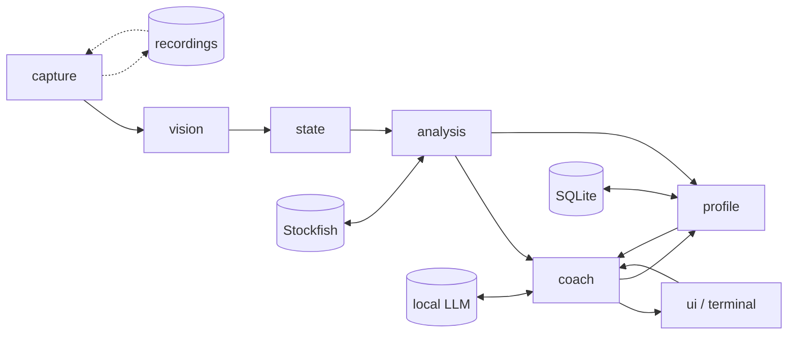

# Sidecoach design

Status: draft v0.1, 2026-09-14. Owner: Tai. This document is the source of truth for scope and architecture until code supersedes it. Decisions are dated; change them by editing this file.

## 1. What it is

Sidecoach is a background service that watches the screen, finds the chessboard, and coaches the player while they play, practise, or review on any chess site. It is vision-first and platform-agnostic: it reads pixels, never the site's DOM. It maintains a legal, reconciled game state, annotates every position with Stockfish and a motif tagger, and talks to the player through an LLM that only ever sees verified facts, at a disclosure level the player controls. A long-term player model drives post-game review, targeted puzzles, and lesson recommendations.

First target: Windows, chess.com, text coaching in bot games.

## 2. Goals and non-goals

Goals

- Improve the player's chess, measured by per-motif error rates, targeted-puzzle accuracy, and eval loss at decisive moments. Engagement is not a goal.
- Socratic by default. Before a move the coach asks and hints; it does not hand over moves unless asked.
- Never commit an illegal transition, never let the LLM invent a board fact, never leak beyond the current disclosure level.
- Work on any board theme, piece set, and board size on chess.com first, other sites later, without per-site integration.

Non-goals

- Playing moves for the user, automating the browser, or reading site internals.
- A cloud service. Everything runs locally except an optional hosted LLM fallback.
- Mobile in the first phases. Android and iOS come after the desktop pipeline is proven.

## 3. Policy

Decided 2026-09-14.

- Sidecoach is a generic tool. Where and how it is used is the user's own responsibility, the same as running any engine app beside a game.
- Live engine-informed coaching is always available. There is no structural gating by opponent type or game mode.
- Before a move the coach discloses only questions and hints. The best move, or the set of near-equal candidates, is withheld until the user names it, plays it, or explicitly asks for it.
- An EULA is the last step before any public release, not part of the personal-project phases.

## 4. Architecture

One process, a pipeline of stages connected by typed events. Every stage consumes events and emits events, so any stage can be replayed from a recording.

| Stage | Package | Consumes | Emits | Responsibility |
|---|---|---|---|---|
| capture | `sidecoach.capture` | timer | `Frame` | Screen frames at 10 fps, all monitors until a board is locked, then the board region only. Pixel-diff gating. Optional recording to disk. |
| vision | `sidecoach.vision` | `Frame` | `BoardLocated`, `BoardLost`, `SquareObservation`, `ClockObservation`, `ScreenState` | Board detection, per-square classification, orientation, clock and move-list OCR, screen-state inference. |
| state | `sidecoach.state` | vision events | `PositionChanged`, `MovePlayed`, `GameStarted`, `GameEnded`, `Takeback`, `Resync` | Reconciliation into a legal python-chess game. Move detection over legal moves. Cold-start and resync. |
| analysis | `sidecoach.analysis` | `PositionChanged`, `MovePlayed` | `Analysis`, `MoveAssessment` | Stockfish multi-PV, expected-score eval loss, decisive-moment flag, threats, motif tags, opening identification. Continuous analysis during the user's think time. |
| coach | `sidecoach.coach` | analysis events, `UserUtterance`, clock | `CoachMessage`, `ProfileEvidence` | Disclosure state machine, interjection policy, fact-bundle filtering, LLM calls, claim verification in both directions. |
| profile | `sidecoach.profile` | `ProfileEvidence`, `GameEnded` | `ProfileSnapshot`, `Recommendation` | SQLite storage, error taxonomy counts, session summaries, recommendations. |
| ui | `sidecoach.ui` | `CoachMessage` | `UserUtterance` | Terminal first, companion panel second, on-board overlay third. |
| voice | `sidecoach.voice` | audio, `CoachMessage` | `UserUtterance` | Later. Local STT, TTS, VAD. |
| replay | `sidecoach.replay` | recordings | `Frame` | Record and replay harness. Recordings are the test suite. |
| llm | `sidecoach.llm` | prompts | completions | Provider interface. Local server first, hosted Claude as a swappable fallback. |

Events are pydantic models in `sidecoach.events`. Every event carries a monotonic timestamp and the frame id it derives from, so latency can be measured end to end.

## 5. Stage designs

### 5.1 Capture

- Backend protocol: list monitors, grab a region as a numpy BGR array. First backend is `mss` (GDI BitBlt). Windows Graphics Capture through `windows-capture` is the planned upgrade: it captures a window even when overlapped and can exclude the cursor. `dxcam` (DXGI Desktop Duplication) is the alternative if CPU cost matters. None of them draw the cursor into frames unless asked.
- The cursor, user-drawn arrows and circles, and highlights are local outliers against 64 cells of evidence; detection scores the whole grid and tolerates them. The square classifier is trained with those overlays as augmentations.
- 10 fps. At 5 fps the frame interval alone eats the 200 ms latency target.
- Until a board is locked, scan every monitor at a reduced rate. After lock, capture only the board region plus a margin, and validate the lock each frame. Re-scan on validation failure.
- Pixel-diff gate: skip vision when the region is unchanged.
- Recording: full frames to a rolling window on disk during development, plus board crops labelled with the reconciled FEN when reconciliation is confident. Both configurable. A crops-only default is reserved for a later public release.

### 5.2 Vision

Board detection is classical computer vision. A chess.com board is an axis-aligned square split into an 8 by 8 grid of equal cells in exactly two theme colours.

1. Edge map, then 2D autocorrelation or projection profiles to find the dominant cell pitch.
2. Candidate outer squares at that pitch. Score each on checkerboard fit using the two dominant colours of its empty cells.
3. Prefer the largest candidate above the score threshold. Lobby and puzzle pages show several boards.
4. Lock the region. Re-detect only when the per-frame validation fails.

A small learned detector is a fallback for themes that defeat the classical path, not the primary method. Known hazards to test for: marble, glass, and 8-bit themes; last-move and check highlights; coordinate labels inside edge cells; partial occlusion by dialogs.

Square classification: a small CNN with 13 classes, six pieces in two colours plus empty, exported to ONNX and run on the 64 cell crops. Training data comes from synthetic renders using open-licensed Lichess piece sets with heavy augmentation, plus board crops harvested from the user's own sessions. Chess.com assets are proprietary and are only observed from the user's own screen.

Orientation is never assumed. Chess.com puts the user's pieces at the bottom by default, but a setting can pin white to the bottom or top, so the bottom side can be either colour (Tai, 2026-09-14). It is decided per game from the side whose pieces occupy the bottom two ranks at the start position, cross-checked against the coordinate labels, and a mid-game flip shows up as the entire piece pattern mirroring.

Window moves and resizes mid-game are handled by the tracker: per-frame validation fails within three frames, a narrow-scale search around the last cell size re-locks a moved window quickly, and the full multi-scale search runs only if that fails. A periodic wide re-fit catches a board that slid by exactly one cell, which the checker fit alone cannot see.

OCR: RapidOCR for the move list and player names, digit templates for clocks. OCR is a resync and cold-start aid, not the primary move source.

Screen state: derived from board presence, running clocks, and a few layout cues. No separate classifier in the first slice.

### 5.3 State reconciliation

The core idea: detect moves, not positions. Given a known legal position there are about thirty legal moves. Only the squares that changed need classifying, and the legal move most consistent with the diff wins. Full FEN reconstruction is only for cold start and resync.

- Settle: commit a move only after two consecutive frames agree.
- If no legal move explains the diff, hold. If the disagreement persists past a threshold, trigger resync: full-board classification, move-list OCR, and a search for a legal history that reaches the observed position.
- Edge cases handled explicitly: drag in progress empties the source square; premove highlights without moving; the promotion dialog; the red check highlight; hover highlights; user-drawn arrows and circles; capture animations; takebacks, which reverse the last move; rematch and new game, detected by the initial position; board flip; board resize.
- Cold start loses castling and en passant rights. The move list resolves them when readable; otherwise assume rights conservatively from king and rook placement.
- Takebacks are normal in bot games (Tai, 2026-09-14). One ply and two plies are both recognised: a takeback while the bot has already replied removes the user's move and the reply together. Because two retreats can produce the same squares as a two-ply takeback, takebacks are checked before the two-move catch-up.
- Game end: checkmate and stalemate come from the board state. Resignation, timeout, and agreed draws leave no trace on the squares. Until the screen-state and OCR work in M2 reads the game-over dialog and the result in the move list, the companion panel gets a button for "white resigns", "black resigns", and "draw" (Tai, 2026-09-14). A new start position always ends the previous game.
- Browsing history (Tai, 2026-09-14): during a game the user can step back through the move list with the arrow keys or by clicking a move, and the board shows an earlier position; if the opponent moves meanwhile, the board snaps to the latest position. A frame that matches an earlier position of the current game puts the reconciler in a viewing state and nothing is undone. A takeback is recorded only when a different move is played from the viewed position, which is the only board-visible difference between the two. Chess.com's PGN omits takebacks, so the final move list is the ground truth for the committed line only.
- Missed moves: when the window was minimised, a dialog covered the board, or a badge hid a piece, a bounded search finds the shortest path of up to four legal moves that explains the frame, requiring every touched square to be read exactly; transpositions to one position are accepted, paths to different positions are held as ambiguous.
- The recogniser is rebuilt from every new start position, so a theme or piece set changed between games is harmless and orientation is decided per game.
- Gaps no move search can bridge (the window minimised for a minute, a restart mid-game, a recording that starts mid-game after a start position was seen) are closed by a position resync: when every cell reads exactly and settled, the board disagrees with the known position on several cells, and it holds still for ten frames, the observed position is adopted. Castling rights survive only for a king and rook still on their home squares, en passant is dropped, and whose turn it is, when the position does not decide it, is settled by the first move seen afterwards. The move list before the gap is kept; numbering restarts after it. `sidecoach replay` re-aligns its scoring to the PGN at the adopted position.
- Lessons from the first real game (2026-09-14): a dragged piece is drawn over neighbouring squares and the origin square is shown selected, and a click-move animates the piece across squares that may still carry the previous move's highlight. Highlights are therefore not used to commit moves at all: a move commits only when every piece it touched is centred where its own exemplar sits, no square carries the hover outline chess.com draws under a dragged piece, and the state holds for the settle frames. That is agnostic to any highlight colour, selection tint, red right-click mark, or check tint (Tai, 2026-09-14); a highlight-based rule was tried first and broke on each of those in turn. Arrows are drawn shapes and add foreground that the occupancy thresholds and stale-cell handling absorb. Premoves happen in bot games: the piece is drawn on its destination over the piece it will capture until the opponent moves, then several plies land within a second, which the iterative-deepening catch-up explains shortest story first.
- Overlays (2026-09-14): chess.com's game-over dialog, the promotion picker, and tooltips are opaque and cover several cells. A translucent tint keeps light and dark squares apart under it, so two 4-neighbours whose backgrounds match while both sit away from their square colours are under an opaque overlay, whatever its colour; a cell next to a covered one whose silhouette holds a rectangle of the overlay's colour anchored on a side or a corner is covered at its edge. Both read as unknown, which is no evidence, and never as a hover. The tracker keeps its lock through it: cells whose background is far from both square colours are left out of the checker fit and their insides out of the boundary re-fit, as long as 24 cells remain readable. At the end of a game the final position stays uncovered for about a second before the dialog fades in. That second alone is a thin margin, since a badge spill next to the king first has to turn stale, so a cell a confirmed overlay has just covered keeps its last stable reading (exact, settled, and identical in two consecutive frames, which rules out the fading dialog and a piece in flight) for three seconds: nothing changes under a dialog, and the explanation found in the uncovered frames keeps settling under it instead of turning ambiguous (c8=Q# and Qd7-c8 cover the same visible cells once c7 and d7 are hidden). The memory applies only to confirmed overlays, never to a hint dot or a lone badge, and a piece that leaves a covered square for a visible one waits for the memory to expire. The dialog fades in over two or three frames, and a half-transparent dialog reads as junk rather than as a cover, junk the memory would then keep; so a block of six or more neighbouring cells whose colours all fit one translucent tint (the light-dark gap shrinks by the same factor in every channel) is covered as well. Highlights and marks tint a few cells and never reach the block size.
- Badges (2026-09-14): the checkmate and winner badges land on the kings in the same frame as the mating move, spill into the neighbouring cell, and stay. The spill reads as an occupied cell that no move explains, and it turns stale exactly when the move's own cells do, so stale cells are ignored one at a time, junk-looking readings first, then in pairs, with the rest of the disagreement still explained by legal moves. Junk-looking cells are always tried, however many cells of the blocked move have turned stale beside them; clean stale cells join only when the stale set is small. The hover outline test needs all four sides of the cell to differ from its background, since a badge or a dialog edge crosses one or two.
- Piece colour comes from the nearest exemplar's brightness profile rather than a global threshold: some sets draw a white queen whose interior is half black detail, which a threshold reads as black, and that one persistent misread stalled a whole game. Legal-move hint dots and capture rings appear during drags; dots read as unknown by occupancy, and a piece whose type cannot be matched asserts only that the square is occupied, never a colour, because capture rings flip the measured colour and a wrong colour lets the move search invent captures.

### 5.4 Analysis

- Stockfish over UCI through python-chess, persistent process, MultiPV 4, WDL enabled.
- Live: about 300 ms per new position, then continuous analysis while the user thinks, so the coach's scaffolds are ready before the user asks. Post-game: 1 to 2 s per position.
- Expected score from WDL: (W + 0.5 D) / 1000 from the mover's view. Eval loss of a played move is the expected score of the best line minus that of the played line, at matching depth. Centipawns are never used for thresholds, because a 50 centipawn loss at +8 is nothing.
- Severity thresholds, tunable: inaccuracy 0.05, mistake 0.10, blunder 0.20 expected-score loss.
- Decisive moment: gap between the best and second-best line of at least 0.10, or an only-move. Later, Maia predicting a losing move for the user's rating band is a third trigger.
- Opponent threats: analyse the position with a null move to find what the opponent would do if it were their turn.
- Motif tagger: pure functions over (board, move, principal variation) returning tags with evidence squares, using Lichess puzzle theme names. Groups, in implementation order: tactical basics, mating patterns and king safety, openings, positional themes, endgame themes. Tactical and mating tags are computable from attack maps and the PV. Positional and endgame tags are heuristics and will be tuned against the user's games.
- Openings: Lichess chess-openings data for ECO and names via prefix matching on the move sequence; a Polyglot book for book-move membership and the first deviation.

### 5.5 Coach

Disclosure state machine, one instance per position where the user is to move:

| Level | Coach may say | Reached by |
|---|---|---|
| 0 silent | nothing | new position |
| 1 question | an orienting question | decisive-moment trigger, stuck timer, or a hint request |
| 2 theme | the theme category, for example "a loose piece is involved" | next hint request or stuck timer |
| 3 region | a board region, for example "look at the kingside" or "something around f7" | next hint request or stuck timer. Autonomous ceiling. |
| 4 piece | the piece that carries the idea, never the destination | explicit hint request beyond region |
| 5 candidate | the move, or the near-equal set | user names it, plays it, or asks for the move |
| 6 line | the full principal variation | user asks for the line, or after the move |

Hiding is by construction, not by instruction. The fact bundle handed to the LLM is filtered by the current level: at level 2 the bundle contains the theme name and nothing about squares; at level 3 it contains the region; the move and the PV are absent from the prompt until level 5 and 6. After the move is played, feedback about the previous position is unrestricted.

Interjection policy. Unprompted triggers, decided 2026-09-14:

1. Answer explicit user input, always.
2. Post-mistake lesson after a move above the mistake threshold, framed as a counterfactual pattern.
3. Brief feedback after every user move, one or two sentences, length scaled by eval loss.
4. Pre-move orienting question at decisive moments.
5. Stuck hint after a configurable time on the current move, default 45 s.

Higher numbers yield to lower ones when they collide. At most one unprompted message per position. A quiet toggle silences everything except explicit asks.

Clock scaling: rapid and slower get all triggers with the stuck threshold scaled to the remaining time. Blitz gets post-move feedback only. Bullet is silent during the game and everything goes to the post-game review. Untimed bot games and analysis get all triggers.

Claim verification, both directions:

- The user's stated reasons are extracted into structured claims: attacks, defends, threatens, hanging, safe, best, plan. Board claims are checked with python-chess, evaluation claims against the engine, threat claims against the null-move analysis. Vague reasons are non-checkable and prompt a follow-up question.
- The coach's own draft is checked before it is shown. Any square, piece, or move it mentions is verified against the board, and any withheld content beyond the current level is a leak. A failed check regenerates once, then falls back to a template.

LLM: one OpenAI-compatible provider with two configured backends. `local` is LM Studio at `http://localhost:1234/v1`; its Qwen 3.8 builds reason before every answer and ignore every documented switch, so reasoning is suppressed with an empty think-block prefill as a trailing assistant message (measured: zero reasoning tokens, same answer quality). `dashscope` is Alibaba Cloud Model Studio in the US region with qwen3.8-max by default and qwen3.8-flash as the cheaper option; it honours `enable_thinking` in the request. Measured 2026-09-14 with thinking off: local 1 to 3 s, max 1.8 s, flash 1.1 s; with thinking on, 5 to 10 s typically, 45 s once on qwen3.8-max for an explanation, and an occasional runaway on the local model that exhausts the budget and returns nothing. Conversational turns run with thinking off; claim extraction and post-game review may turn it on. Hosted Claude remains a possible third backend. Persona: warm but direct, like a good club coach.

### 5.6 Profile

Error taxonomy has two axes.

- Cause, from engine evidence plus self-reports: missed opponent threat, miscalculated line, never considered the candidate, positional misjudgment, opening knowledge gap, endgame technique, time pressure. A mistake with under ten seconds on the clock defaults to time pressure.
- Motif, from the tagger.

Each cell is a Beta-distributed error rate with counts, so a single event never creates a weakness. Insights such as biggest cost category and knowledge gap versus habit are computed from the counts. Self-reports are elicited sparingly, at most once per few mistakes, and every profile entry is user-correctable. Session summaries give the coach continuity across sessions.

Initial prior: the user plays rapid and blitz in the 1000 to 1400 band.

### 5.7 Recommendations

- Lichess puzzle database, CC0, downloaded once and filtered offline by rating band and theme into SQLite. Served in-app for spaced repetition per motif. Outcome tracked.
- Chess.com lessons: a one-time rate-limited scrape of the paginated course list and course pages into a catalogue of title, URL, level, category, and description, then mapped to motifs and phases with a review pass. The coach links to lessons and tracks follow-through.

### 5.8 UI

Terminal first: the dialogue prints in a console and the user types replies. Then an always-on-top companion panel with the dialogue, a text input, the current disclosure level, and a mirrored board. Then a click-through transparent overlay over the detected board for region highlights and arrows.

### 5.9 Voice

Later. Local only: faster-whisper for STT with post-correction against the legal move list, Silero VAD for barge-in, Kokoro for TTS. SAN is converted to spoken form before synthesis.

### 5.10 Replay and recording

Every stage is replayable. Recordings hold frame sequences with timestamps and the events each stage emitted. The test suite is recordings plus expected outputs, so a vision or reconciliation regression fails a test instead of a live game.

## 6. Storage

SQLite, single file, plus PGN files. Tables: games, positions, moves with eval loss and tags and cause, dialogue turns, claims and verdicts, profile cells (motif, cause, phase, alpha, beta), puzzles, lessons, recommendations with outcomes, sessions with summaries. Board crops and recordings live on disk under the data directory, referenced by path.

## 7. Latency budget

| Step | Target |
|---|---|
| Frame to settled move | 200 to 300 ms at 10 fps with two-frame settle |
| Engine, new position | about 300 ms live, continuous afterwards |
| Text turn, local LLM | under 1.5 s to first token; measured 0.43 s on 2026-09-14 |
| Voice turn end to end | under 2 s with streamed TTS, later |

## 8. Evaluation

Pipeline metrics first: per-square classification accuracy, move-detection precision and recall on recordings, false interjection rate, disclosure leak rate measured by the output checker, latency percentiles per stage. Skill metrics after: per-motif error rates over time, targeted-puzzle accuracy, eval loss at decisive moments, lesson follow-through.

## 9. Stack

| Concern | Choice |
|---|---|
| Language and tooling | Python 3.12, uv for everything, src layout, single package `sidecoach` |
| Capture | mss first; dxcam or windows-capture if needed |
| Vision | OpenCV, numpy; small CNN in PyTorch exported to ONNX Runtime; RapidOCR |
| Chess | python-chess, Stockfish release binary, Lichess chess-openings data, Polyglot book |
| LLM | OpenAI-compatible provider over httpx: LM Studio locally, DashScope qwen3.8-max or qwen3.8-flash hosted; keys in `.env` |
| Voice, later | faster-whisper, Silero VAD, Kokoro |
| Storage | SQLite, PGN files |
| CLI and terminal UI | typer, rich |
| Config and events | pydantic, TOML |
| Tests | pytest on recordings; ruff; pyright |

Machine: RTX 3090 Ti 24 GB, Ryzen 9 9900X, 62 GB RAM. LM Studio serves the 27B model from a remote device (h200-1), so the local GPU is free for vision training, STT, TTS, and Maia.

## 10. Roadmap

M1 See the board

- [x] `sidecoach doctor` checks Python, video codec, Stockfish, the LLM, and capture.
- [x] Record and replay harness: `sidecoach record` to lossless video with change gating, `sidecoach replay` into the pipeline, `sidecoach cells` to inspect readings.
- [x] Board detection on real chess.com frames (green and brown themes so far), tracker for moves, resizes, occlusion; orientation from the start position.
- [x] Piece recognition without training: silhouette exemplars bootstrapped from each game's start position. The learned cross-theme classifier remains a later upgrade, needed for cold starts mid-game.
- [x] Move detection over legal moves with settle, highlight gating, history browsing, takebacks, missed-move catch-up, and new-game handling.
- [x] From a 10 fps recording of a bot game, reconstruct the exact PGN: game one of 2026-09-14, 79 of 79 plies including promotion, checks, and checkmate.
- [x] `sidecoach watch` follows the game live in the terminal, printing every move with the board, and records the session so anything odd can be replayed with `sidecoach replay` and inspected with `sidecoach cells`.
- [x] A second game on the brown theme and a different piece set, from two recordings merged with `sidecoach concat` and a 91-second gap between them: 140 of 141 on-screen plies correct on the final line, 24 plies skipped across the gap and recovered by a position resync, one wrong ply that is an order ambiguity (Rd2 versus Rf1+ reaching the same position within a second), a real two-ply takeback recognised as such, and the mating move committed under the game-over dialog from remembered cells.
- [x] A live session followed end to end: 109 of 109 plies of the 2026-09-14 16:49 game including two takebacks and the mating promotion under the checkmate badges, with the game-over dialog tolerated afterwards.

M2 Analyze: Stockfish integration, expected-score loss, decisive flags, threats, tactical and mating taggers, opening identification. `sidecoach watch` prints assessments.

M3 Coach: disclosure state machine, interjection policy with clock scaling, fact-bundle filtering, local LLM provider, claim verification both ways, terminal dialogue. First end-to-end coached bot game.

M4 Review and profile: post-game review, SQLite, error taxonomy, session summaries, self-report elicitation.

M5 Companion panel. M6 Recommendations from Lichess puzzles and the chess.com catalogue. M7 Voice. M8 Overlay. M9 Maia and remaining motif groups tuned. Later: macOS and Linux capture, Android, iOS, EULA, public release.

## 11. Open items

- Stockfish 19 ships one universal Windows build that picks the CPU code path at runtime, so there is no avx2 versus vnni512 choice to make. Verify with a benchmark that it uses AVX-512 on the Ryzen 9 9900X.
- Stuck-threshold scaling formula for rapid. Start with the smaller of 45 s and ten percent of remaining time.
- Whether generic "hint" requests may advance past level 3 to level 4, or only a request that names the piece. Current answer: a hint request advances one rung, including to level 4; levels 5 and 6 need a request for the move or the line.
- Lichess puzzle rating window around the user's band. Start with 800 to 1600.
- Reasoning control on the local LLM, resolved 2026-09-14. The Qwen `/no_think` switch is ignored and LM Studio's native `reasoning` field returns 400 for these models, but an empty think-block prefill as a trailing assistant message on the OpenAI-compatible endpoint suppresses reasoning completely. If a future model or server version stops honouring assistant continuation, revisit.
