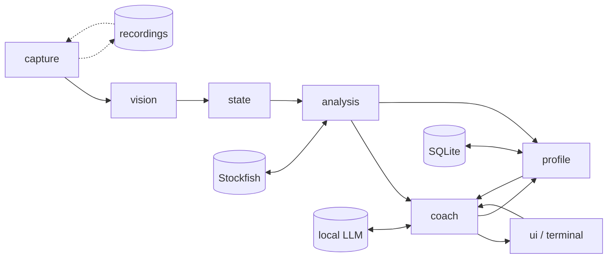

# Sidecoach design

Status: draft v0.1, 2026-09-14. Owner: Tai. This document is the source of truth for scope and architecture until code supersedes it. Decisions are dated; change them by editing this file.

## 1. What it is

Sidecoach is a background service that watches the screen, finds the chessboard, and coaches the player while they play, practise, or review on any chess site. It is vision-first and platform-agnostic: it reads pixels, never the site's DOM. It maintains a legal, reconciled game state, annotates every position with Stockfish and a motif tagger, and talks to the player through an LLM that only ever sees verified facts, at a disclosure level the player controls. A long-term player model drives post-game review, targeted puzzles, and lesson recommendations.

First target: Windows, chess.com, text coaching in bot games.

## 2. Goals and non-goals

Goals

- Improve the player's chess, measured by per-motif error rates, targeted-puzzle accuracy, and eval loss at decisive moments. Engagement is not a goal.
- Socratic by default. Before a move the coach asks and hints; it does not hand over moves unless asked.
- Never commit an illegal transition, never let the LLM invent a board fact, never leak beyond the current disclosure level.
- Work on any board theme, piece set, and board size on chess.com first, other sites later, without per-site integration.

Non-goals

- Playing moves for the user, automating the browser, or reading site internals.
- A cloud service. Everything runs locally except an optional hosted LLM fallback.
- Mobile in the first phases. Android and iOS come after the desktop pipeline is proven.

## 3. Policy

Decided 2026-09-14.

- Sidecoach is a generic tool. Where and how it is used is the user's own responsibility, the same as running any engine app beside a game.
- Live engine-informed coaching is always available. There is no structural gating by opponent type or game mode.
- Before a move the coach discloses only questions and hints. The best move, or the set of near-equal candidates, is withheld until the user names it, plays it, or explicitly asks for it.
- An EULA is the last step before any public release, not part of the personal-project phases.

## 4. Architecture

One process, a pipeline of stages connected by typed events. Every stage consumes events and emits events, so any stage can be replayed from a recording.



| Stage | Package | Consumes | Emits | Responsibility |
|---|---|---|---|---|
| capture | `sidecoach.capture` | timer | `Frame` | Screen frames at 10 fps, all monitors until a board is locked, then the board region only. Pixel-diff gating. Optional recording to disk. |
| vision | `sidecoach.vision` | `Frame` | `BoardLocated`, `BoardLost`, `SquareObservation`, `ClockObservation`, `ScreenState` | Board detection, per-square classification, orientation, clock and move-list OCR, screen-state inference. |
| state | `sidecoach.state` | vision events | `PositionChanged`, `MovePlayed`, `GameStarted`, `GameEnded`, `Takeback`, `Resync` | Reconciliation into a legal python-chess game. Move detection over legal moves. Cold-start and resync. |
| analysis | `sidecoach.analysis` | `PositionChanged`, `MovePlayed` | `Analysis`, `MoveAssessment` | Stockfish multi-PV, expected-score eval loss, decisive-moment flag, threats, motif tags, opening identification. Continuous analysis during the user's think time. |
| coach | `sidecoach.coach` | analysis events, `UserUtterance`, clock | `CoachMessage`, `ProfileEvidence` | Disclosure state machine, interjection policy, fact-bundle filtering, LLM calls, claim verification in both directions. |
| profile | `sidecoach.profile` | `ProfileEvidence`, `GameEnded` | `ProfileSnapshot`, `Recommendation` | SQLite storage, error taxonomy counts, session summaries, recommendations. |
| ui | `sidecoach.ui` | `CoachMessage` | `UserUtterance` | Terminal first, companion panel second, on-board overlay third. |
| voice | `sidecoach.voice` | audio, `CoachMessage` | `UserUtterance` | Later. Local STT, TTS, VAD. |
| replay | `sidecoach.replay` | recordings | `Frame` | Record and replay harness. Recordings are the test suite. |
| llm | `sidecoach.llm` | prompts | completions | Provider interface. Local server first, hosted Claude as a swappable fallback. |

Events are pydantic models in `sidecoach.events`. Every event carries a monotonic timestamp and the frame id it derives from, so latency can be measured end to end.

## 5. Stage designs

### 5.1 Capture

- Backend protocol: list monitors, grab a region as a numpy BGR array. First backend is `mss` (GDI BitBlt). Windows Graphics Capture through `windows-capture` is the planned upgrade: it captures a window even when overlapped and can exclude the cursor. `dxcam` (DXGI Desktop Duplication) is the alternative if CPU cost matters. None of them draw the cursor into frames unless asked.
- Clocks (2026-09-15, Tai): every online game has them, bot games included, so the clocks next to the board are read for the remaining time and the time control. Two rules. The clock reader may never break a session: a failed read is no reading, never an error, and it runs inside a guard. And whose turn it is has nothing to do with the clocks: the reconciler decides that from the board alone, and a clock reading never feeds the game state. The clock only scales the coach, how soon a hint comes and which triggers a time control allows, and when it is absent or unsure the coach treats the game as untimed and speaks on every trigger.
- The cursor, user-drawn arrows and circles, and highlights are local outliers against 64 cells of evidence; detection scores the whole grid and tolerates them. The square classifier is trained with those overlays as augmentations.
- 10 fps. At 5 fps the frame interval alone eats the 200 ms latency target.
- Until a board is locked, scan every monitor at a reduced rate. After lock, capture only the board region plus a margin, and validate the lock each frame. Re-scan on validation failure.
- Pixel-diff gate: skip vision when the region is unchanged.
- A live session must not die with the screen. A grab that fails (a locked session, a sleeping monitor, a display change) is retried every half second with the capture rebuilt, up to thirty times in a row, before the loop gives up with a clear message; the frames are simply missed and the reconciler catches up. A recorder that fails (a full disk, a frame of the wrong shape) stops the recording and the watching goes on. A bad monitor index is refused with the count found; the default monitor is the primary, the one at the desktop origin, which `doctor` marks.
- Recording: full frames to a rolling window on disk during development, plus board crops labelled with the reconciled FEN when reconciliation is confident. Both configurable. A crops-only default is reserved for a later public release.

### 5.2 Vision

Board detection is classical computer vision. A chess.com board is an axis-aligned square split into an 8 by 8 grid of equal cells in exactly two theme colours.

1. Edge map, then 2D autocorrelation or projection profiles to find the dominant cell pitch.
2. Candidate outer squares at that pitch. Score each on checkerboard fit using the two dominant colours of its empty cells.
3. Prefer the largest candidate above the score threshold. Lobby and puzzle pages show several boards.
4. Lock the region. Re-detect only when the per-frame validation fails.

A small learned detector is a fallback for themes that defeat the classical path, not the primary method. Known hazards to test for: marble, glass, and 8-bit themes; last-move and check highlights; coordinate labels inside edge cells; partial occlusion by dialogs.

Square classification (2026-09-19, `vision/embedding.py`, `vision/pieces.py`): a frozen pretrained net and its embeddings, nothing trained (Tai's design). Ultralytics' YOLO26n-cls -- the smallest of the newest YOLO family, ImageNet-pretrained -- cut before its ImageNet linear and exported to ONNX (`tools/classifier/export.py`; AGPL-3.0 weights) gives a 1280-wide embedding of a cell crop at 224 px. At the start position the 64 cells are embedded once; every later cell is named by cosine similarity to the nearest of them, the side by the fill's brightness only where the embedding's nearest white and black lie within 0.05 of each other, empties and squares with a hint or a label on them by the foreground fraction as before. Whether a piece has landed is the phase correlation of the cell's grey crop against that piece kind's start-position crop: the shift itself, sub-pixel, unmoved by a badge, the check glow, a hint ring, an arrow, a tint or a label (0.0% wrong at the 0.08 tolerance over eight sets, three sizes, both square colours). No silhouette threshold takes part in naming or landing; the geometry and colour rules still tell a tint, a hover outline, a cover and a drawing. Runs on the GPU through onnxruntime (17 ms for 64 cells), the CPU otherwise. The side of a piece is a vote of three signals, each cast only when sure -- the embedding's nearest white against nearest black, the fill's brightness, the fill's pixels under the kind's exemplar mask -- since each is wrong on some set alone and the other two were right in every case seen; the check glow, which the drawing rule takes for a drawing on some themes, is the king under it when it lies on or beside a king's square (the reconciler knows the kings). Numbers against the silhouette overlap it replaced: 300 seeds of the sweep, 901 of 901 cases to the overlap's 13 failures (the first clean sweep); the six recordings, every complete game read ply for ply and ended (g04 109/109 and g06 88/88 where the overlap had 73/19 and 66/22; g05 135/135 where it had lost the end). What was tried and rejected on the way, each with its numbers in the modules: a CNN trained from scratch on synthetic crops (95.8% on unseen sets, 80% on pixel art), a fine-tune of the same net (generality is what a pretrained model is for), landing by shifted-copy exemplars in embedding space (the pooled vector is translation-tolerant), a stillness rule on the silhouette (a classified frame of latency, which frames stored only on change made a second of), and the earlier cookie cutter. Chess.com assets are proprietary and are only observed from the user's own screen; the synthetic renders use open-licensed Lichess sets.

Orientation is never assumed. Chess.com puts the user's pieces at the bottom by default, but a setting can pin white to the bottom or top, so the bottom side can be either colour (Tai, 2026-09-14). It is decided per game from the side whose pieces occupy the bottom two ranks at the start position, cross-checked against the coordinate labels, and a mid-game flip shows up as the entire piece pattern mirroring.

Window moves and resizes mid-game are handled by the tracker: per-frame validation fails within three frames, a narrow-scale search around the last cell size re-locks a moved window quickly, and the full multi-scale search runs only if that fails. A periodic wide re-fit catches sub-cell drift and small resizes, which the checker fit is blind to for up to a third of a cell; it is adopted only when it passes on its own and its boundary comb is clearly stronger than at the held geometry, since the fit score is quantised to a cell and a badge can make the wrong geometry score higher. A board that slid by a whole cell fails validation at once, because the locked colours carry the theme's polarity (which cells are light), and goes through re-detection. A board the frame does not show whole, to two pixels, is not read and waits to be back (2026-09-27): the cells the frame cuts would reach the recogniser squeezed. The fit still places such a board truly -- its whole-cell placement is chosen from the cells, a cut cell read on the part the frame shows -- so the window a cell inward, part board and part background, is never locked in its place. Second review (2026-09-14): the polarity also holds for a theme whose light squares are the darker ones; coarse candidates are the local maxima of the checker response per scale, so an empty board's plateau of perfect scores can no longer crowd out the game board at the same cell size; among boards of one size a better fit wins, then the more occupied one.

Review outcomes (2026-09-14, first line-by-line pass): the fit score reads the ring of cells just outside a candidate and rejects it when the checker pattern continues on any side, which is what tells a whole-cell slide or a window of a larger checkerboard from a board; a lock keeps the square colours and tolerance it was taken with, so a dialog over most of the board cannot rewrite its palette, while a fresh palette that validates re-locks the colours when the theme changed between games; a held lock reports the fit it measured, and the pipeline reads nothing from a lock the frame did not validate; the coarse response is computed on cell border rings and gated on the checker amplitude, so pieces do not drag it and background does not inflate it; the boundary comb sees only the strips around the cell boundaries, goes coarse to fine, and costs about 14 ms instead of 105 ms per re-fit at 1440p. The recogniser refuses a start frame in which any piece is not plausibly drawn on its own square (a cursor or outline on the king or queen would have been its exemplar for the whole game) and fuses the pawns and the pairs by majority vote; a tinted block is an overlay only when it is a filled rectangle, so a file of marks or a queued premove stays readable. Every cell is upscaled to a 96-pixel patch before analysis, so board size does not matter down to about 32 pixels a cell (a 256-pixel board): the six recordings replay identically at 720p (43-pixel cells), and at 32 pixels the live game of 16:49 has no wrong ply, with one 15-ply stretch bridged by a position resync instead of followed move by move. Below that a black piece's light outline outweighs its fill. The hover outline is thinnest on its left side, about a pixel narrower than the others, so the hover test needs the median side over the tolerance and the weakest over half of it.

What the game window does during a session is covered by an end-to-end scenario suite on the synthetic board (tests/test_scenarios.py, 2026-09-14): the window moved or resized mid-game, the board fully covered by another window while plies happen underneath, partly covered while a move lands on the visible side and then on the covered side, minimised for seconds and restored, a toast over a corner, the page scrolled so the board is partly off screen, and gaps of two and four plies. The rule that made the covered and scrolled cases pass: while the lock is lost, the cheap search near the last cell size runs every few frames, so a board that comes back re-locks within a few frames, and only the full multi-scale search backs off.

Known limits of the silhouette recogniser (2026-09-19, after the stress sweep over 38 real piece sets, 8 themes, 44-144 px cells and every decoration the sites draw -- tests/test_stress.py): about one random game in seventy fails, and every one comes down to two tolerances documented at the top of `sidecoach/vision/pieces.py`. A pixel is piece when it is more than 25 levels from the square's colour, so a shaded set on a board of its own tone (riohacha or pirouetti on a dark grey board) loses its shaded half and reads as two shapes; lowering the cutoff merges coordinate labels into the pieces beside them, so instead a low-contrast piece is re-read at half its own contrast, which rescues a greyish white on a pale board but not a shaded half within a dozen levels of the square. A piece has landed when its centroid is within 8% of a cell of its exemplar's; when part of a small piece is lost its centroid moves past that, the piece reads as in flight, and a cold start refuses the board, while loosening the limit would let a piece mid-animation look settled. Decision: document and leave both where they are.

OCR: RapidOCR for the move list and player names, digit templates for clocks. OCR is a resync and cold-start aid, not the primary move source.

Screen state: derived from board presence, running clocks, and a few layout cues. No separate classifier in the first slice.

### 5.3 State reconciliation

Since 2026-10-05 the explanations are stories (`state/stories.py`): every way the game may
have gone on past the record that fits the frames is kept, costed by the pictures it needs
that no frame showed, and the record takes only what all of them agree on; premove queues
are part of the state, drawn the way the site draws them, and no colour is read. The model,
its guarantees and its known limits are in docs/reconciler-model.md, which supersedes the
bullets below where they describe the order of explanations, the premove queue read from red
squares, and the side to move settled by the clock or by the first story.

The core idea: detect moves, not positions. Given a known legal position there are about thirty legal moves. Only the squares that changed need classifying, and the legal move most consistent with the diff wins. Full FEN reconstruction is only for cold start and resync.

- Settle: commit a move only after two consecutive frames agree.
- If no legal move explains the diff, hold. If the disagreement persists past a threshold, trigger resync: full-board classification, move-list OCR, and a search for a legal history that reaches the observed position.
- Edge cases handled explicitly: drag in progress empties the source square; premove highlights without moving; the promotion dialog; the red check highlight; hover highlights; user-drawn arrows and circles; capture animations; takebacks, which reverse the last move; rematch and new game, detected by the initial position; board flip; board resize.
- Cold start loses castling and en passant rights. The move list resolves them when readable; otherwise assume rights conservatively from king and rook placement.
- A cold start happens on its own (2026-09-20): with no game followed and a board locked, the pipeline reads it through the theme cache every half second and adopts the position once the same quiet, complete read has come three times (an unreadable frame between -- a tooltip, a label -- is skipped, not held against it); a start position is left to the bootstrap. The orientation comes from the coordinate labels, or from the panel's Flip (`forced_bottom`) when they cannot be read; a position resync is checked against the labels too, and a board that comes up the other way round (the next puzzle, from the other side) is read again that way as a new game rather than adopted on its head. The side at the bottom is the presumed mover of an adopted position (the solver of a puzzle), the running clock settles the turn as soon as it is read (`Reconciler.turn_from_clock`; a takeback of a move pair read as two moves black-first once fixed the turn on the wrong side), and the first move seen settles it otherwise. Such a game is a *position* (`GameStarted.kind`): the coach is told, the engine measures it at once so a hint or the best move is there before any move, the profile records nothing of it, no review follows, and the mating move on a puzzle gets no word.
- Every board-and-piece set is learned once, from a start position, and kept (2026-09-23): the theme cache holds several sets per board's square colours (a set changed, another site with the same colours, a test board) and a set learned again replaces itself (the cached set that reads the new start frame as the start is the same one). A cold read tries each set on those colours and keeps the surest read that is a quiet, complete, legal position; a set for other pieces is passed over (a test board's set cached under chess.com's green read Tai's puzzles' black pawns as white, and nothing was ever adopted). Pixels that have not changed are not read cold again, and the start-position check with no model runs on new pixels only. A board left unread for six seconds with no game on it is explained once (`BoardUnread`): no learned set reads it (show a start position once), or a set reads it but its coordinates cannot be read (Flip); a piece held or a selected piece's dots are not explained, they pass.
- A board no move explains has its coordinate labels read (a few milliseconds); two reads a quarter second apart that say the other side is at the bottom turn the game round at once, from the readings already taken -- the recogniser reads cells, not squares -- rather than waiting for a resync on its head and reading all 64 cells again (Tai's puzzles on the Pixel, 2026-09-23: five to ten seconds a puzzle). A position resync adopts a board held ten frames, or three frames spanning 0.4 s, so a slow stream of frames does not stretch the wait. A tracker re-fit that moves no edge more than two pixels keeps the lock (a board flush with the frame's edge flipped between two equally good geometries, and every cell was read again), and the embedding net reads only the changed cells with a piece's worth of ink -- the only cells its vector names.
- Takebacks are normal in bot games (Tai, 2026-09-14). One ply and two plies are both recognised: a takeback while the bot has already replied removes the user's move and the reply together. Because two retreats can produce the same squares as a two-ply takeback, a frame that a story from the viewed position explains is compared with the story from the latest position, and the one with fewer new plies wins: a takeback followed by the bot's instant reply is a takeback and two moves, never four moves of retreats.
- Game end: checkmate and stalemate come from the board state. Resignation, timeout, and agreed draws leave no trace on the squares, but chess.com stamps the result on the two kings the moment a game ends -- a green disc on the winner's, a red one on the loser's, grey on both for a draw -- and the discs stay under the game-over dialog. The pipeline reads the pair at the kings it knows (`vision/result_badges.py`, 2026-09-19): a disc near the square's top-right corner, of one colour, ringed by others, not the square's own colour; only the win and loss discs are read (the grey draw disc was never verified on a real game and a label's grey end read as one), and never on a covered cell (a half-faded dialog turns the green disc grey). Two consecutive frames of an agreeing pair end the game, a mating story still pending committed first; while the screen is ahead of the record (a story pending, a premove's reply just committed with the mate still to be told, the badge's spill not yet stale) the badges wait up to twelve frames for the move, so the record ends with the mate and not a ply short of it. The reason is what the pipeline knows: a mate or stalemate on the board, repetition or material, the loser's clock at zero, else a resignation or an agreed draw. The dialog's title is never read (it names the bot). The panel's End game menu stays for a site that stamps nothing, and a cover with no badges only makes the state COVERED. A new start position always ends the previous game.
- Browsing history (Tai, 2026-09-14): during a game the user can step back through the move list with the arrow keys or by clicking a move, and the board shows an earlier position; if the opponent moves meanwhile, the board snaps to the latest position. A frame that matches an earlier position of the current game puts the reconciler in a viewing state and nothing is undone. A takeback is recorded only when a different move is played from the viewed position, which is the only board-visible difference between the two. Chess.com's PGN omits takebacks, so the final move list is the ground truth for the committed line only.
- Missed moves: when the window was minimised, a dialog covered the board, or a badge hid a piece, a bounded search finds the shortest path of up to four legal moves that explains the frame, requiring every touched square to be read exactly; transpositions to one position are accepted, paths to different positions are held as ambiguous.
- The recogniser is rebuilt from every new start position, so a theme or piece set changed between games is harmless and orientation is decided per game.
- Gaps no move search can bridge (the window minimised for a minute, a restart mid-game, a recording that starts mid-game after a start position was seen) are closed by a position resync: when every cell reads exactly and settled, the board disagrees with the known position on several cells, and it holds still for ten frames, the observed position is adopted. Castling rights survive only for a king and rook still on their home squares, en passant is dropped, and whose turn it is, when the position does not decide it, is settled by the first move seen afterwards. The move list before the gap is kept; numbering restarts after it. `sidecoach replay` re-aligns its scoring to the PGN at the adopted position.
- Lessons from the first real game (2026-09-14): a dragged piece is drawn over neighbouring squares and the origin square is shown selected, and a click-move animates the piece across squares that may still carry the previous move's highlight. Highlights are therefore not used to commit moves at all: a move commits only when every piece it touched is centred where its own exemplar sits, no square carries the hover outline chess.com draws under a dragged piece, and the state holds for the settle frames. That is agnostic to any highlight colour, selection tint, red right-click mark, or check tint (Tai, 2026-09-14); a highlight-based rule was tried first and broke on each of those in turn. Arrows are drawn shapes and add foreground that the occupancy thresholds and stale-cell handling absorb. Premoves happen in bot games: the piece is drawn on its destination over the piece it will capture until the opponent moves, then several plies land within a second, which the iterative-deepening catch-up explains shortest story first.
- Overlays (2026-09-14): chess.com's game-over dialog, the promotion picker, and tooltips are opaque and cover several cells. A translucent tint keeps light and dark squares apart under it, so two 4-neighbours whose backgrounds match while both sit away from their square colours are under an opaque overlay, whatever its colour; a cell next to a covered one whose silhouette holds a rectangle of the overlay's colour anchored on a side or a corner is covered at its edge. Both read as unknown, which is no evidence, and never as a hover. The tracker keeps its lock through it: cells whose background is far from both square colours are left out of the checker fit and their insides out of the boundary re-fit, as long as 24 cells remain readable. At the end of a game the final position stays uncovered for about a second before the dialog fades in. That second alone is a thin margin, since a badge spill next to the king first has to turn stale, so a cell a confirmed overlay has just covered keeps its last stable reading (exact, settled, and identical in two consecutive frames, which rules out the fading dialog and a piece in flight) for three seconds: nothing changes under a dialog, and the explanation found in the uncovered frames keeps settling under it instead of turning ambiguous (c8=Q# and Qd7-c8 cover the same visible cells once c7 and d7 are hidden). The memory applies only to confirmed overlays, never to a hint dot or a lone badge, and a piece that leaves a covered square for a visible one waits for the memory to expire. The dialog fades in over two or three frames, and a half-transparent dialog reads as junk rather than as a cover, junk the memory would then keep; so a block of six or more neighbouring cells whose colours all fit one translucent tint (the light-dark gap shrinks by the same factor in every channel) is covered as well. Highlights and marks tint a few cells and never reach the block size.
- Badges (2026-09-14): the checkmate and winner badges land on the kings in the same frame as the mating move, spill into the neighbouring cell, and stay. The spill reads as an occupied cell that no move explains, and it turns stale exactly when the move's own cells do, so stale cells are ignored one at a time, junk-looking readings first, then in pairs, with the rest of the disagreement still explained by legal moves. Junk-looking cells are always tried, however many cells of the blocked move have turned stale beside them; clean stale cells join only when the stale set is small. The hover outline test needs the weakest side of the cell's border to differ from its background by half the tolerance and the median side by all of it, since a badge or a dialog edge crosses one or two sides and leaves the others near zero. A check glow ramps up to the border from inside the square, so the outline test also steps in from the border at both ends of each side and wants the second step still to differ from the background: an outline is a thin line, a glow a ramp (2026-09-19).
- The cookie-cutter matcher (2026-09-19, `vision/cookie.py`): Tai's proposal, each exemplar laid over the cell like a cutter, the pixels under it compared with the piece's own pixels from the start position and the ring around it with the square, tried at every shift of up to four pixels so that one measure names the piece and says whether it has landed; and a binary variant on the foreground mask. Built and run against the silhouette overlap on 300 seeds of the sweep and the six recordings: the pixel variant 18 failures to the overlap's 13 and three times the time, worse on two recordings and equal on four; the binary variant half the cases. The pixel variant's losses are all sets with thin detail: a whole-pixel crop of a board with fractional cells puts the same piece's pixels up to a pixel apart from one square to the next, and every remedy (blur, a one-pixel slack) cost the margin between similar pieces. The overlap stays; the variants stay behind `cookie.MATCHER` for the next look. The lesson for section 5.2: a classifier that is to beat the overlap will be trained on the crops, not compared pixel for pixel.
- The decorated king (2026-09-19): the mating move lands in the same frame as the glow, the badge and the site's label on the mated king, and the king under them reads as an unsettled piece of no known kind -- the reading a drag gives. It is not a drag: an unsettled reading of no known kind on a king's square or one step from it blocks nothing, and a king's move landing on such a cell counts as seen, provided the story ends with that king in check (a king moves into no check of its own, so the decoration is the reply's). A badged king's cell is read as that king, settled and not drawn on. This is what lets the mate be told on the clean frames, before any dialog, which is where every end is read: the site's labels are ephemeral and opaque, and the dialog is a cover.
- Premove queues (2026-09-14, fourth game): while the opponent is to move, the user may queue several moves of one piece by dragging it on from where it is drawn. The site draws the piece at the end of the queue and leaves its real square empty, tints every queued square red, executes the first queued move the moment the opponent moves without changing the picture, and clears the rest and snaps the piece back when the opponent's move makes a queued move illegal (or for reasons of its own: a queued promotion was dropped once). A single premove already looked like a move for the wrong side and waited for the opponent; a queue looked like a position no moves reach. So a frame with exactly one of the user's pieces missing from its square and drawn on a square it cannot reach in one move, during the opponent's turn, is read as a queue: the queue is the unique shortest way for that piece to get there (a pawn drawn on the last rank as a pawn means the promotion is not chosen yet, and nothing is known), and each visible opponent move commits together with the next queued step. Nothing about the queue is stored: it is re-read from the piece's true square every frame, so a queue the user extends, shortens, or cancels needs no special case.
- A story seen once survives a drag (2026-09-14, same game): with premoves, two plies land in one frame and the next drag starts a fraction of a second later, before the story has settled; by the time the board is quiet again it is several plies further on, and a piece may have returned to a square it left, which the missed-move search cannot express from the committed position. So a pending story is kept through frames a drag blocks (up to four seconds) and, when the next quiet frame no longer fits it, it is extended by the moves that explain the frame from the position it leads to; the whole chain then settles. The intermediate frame also settles transpositions the search alone would have to guess.
- A piece in flight is one move (2026-09-25, Tai's chess.com puzzles on the phone and the desktop: "I played Rxc1+ but it misunderstood as Rc7"). Every site slides a moved piece in a straight line from its square to the next -- chess.com's phone app always, speeding up as it goes, with a faint trail -- and a frame that catches it near the centre of a square on its way reads as a piece standing there. The next frame, the piece further on and the site's reply already sliding, then explained as that piece moving on, and the extension above committed the chain on the one sighting: Rc7, an invented Rf1, Rxc1 twice. So a story in which a piece stops partway along a straight line and goes on the same way (a to x, later x to y, x strictly between a and y: `reconcile.in_flight`), seen on one frame only, is never built on: it is no pending story to extend or to read the opponent's move from, and no extension may make one. A piece that stood still was seen twice where it stood, which a slide never is, so a pawn pushed on a move later is two moves; and while a premove queue is about (a red, empty square seen in the last three seconds) its steps land one for each reply, faster than frames can witness, and the rule stands aside. Real moves are unaffected -- they settle on frames of their own -- and so is a piece that returns to a square it left. Geometry alone, for every piece and both sides, any animation speed and capture rate; the highlights are not read (they can be turned off). `tests/test_slides.py` plays both puzzles sliding at the phone's frame rate; a sweep of 720 slides (0.3 to 0.6 s, three accelerations, instant and later replies, tapped or not) went from 8 invented chains to none.
- The opponent's move commits through a drag (2026-09-14): a drag blocks the user's own moves, since a dragged piece is not a move, but it cannot move the opponent's pieces. So the opponent's move is read from the cells it touches alone, from the position the pending story leads to, as long as those cells are settled and not under the cursor; a pending story that ends with the opponent's move is confirmed the same way. Without this a bot that replies while the user is already dragging the next premove is seen only as a net displacement once the board is quiet, and a premove queue advances one step for every two or three the site executed.
- Order of explanations (2026-09-14): shortest story first. One move; the pending story confirmed or extended; a premove queue; the opponent's move on its own; and only then a path of missed moves, which would otherwise explain a queue display (a pawn drawn two squares on) with a longer story than what happened. In the stale-cell retry, the ignored cells are wildcards for the path search: a move may touch them instead of an unexplained cell and needs no exact reading there, so the mating move settles while the checkmate badge has made the king's square unreadable.
- Next to a dialog-sized overlay, a cell that does not read cleanly is the overlay's edge cutting through it (a strip of dialog over a pawn read as a queen, unsettled, with a hover outline that kept every commit blocked under the dialog). Nothing is dragged while a dialog is up, so such cells read as covered.
- Second review (2026-09-14): the lifecycle is now explicit. A finished game takes no more moves: browsing after the game is followed, moves played on the review board are analysis and ignored, the start position begins the next game, and a position far enough away to be adopted by a resync begins another game under a new id (a game seen from the middle after the last one ended). A resync that adopts a mated position ends the game; a start position after a resync ends the game it resynced. When a resync left the side to move open, the first story is searched for both sides and settles like any other, fixing the turn only when it commits, so a premove dragged during the bot's turn cannot flip it. Browsing is entered only from a quiet frame, since a piece dragged back over its own square shows an earlier position for a moment. The memory of covered cells forgets a cell the moment it is seen clearly with something else on it, and forgets everything once the board has gone unseen for several ticks (lost, covered, minimised: the pipeline reports each such tick), since a board that went unseen may have changed; a capture stall with the board in view is not a gap in evidence. A reading of something unnameable on a square the position has empty, once stale, is an arrow and counts as unknown, so a few arrows neither stall the game nor multiply the stale retries. A premove queue's route is read from the red squares when the site tints them (a3 then a4 is two steps, not the shortest a4), which keeps the ply count and the side to move right. A frame with fewer than half its cells readable is no evidence at all: a theme the recogniser was not built for reads as unknown almost everywhere without contradicting anything, and two tinted cells alone must not commit a move. Think time is measured from the frame timestamps between commits. In the pipeline, the bootstrap decision is taken on every verified tick, changed or not; a start position the recogniser cannot read as its own before the first move (the board flipped when the user was paired as black, or re-themed) rebuilds the recogniser and re-orients the same game rather than ending it; readings are keyed to the geometry they were taken with, so a re-lock re-reads the frame even when the change gate says nothing changed; and "reads as the start" counts contradictions (a piece read as another, an empty square where a piece belongs) rather than any stray cell, with most of the board readable.
- Piece colour comes from the nearest exemplar's brightness profile rather than a global threshold: some sets draw a white queen whose interior is half black detail, which a threshold reads as black, and that one persistent misread stalled a whole game. Legal-move hint dots and capture rings appear during drags; dots read as unknown by occupancy, and a piece whose type cannot be matched asserts only that the square is occupied, never a colour, because capture rings flip the measured colour and a wrong colour lets the move search invent captures.

### 5.4 Analysis

- Stockfish over UCI through python-chess, persistent process, MultiPV 4, WDL enabled.
- Live: about 300 ms per new position, then continuous analysis while the user thinks, so the coach's scaffolds are ready before the user asks. Post-game: 1 to 2 s per position.
- Everything is in expected score from the mover's view, where 0.5 is a dead draw and 1.0 is a win. Eval loss of a played move is the expected score of the best line minus what the move actually left, both measured at the same depth, which is why every position of a game is searched the same way and cached. Centipawns are never used for thresholds, because a 50 centipawn loss at +8 is nothing.
- Which curve turns a score into an expected score matters more than it looks (2026-09-15). Stockfish's own win-draw-loss numbers answer "how often does Stockfish beat Stockfish from here", and that is 1.000 from a knight up: measured against the game of 2026-09-14 20:06 they produced 7 blunders and not one inaccuracy or mistake in 88 plies, because inside a won position every move scores the same and only the moves that flipped the result registered at all. A club player's won position is not won, so the default model is Lichess's curve from centipawns, fitted to games between people: a knight up is 0.88 there, and the same game scores 7 inaccuracies, 2 mistakes and 5 blunders. The engine's numbers stay available as `engine.score_model = "engine"` and are carried on every line either way. A mate is 1.0 or 0.0 under both.
- The engine's own first choice costs nothing by definition; without that rule a search that returns a slightly different number for the same line at the same depth has the coach calling the best move on the board an inaccuracy.
- Severity thresholds in expected-score loss: inaccuracy 0.04, mistake 0.10, blunder 0.28. Fitted (2026-09-15) to chess.com's review tallies over six of Tai's games, 671 plies: they put our inaccuracy, mistake, miss and blunder counts at 57, 32, 26 and 10 against chess.com's 55, 38, 24 and 10. The remaining shortfall in mistakes is the other engine finding more than ours at depth 14, not a threshold. Every blunder chess.com flagged we flag at mistake or worse, and none of ours is a move they left unlabelled.
- Move labels in chess.com's vocabulary (2026-09-15), because that is what the user reads after every game and a coach whose verdicts disagree with it loses trust. Two axes: the loss says how good a move was (best is the engine's first choice, excellent under 0.02, good under the inaccuracy line, then the three severities), and the moment says whether it mattered. A miss lets go of a chance the opponent's mistake handed over; a great move takes it with the best move, or is the only move; a brilliant move is a sound sacrifice. Neither great nor brilliant applies to an obvious move (a recapture, a free capture nobody can take back, the only legal move), nor in a lost position, where the best move changes nothing; a great move in a won position stays great, since chess.com awards it there. A book move keeps the label only while it is sound: the tables hold 1. e4 f5. Measured over the six games: great 22 against chess.com's 20, miss 26 against 24, brilliant 0 against 0, blunder 10 against 10, best 202 against 220 (which engine's first choice a move happened to be). Lessons from the first cuts, each found by reading the disagreements rather than the counts: forced recaptures passed the only-move test and tripled the greats; a reply that captured and was taken straight back read as a sacrifice and made quiet developing moves brilliant; taking a piece that merely moved onto a square is not a recapture, it is how a blunder gets punished; king moves in dead-lost endgames were the only moves and so came out great; and chess.com files a free grab of a hanging piece as best, keeping great for exchanges and quieter finds.
- Accuracy (2026-09-15): the per-move number is Lichess's exponential of the drop in winning chances, but three times steeper, and a side's accuracy is the plain mean. Lichess's own steepness ran fifteen points above chess.com on every game; steepened, the twelve game-sides land within 4.4 points of chess.com with no bias, which says chess.com's accuracy is, in effect, how often you played a near-best move. Chess.com's formula is not published, so near is the most that can be claimed.
- Chess.com's review is the calibration reference, not ground truth: it runs its own engine at its own depth with its own thresholds. Its move list and overview panels, copied by hand out of the browser's developer tools and saved to a file, parse into a per-ply reference (`analysis/chesscom.py`): labels, times per move in tenths of a second, the per-side tallies, accuracy and game rating. `sidecoach import-reviews` files each game in such a page beside the recording whose truth PGN it replays against, and `sidecoach review --compare` prints our labels beside theirs and the tallies side by side. The times per move are ground truth for the think times the clock OCR will read later.
- Decisive moment: gap between the best and second-best line of at least 0.10, or an only-move, which is either the single legal move or a best move that beats the second by 0.30. Later, Maia predicting a losing move for the user's rating band is a third trigger.
- Opponent threats: analyse the position with a null move to find what the opponent would do if it were their turn.
- Motif tagger: pure functions over (board, move, principal variation) returning tags with evidence squares, using Lichess puzzle theme names. Groups, in implementation order: tactical basics, mating patterns and king safety, openings, positional themes, endgame themes. Tactical and mating tags are computable from attack maps and the PV. Positional and endgame tags are heuristics and will be tuned against the user's games.
- Openings: the Lichess chess-openings tables (3810 lines, CC0), fetched by `scripts/fetch_openings.py` into `data/openings` and compiled once into a cache that loads in about three milliseconds. Indexed by position rather than by move order, so transpositions resolve: the Queen's Gambit Declined is named whichever way the moves were played. The same index answers book membership and the first deviation, which is what the design reserved a Polyglot book for, so there is no `.bin` file. Absent tables simply mean no opening name.
- No single position may hold up a game (2026-09-15). Some positions are pathologically slow to reach a given depth: seventeen knight-and-pawn endgames in the game of 2026-09-14 16:13 took Stockfish minutes each to separate four lines at depth 14, and reviewing that game took over half an hour instead of two minutes. Every search therefore carries a time cap as well as a depth, five seconds by default, and each assessment records the depth actually reached, since a capped search makes the comparison between the position before a move and the position after it less exact.
- The engine never runs on the capture thread. `analysis.annotator.Analyser` owns a worker thread, takes moves as they are committed, and hands back assessments a moment later, which is when a coach would speak anyway; a failed analysis is counted, not raised, so a dead engine cannot end a session. The engine wrapper restarts a crashed process once per call for the same reason.

### 5.5 Coach

Disclosure state machine, one instance per position where the user is to move. Two hints, then the answer with a correct explanation (Tai, 2026-09-23, replacing the six-rung ladder whose question, theme and region rungs said things like "look at the whole board" on a mate in one):

| Level | Coach may say | Reached by |
|---|---|---|
| 0 silent | nothing | new position |
| 1 idea | a short lesson on the position (`coach/situation.py`): what is at stake, the key fact named on the board, the principle behind it, and the trap if there is one; pieces, squares and their moves are named, never the player's move nor the square it goes to unless an enemy piece stands there | stuck timer, or a hint request |
| 2 focus | the target where it stands now ("their king on h8, with no free square"), the piece to use ("your queen on h3 -- the piece you give up"), and the question from there to the move, said of what the first hint named; never the move | the second hint or stuck timer. Autonomous ceiling. |
| 3 move | the move, played out and explained ("Qxh7+, a queen sacrifice, and after Kxh7, Rh5 is mate") | the third hint, naming it, or asking for the move |
| 4 line | the full principal variation | user asks for the line, or after the move |

Hiding is by construction, not by instruction. The fact bundle handed to the LLM is filtered by the current level: at the idea level it holds the goal, the pattern, how it works, the question, and the first hint's stakes, key fact, trap and the moves named as all as good; the target, the piece and the region come at focus; the move, the tactic's squares, the candidates, the threats and the board's lists of checks and captures only at the move level, and the PV at the line. After the move is played, feedback about the previous position is unrestricted.

What the rungs say comes from reading the engine's best line through the player's own moves (`coach/idea.py`), never from static features that happen to sit on the board: the goal is a mate (the engine's mate score), material won (the line's net after the opponent's replies, a queen the player makes not counted, what can be taken back at a line's end not counted), a pawn queened, an attack on the king (a won position, two checks in the player's first four moves), a combination (material given and won back by a tactic), a threat to meet, or a plan (the positional layer below). The pattern is the blow that delivers it -- the named mate for a mate, else the most telling tactic of the player's moves up to where the material is won -- and a tactic counts only when the line cashes it in: a fork's or a skewer's target worth a minor piece taken, a pin's piece taken while its pinner lives, a trapped or loose piece taken, what a captured defender guarded taken and worth what was captured. A sacrifice is two points given up that the next move does not win all back, counted against the material the line starts with, so a rook given in two steps is one sacrifice and a rook given for a queen next move is none. The best line is carried to sixteen plies by searching on from where Stockfish's own line stops (a puzzle's point can come seven moves in). The templates (`coach.py`: idea, focus, move, line and lesson) are the whole coach when no model is configured and the floor the model must rise above: each rung says something true of this position, and `tools/puzzles/coach_bench.py` holds them to it against Lichess puzzles -- the move, the goal, what a win wins, no leak below the move rung, every piece named where it stands, every tactic described true on its board by the rules -- with the Lichess themes as a reference only, never an input.

Where the line wins nothing -- the quiet positions a grandmaster's notes are mostly about -- the plan is read from the line too (`coach/plans.py`), never from the best move alone. The player's first four moves in the best line, each piece followed from where it stands, carry out a plan when their quiet moves (a capture is an exchange, not a plan) bring two pieces or more against the king, storm it with pawns while the player's own king is on the other wing, double two heavy pieces on a file free of the player's pawns, take a knight in two moves to an outpost, push a passed pawn twice, prepare a central pawn break with a piece first, or take space on the wing away from both kings; the best move must be part of it, and an attack or a storm is not read for a side the engine calls worse. The best move's threat, where the line shows they answer it, is read the same way: a mate in one it sets up, what it newly attacks that a capture would win (never a move that leaves its own piece to be won, which is an offer), or a trade with a like piece face to face that the line takes up. Castling, a rescue, prophylaxis and development come first; then a threat of mate, the line's plan, the threat to win material, and the best move's own positional idea. The one-move ideas keep to what they say: a storm only with the kings on different wings and a pawn past its third rank, space only a pawn past its third rank, and no piece idea for a capture; a repeating level line is a draw only when the next-best move is clearly worse. `tools/eval/masters_notes.py` holds the coach's readings against the notes of 199 annotated master games (4,600 annotated moves), with a concept lexicon as the proxy and samples read by hand as the judge.

A tactic counts only when it wins: the capture that cashes it in must leave the player up on the material before the tactic's move, the exchange on that square played out to its end (a loose bishop taken after theirs took one of the player's is a trade), a loose piece won whole, give or take a pawn, and a discovered attack's target worth a minor piece. The threat to meet is read one move deeper too: when the opponent's best reply to a pass is a quiet move that would itself threaten mate or a piece, it is a threat the player must meet -- but only when the best move takes that same threat away; where the best move lets it come and strikes first, the point is the counter, and the coach does not call it a defence.

A lesson after a mistake says what the move allowed, not only what was better: the engine's line in the position the move left, read by the same idea reader from the opponent's side -- a piece or more won, mate, a won ending, a winning attack, a pawn through ("after Qxd5, Rxa1+ wins a rook") -- and the model gets the same sentence as a fact. The right capture made with the other piece is taught as that. A win that lands more than two moves on, and a mate longer than five, are not read out move by move. The focus rung points at the target alone, never at a static feature of the board the best move may have nothing to do with.

The first hint is a lesson, never a bare principle (Tai, 2026-09-24, after reading Capablanca-Marshall move by move: "fight for the centre" in a middlegame, where a million moves fight for it and only a few keep the game). It is composed from, in order:

- The stakes, from the engine's six lines: in check (one legal move, one way out, or several); opening theory, with the book's main moves (the opening book, not the deepest named line, decides it is still theory); won or lost; only one move holds (the next line 0.15 below, and what even it costs, read from its line by the same idea reader: "even the next best move loses a rook", "hands them a winning attack", else by score); only two or three keep it (0.08 below); nothing is urgent, with three of the good moves named. A few moves close together say nothing.
- The key fact, named on the board, from the best move's own reading: their threat, direct or prepared; their king's free squares and the player's checks, counted (the squares come at focus, since one may be where the check lands); the target of a win, or the piece to trade into a won ending; the square a threat hits; the line's plan; the concrete situation behind the best move's positional idea (the king in the centre, the bishop shut in behind a pawn, the pieces at home, the wing to take space on, the pawn to strike at). Failing that, their passed pawn near queening that the move takes, the kings face to face in a pawn ending, a static feature of the board the best move itself acts on (never one only a later move touches, never a piece's asset on a square the move leaves), and last what they would play if passed -- only a capture, a check or a pawn move, unless every other move loses.
- The principle, only after the fact it explains, and a tactic's question only when it narrows the search.
- The trap: a capture that looks free by the exchange on its square, not among the good lines, and TRAP_DROP (0.10) below the best move or walking into mate (`analysis/traps.py`, at most two searched per position at depth 14). It is said only when it loses: mate, a winning attack, material lost net over its line, a game turned lost, a run of their checks against a bare king, or an edge gone -- a capture that comes out ahead or even is a lesser move, and none is said beside a recapture. When it takes what the best line wins later, the two are one lesson: "Not yet: their rook on a8 can be won, but Qxa8 at once runs into Nxh3+, and they have mate."

The first hint is told as one story of the best line, the most immediate beat first (`coach/story.py`, Tai 2026-09-24, after the puzzles were read by hand: the hint's parts were chosen on their own and could disagree with the move to find). In check, the piece giving check; a piece that simply hangs -- the exchange on its square nets what the whole line does, or a whole minor piece or more -- said as that, and "after that" what the line wins beyond it; the pawn the first move pushes to the seventh or the line queens; the prize, where it stands, when the pattern that wins it names other pieces; for a win with no named pattern, what the first move does (checks, attacks, stops their idea, takes the square their piece wants, takes the opposition in a pawn ending), and at the move rung the line to it, never the result alone; where only one or a few moves hold, what the move does. "Won back" only for what their last move took. A quiet first move -- no capture, no check -- is told by what it threatens, asked of the engine (`threats.aim_lines`: the player's best line after the move and a free move for the opponent, searched only when the best line wins): a mate, a pawn that queens, a piece taken where it stands, a check that also hits a piece, material, a pawn break, a check; else the bait it sets (the piece it moves is taken, and the next move takes the taker or what the taker guarded) or the passed pawn it sets going (2026-09-25: the 28 wins of the puzzle sample whose first hint named only the target). The second hint then asks after what the first said the move is for. Traps are ranked: the one on the target ("not yet"), then into mate, then the worst; beside a recapture only the wrong piece to take back with. Each beat is a check read from the board and the engine's line alone (`tools/puzzles/story_checks.py`: won, plain, free, checker, queening, reason, how), run over the Lichess puzzles and the 199 master games (`tools/eval/story_masters.py`, which also pulls the annotators' refuted moves from the notes as an answer key), and a fixed batch of 48 puzzles is read by hand before and after every round (`tools/eval/read_batch.py`): the checks catch only what has been written down.

In a position the engine calls lost, material the opponent hands over for their attack is not the player's win: the line is counted only up to their first piece left to be taken. The move rung says what a quiet move is for in the same terms: the central square a pawn now covers, the file a pawn capture opens, how many more squares a piece reaches.

Interjection policy. Unprompted triggers, decided 2026-09-14:

1. Answer explicit user input, always.
2. Post-mistake lesson after a move above the mistake threshold, framed as a counterfactual pattern.
3. Brief feedback after every user move, one or two sentences, length scaled by eval loss.
4. Stuck hint after a configurable time on the current move, default 45 s.

While the player thinks, nothing else: no question at a decisive moment, in a game or a puzzle (Tai, 2026-10-01, replacing the pre-move orienting question of 2026-09-14, which on a puzzle -- decisive from its first position -- gave the idea seconds after it appeared: nothing "until the user is stuck or actively request a hint or after they have made a move"). Higher numbers yield to lower ones when they collide. At most two unprompted messages per position -- the idea, then the focus, each after its own stuck spell -- and the move only when asked. A quiet toggle silences everything except explicit asks.

Clock scaling: rapid and slower get all triggers with the stuck threshold scaled to the remaining time. Blitz gets post-move feedback only. Bullet is silent during the game and everything goes to the post-game review. Untimed bot games and analysis get all triggers.

Claim verification, both directions:

- The user's stated reasons are extracted into structured claims: attacks, defends, threatens, hanging, safe, best, plan. Board claims are checked with python-chess, evaluation claims against the engine, threat claims against the null-move analysis. Vague reasons are non-checkable and prompt a follow-up question.
- The coach's own draft is checked before it is shown. Any square, piece, or move it mentions is verified against the board, and any withheld content beyond the current level is a leak. A failed check regenerates once, then falls back to a template.

The fact bundle has two halves (2026-09-15). The tactical half comes from the motif tagger: the theme, its focus squares, and a grounded one-sentence description of the tactic. The strategic half — the ideas the coach teaches when there is no tactic to teach — comes from a positional layer (`analysis/positional.py`): the strategic idea behind the engine's best move, as a square-free plan gated at the theme level (castle, develop, take the file, plant a knight, centralise, push a passer, prophylaxis, storm the castled king, activate the king in the endgame, rook behind the passer, break, simplify); and the position's most instructive static features gated at the region level (open and half-open files, passed pawns, outposts, the isolated queen's pawn and hanging pawns, isolated/backward/doubled pawns as targets or cautions, the bishop pair, a bad bishop, an uncastled king, a passive endgame king, the least-active piece, the convert/complicate material plan). Every one is computed from the board and carries its squares, so it is as grounded and un-fabricatable as a tactic; the features are ranked and capped so the sheet is never a laundry list, and the draft checker verifies the concrete claims (a file said open that has pawns, a pawn said passed that is held up). A tactic leads only when it is the point: the blow of the best line (above), never an incidental pin that merely sits on the board. A pin is tactical (Tai, 2026-09-23): the piece behind is the king, or can be won -- worth more than the pinner, or undefended -- in the tagger and in the board's lists alike; a skewer the same.

The game is one conversation (2026-09-16, replacing the "Game so far" memory line and the sliding window of position snapshots that preceded it). Every move on the board -- the player's and the opponent's -- is a `user` message of one chat per game, built by `coach/conversation.py` from the same events the pipeline emits, and the coach is an `assistant` turn only when prompted: after the player's move (a verdict), when stuck, after a question, at the end. Each move message carries, in order: the moves so far and the board after the move (ASCII, coordinates), whose turn it is; the move, who played it and the time taken; the engine's verdict on it (label, cost in expected score, what the engine preferred, the material from the player's side, the motifs in the move); the engine's lines for the position now (the best three, then weaker ones with their distance behind, scores from the player's side; for the position the player faces, withheld below the CANDIDATE level and said so); the grounding facts at the level in force; and, after the player's own move, a running tally of their moves by label with the moves where ground was lost. A takeback, a re-read of the board, a covered board, the game's end and the player's own words are messages that say what they are, so the position never changes silently. Messages freeze once the model has seen them; a fact that lands late goes in as a later note, never an edit. A request is the system message, every message so far and one transient directive for the moment (the kind of reply, the length, the sampling format); the chosen reply is stored as the coach's turn. Measured on LM Studio: the loaded model runs at its full 262k context, and the KV prefix is reused across requests (a 117-message game costs 10.5 s cold and 1.8 s with one message added), so every move of the player's now prompts the model -- a fine move gets one short sentence, two candidates, the two-word template as fallback; blitz keeps the template. Since 2026-09-20 theory, the engine's own move and an excellent one (best, excellent, book) do not prompt the model at all: `coach/verdicts.py` writes the sentence from the board -- the verdict for the label, then the mate, check, capture, castling, promotion or the tagged tactic when the squares bear it out -- free, immediate and true by construction; `coach.local_verdicts` turns it off. A good move was a little behind the best, so the model writes that word and names the better move; a great or brilliant move -- rare, and worth a real sentence -- gets the model at its full effort, told to show some delight, the board's exuberant line standing in if the reply fails (Tai's rules). The first question this fixed was "how did I do overall this game?", which the snapshot design had answered from an invented middlegame; from the conversation the answer is read off the tally.

The system message (`coach/prompt.py`) is a contract in five parts: the persona (the player's colour is stated in the new-game message; their rating never is -- the coach that helps a club player is the coach that helps anyone, and nothing anywhere pitches to a level); how the game reaches the model -- what each message carries, what the labels and expected-score costs mean, where the course of the game lives (the moves, the verdicts and the tally, and nowhere else), what a takeback or a re-read means; the rules; the reply format; and C, the corrective demonstrations produced by iterative context refinement (section 8), read from `coach/context/corrections.md`. Test-time training lives there and nowhere else.

Verbalized sampling (2026-09-15). A single reply collapses onto the one most typical phrasing, so the coach repeated itself across a game. Following Verbalized Sampling (arxiv 2510.01171, which traces the effect to typicality bias in preference data), the speaker asks the model for several candidate replies each with its own likelihood, runs the leak and board checks over every one, and samples a passing reply weighted by its likelihood. This restores the model's range — over the six recorded games, exact-duplicate questions fell to zero — and, because several are offered at once, a clean one is almost always among them, so the template fallback and any fabrication caught fell to zero too. A reply with no distribution markers is read as a single candidate, so a plain model still works.

The model reads the position as a labelled ASCII board (white at the bottom, capitals white), not as a FEN: a language model reasons about a laid-out grid far better than a 60-character string, and the board is the same always-visible information. Validated 2026-09-15 on the position where the coach had fabricated a pin: with the ASCII board and the theme's focus squares (d1, d3, d7 for that d-file pin), the local model taught the real pin correctly and the draft checker passed it clean, where before it had said the wrong piece was pinned. Hosted qwen3.8-flash was comparable but flipped a colour, which the checker caught, so the local model stays the default. If ASCII reasoning proves too weak on some positions, a synthetic board image attached to the message and a vision model (qwen-vl through DashScope) is the fallback; `tests/synth.py` already renders the board, so only the multimodal message path and a VL backend would be new.

LLM: one OpenAI-compatible provider with two configured backends. `local` is LM Studio at `http://localhost:1234/v1`; its Qwen 3.8 builds reason before every answer and ignore every documented switch, so reasoning is suppressed with an empty think-block prefill as a trailing assistant message (measured: zero reasoning tokens, same answer quality). `dashscope` is Alibaba Cloud Model Studio in the US region with qwen3.8-max by default and qwen3.8-flash as the cheaper option; it honours `enable_thinking` in the request. Measured 2026-09-14 with thinking off: local 1 to 3 s, max 1.8 s, flash 1.1 s; with thinking on, 5 to 10 s typically, 45 s once on qwen3.8-max for an explanation, and an occasional runaway on the local model that exhausts the budget and returns nothing. Conversational turns run with thinking off; claim extraction and post-game review may turn it on. Hosted Claude remains a possible third backend. Persona: warm but direct, like a good club coach.

### 5.6 Profile

Error taxonomy has two axes.

- Cause, from engine evidence plus self-reports: missed opponent threat, miscalculated line, never considered the candidate, positional misjudgment, opening knowledge gap, endgame technique, time pressure. A mistake with under ten seconds on the clock defaults to time pressure.
- Motif, from the tagger.

Each cell is a Beta-distributed error rate with counts, so a single event never creates a weakness. Insights such as biggest cost category and knowledge gap versus habit are computed from the counts. Self-reports are elicited sparingly, at most once per few mistakes, and every profile entry is user-correctable. Session summaries give the coach continuity across sessions.

Initial prior: the user plays rapid and blitz in the 1000 to 1400 band.

The record and the coach's own queries (2026-09-19). The profile's SQLite file is written for the questions it will be asked, not for the code that writes it: every move carries the phase, the mover's clock, the material, the expected score after it from the player's side, the tactics on the board before it and the ones it allowed, and the engine's better move; games carry the time control and a final score; one key, `move_id`, joins moves, evidence and dialogue. The taxonomy's cells are computed from it, never kept as counts. A question about the player over their games ("why do I keep losing in the middlegame?") is answered by the coach's model writing SQL: the schema in words with its units and keys and nine worked queries are the system message, the model replies with one ```sql block when it needs rows and gets them back as the next message, up to four rounds, then prose. Plain text both ways, so any OpenAI-compatible model can do it; every statement runs under SQLite's authorizer, which refuses anything but a SELECT before it runs, with a row and a time cap; the queries and their rows are kept and shown, so the answer can be read against what it was read from. No prepared views: with a capable model, a documented schema and worked examples are the interface, and the tests run every worked query against a record the profiler wrote. `sidecoach replay --assess --profile <db>` builds a record from recordings on purpose; an ordinary replay keeps its profile in memory.

### 5.7 Recommendations

- Lichess puzzle database, CC0, downloaded once and filtered offline by rating band and theme into SQLite. Served in-app for spaced repetition per motif. Outcome tracked.
- Shipped 2026-09-20 (`sidecoach/profile/puzzles.py`): the store under `data/puzzles.sqlite`, filled from `data/puzzles/*.csv` (the sample `sidecoach puzzles fetch` writes, or the whole database imported) in the 600-2000 band, keyed by the solver's position (placement and side after the opponent's first move -- what a cold read of the screen gives). After a game's review the profiler recommends a few puzzles of the motif that costs the player most -- the worst motif cell once it has evidence enough, else the game's turning point's motif -- within 150 of the player's puzzle level (1100 to begin with, a step of 25 per outcome), none solved in the last fortnight, a failed one back first; the coach says one line, the review card carries the links. A puzzle opened on Lichess is a position the pipeline joins; the store names it by its position, the player's moves are checked against the solution (any mate where the line mates), and the outcome -- solved through the last move, failed at the first wrong one -- is recorded beside the motif and moves the level. The coach says a word on a fail, nothing on a solve. Or the puzzle is solved in a tab of its own, `/puzzle/<id>` (`ui/puzzle.py` for the session, `ui/puzzle_room.py` for the room, `web/puzzle.*` for the page; Tai's ask the same day): the card's puzzle pill opens it, and the room has its own coach (quiet unless asked), engine, log and loop, so the panel goes on watching the screen untouched. The board has chess.com's manners: click a piece of yours and it lights yellow with its legal squares dotted (none if it cannot move), click a square or drag to move, a right-click marks a square red, a right-drag draws an arrow, a left-click clears them; moves slide, captures fade, a pawn reaching the last rank offers a picker over the square; a wrong move lands, shows red and comes back as Lichess does; Give up plays the solution out, Next opens the next recommended one. Hint, Best move, Line and a typed question go to the room's coach, which has the engine's measure of the position; the coach speaks through the panel's voice when the page has it on. The outcome (a miss anywhere is a fail for the record) goes to the profile store once, beside the motif. The chess.com lesson catalogue is not started.
- Chess.com lessons: a one-time rate-limited scrape of the paginated course list and course pages into a catalogue of title, URL, level, category, and description, then mapped to motifs and phases with a review pass. The coach links to lessons and tracks follow-through.

### 5.8 UI

Terminal first: the dialogue prints in a console and the user types replies. Then an always-on-top companion panel with the dialogue, a text input, the current disclosure level, and a mirrored board. Then a click-through transparent overlay over the detected board for region highlights and arrows.

### 5.9 Voice

Later. Local only: Parakeet (onnx) for STT with post-correction against the legal move list, Silero VAD for barge-in, Kokoro for TTS. SAN is converted to spoken form before synthesis.

### 5.10 Replay and recording

Every stage is replayable. Recordings hold frame sequences with timestamps and the events each stage emitted, so anything that looked wrong in a live game can be replayed stage by stage.

Recordings were the regression suite at first (2026-09-14): `data/recordings/gNN-<opponent>-<note>/` holds one game each, with `truth.pgn` from chess.com beside it, stored at half scale (1280x720 for a 1440p session) with `sidecoach shrink`, lossless FFV1, the whole screen kept. Since 2026-09-18 the test suite depends on nothing under `data/` (Tai: recordings are neither committable nor stable enough to hang tests on): tests render their boards (`tests/synth.py`, `tests/pieceset.py`, the sprite sheets and the seven real crops under `tests/fixtures/`), and `tests/test_stress.py` plays seeded random games through the whole pipeline over every theme, set, size and decoration the sites draw. The recordings remain the way to replay a live session and the material for the validation scripts under `scripts/`.

## 6. Storage

SQLite, single file, plus PGN files. Tables: games, positions, moves with eval loss and tags and cause, dialogue turns, claims and verdicts, profile cells (motif, cause, phase, alpha, beta), puzzles, lessons, recommendations with outcomes, sessions with summaries. Board crops and recordings live on disk under the data directory, referenced by path.

## 7. Latency budget

| Step | Target |
|---|---|
| Frame to settled move | 200 to 300 ms at 10 fps with two-frame settle |
| Engine, new position | about 300 ms live, continuous afterwards |
| Text turn, local LLM | under 1.5 s to first token; measured 0.43 s on 2026-09-14 |
| Voice turn end to end | under 2 s with streamed TTS, later |

## 8. Evaluation

Pipeline metrics first: per-square classification accuracy, move-detection precision and recall on recordings, false interjection rate, disclosure leak rate measured by the output checker, latency percentiles per stage. Skill metrics after: per-motif error rates over time, targeted-puzzle accuracy, eval loss at decisive moments, lesson follow-through.

The coach's words are evaluated against ground truth and trained through their context (2026-09-16; the tools live under gitignored `tools/eval/`, the data under `data/eval/`). Three corpora: the recorded games (every ply a verdict moment, every mistake a lesson, the questions a player asks put to the coach on a rotation); the master games of the annotated books in `refs/` (the OCR'd text aligned to the real games from pgnmentor by move number, colour and destination square under an OCR confusion map -- 199 of 220 games, 14,811 plies, 4,602 with a readable note once the scan's table rows, captions and lost variations are cut; the master's note on each move kept as the judge's reference and nothing else; it enters no prompt, no repository file and no C); and the Lichess puzzles. A master game takes exactly the path a bot game takes -- the same triggers, the same rotation of questions, the coach on White's side -- and differs in one thing only: at a ply the book annotates, the items about that move (the verdict on it, the lesson, "why was that bad?", "why did they play that?") carry the note as `reference`. The engine facts of every ply are computed once and cached, and each game is replayed through the real Coach with the model swapped for a capture, so an item is exactly a request as the live coach would send it: the system message, the conversation, the directive, plus its class, the facts a good reply must contain (`taxonomy.py`: class x disclosure level -> required facts and form), the evidence and the reference. The split is by game, 20% of each source held out plus one whole recorded game.

Scoring is the paper's completeness and correctness (Nguyen & Stamm, arXiv 2606.23917, eq. 4) over the required facts, plus two hard fails and two form scores: fabrication (a claim about the board or the game the evidence does not support -- the reply is split into atomic claims and each is verified alone), leak (deterministic, the coach's own leak_check and board-claim checker run first and stand), relevance, and form (length, the closing question where required). The board-checker rules on every claim the judge marks unsupported: true on the board is supported (the object lacked it; the coach did not invent it), false on the board is a fabrication of kind *false*; the judge writes a one-line lesson per failure in its own words. For an item with a reference the judge also states the master's point in one sentence and answers whether the reply makes it and whether the coach's own evidence states it (`idea_match`, `idea_in_facts`). The judge is DashScope qwen3.8-flash on the account's endpoint (`DASHSCOPE_BASE_URL`), every call on a per-process token ledger; a call that fails is never a verdict. Iterative context refinement (`icr.py`) is the paper's loop, exactly: from C empty, the coach answers a fixed sample of the training items (269, stratified by source and class); the judge scores every reply; the items where the coach most severely fabricates or omits -- one per class per round, five a round -- are paired with the reply that was right (written by qwen3.8-max from the facts alone, checked like a coach draft and judged) and appended to C as *the game as it reached the coach at that moment -> the right reply*, nothing else; repeat until eq. 5 or the round limit. The held-out split gives the before/after. Measured (2026-09-17, 231 held-out items, temperature 0.1): C empty pass .52 / completeness .76 / claim support .79 / fabrication .43; 20 demonstrations (~22k tokens) .58 / .89 / .86 / .33; the same C on qwen3.8-max .67 / .89 / .89 / .30. Selection matters: one demonstration per class per round beats the most severe overall; showing only the demonstrations of the request's class does not pay; grouping failures into kinds and replacing a persisting kind's demonstration loses what the coach had learned from it. Two loops feed the object itself. The harness loop (`harness.py`): every unsupported claim is run through the board-checker; the true ones are fact families the object lacks, counted per kind, and the object grows by a generator for the family with the most mass -- the first was the move's effects (`coach/effects.py`), which cut reached-for-true claims from 30 to 6 on the held-out set. The behaviour loop is C. What neither reaches -- the one evaluative flourish per reply -- is caught at test time by verification (`Speaker.verifier`, `coach.verify` in settings): a second model reads every candidate against the last five messages under the judge's own definition of support, the clean ones are sampled from, and when none is clean the likeliest is repaired once (only the flagged statements changed, two tries); measured with the 20-demonstration C: pass .72, completeness .89, correctness .99, claim support .93, fabrication .19 (a stricter verifier reached .15 at completeness .83). Book prose stays the judge's reference only; a missed master's point the facts never stated is logged per round as a facts gap for the facts layer, never for C.

## 9. Stack

| Concern | Choice |
|---|---|
| Language and tooling | Python 3.12, uv for everything, src layout, single package `sidecoach` |
| Capture | mss first; dxcam or windows-capture if needed |
| Vision | OpenCV, numpy; small CNN in PyTorch exported to ONNX Runtime; RapidOCR |
| Chess | python-chess, Stockfish release binary, Lichess chess-openings data, Polyglot book |
| LLM | OpenAI-compatible provider over httpx: LM Studio locally, DashScope qwen3.8-max or qwen3.8-flash hosted, OpenAI over its Responses API (tools with a reasoning effort); keys in `.env` |
| Voice, later | Parakeet, Silero VAD, Kokoro |
| Storage | SQLite, PGN files |
| CLI and terminal UI | typer, rich |
| Config and events | pydantic, TOML |
| Tests | pytest on recordings; ruff; pyright |

Machine: RTX 3090 Ti 24 GB, Ryzen 9 9900X, 62 GB RAM. LM Studio serves the 27B model from a remote device (h200-1), so the local GPU is free for vision training, STT, TTS, and Maia.

## 10. Roadmap

M1 See the board

- [x] `sidecoach doctor` checks Python, video codec, Stockfish, the LLM, and capture.
- [x] Record and replay harness: `sidecoach record` to lossless video with change gating, `sidecoach replay` into the pipeline, `sidecoach cells` to inspect readings.
- [x] Board detection on real chess.com frames (green and brown themes so far), tracker for moves, resizes, occlusion; orientation from the start position.
- [x] Piece recognition without training: silhouette exemplars bootstrapped from each game's start position. The learned cross-theme classifier remains a later upgrade, needed for cold starts mid-game.
- [x] Move detection over legal moves with settle, highlight gating, history browsing, takebacks, missed-move catch-up, and new-game handling.
- [x] From a 10 fps recording of a bot game, reconstruct the exact PGN: game one of 2026-09-14, 79 of 79 plies including promotion, checks, and checkmate.
- [x] `sidecoach watch` follows the game live in the terminal, printing every move with the board, and records the session so anything odd can be replayed with `sidecoach replay` and inspected with `sidecoach cells`.
- [x] A second game on the brown theme and a different piece set, from two recordings merged with `sidecoach concat` and a 91-second gap between them: 141 of 141 on-screen plies correct on the final line, 24 plies skipped across the gap and recovered by a position resync, a real two-ply takeback recognised as such, the order of Rd2 and Rf1+ (the same position within a second) settled by the intermediate frame, and the mating move committed on the clean frames before the game-over dialog, the mated king read through its glow and badge (2026-09-19; it was once committed under the dialog from remembered cells).
- [x] A live session followed end to end: 109 of 109 plies of the 2026-09-14 16:49 game including two takebacks and the mating promotion under the checkmate badges, with the game-over dialog tolerated afterwards.
- [x] First meticulous review pass (2026-09-14): three reviewers plus a line-by-line read of the reconciler; 23 defects fixed with regression tests (bootstrap on browsing to the start, bootstrap starvation, whole-cell slides, a poisoned start frame, tinted blocks, fade junk, the scorer's game boundary, Windows paths in concat, the codec probe, the writer's return value, and more); a live watcher with keys (resign, draw, new game, quit), a decision log beside each recording, a health line, and one change gate for live and replay. 122 tests. Recordings kept at 720p as `gNN-<opponent>-<note>`, scoring identically to the full-resolution originals.
- [x] A fourth game with queued premoves (a5 to a8=Q while the bot's king walked) and the mating move under the checkmate badge: 135 of 135 plies of the 2026-09-14 20:06 game, with the queue read as a displaced piece and each step committed with the bot's reply.
- [x] Second meticulous review pass (2026-09-14/15): three reviewers over the vision stack, the recogniser, and the reconciler with the CLI, then fixes with regression tests for every confirmed finding: the reconciler's lifecycle (finished games, resyncs, new games), the side to move after a resync, takebacks with an instant reply, browsing from quiet frames only, memory that expires when the board goes unseen, arrows as unknown, queue routes from the red squares, no evidence from a mostly unreadable frame; the pipeline's bootstrap on every verified tick with a flip or theme change before the first move re-orienting the same game; the detector's polarity, local-maxima candidates and comb-strength re-fit acceptance; the recogniser's pair fusion by agreement, geometric tint rule, shift-invariant matching and settle floor; capture retries and a clean failure; the recording module's concat, truncated index and gate order. 270 tests. All six recordings score as before (79/79, 141 + 24 skipped, 54 + 2 taken back, 109/109, 135/135, 88/88) and g04 at 0.75 scale (32-px cells) rises from 94 correct with 15 skipped to 109/109.

M2 Analyze

- [x] Stockfish 19 over UCI behind a wrapper that keeps one process alive, asks for real win-draw-loss numbers, and restarts a crashed engine, since a coaching session must outlive a dead subprocess.
- [x] Expected-score loss at matching depth, severity, decisive moments and only-moves, opponent threats from a null move. The scoring curve is human-calibrated, not the engine's own win rate; see section 5.4 for what that measurement showed.
- [x] Motif tagger: 36 Lichess theme names over (board, move, principal variation), pure functions with evidence squares. Every material claim must gain something once defenders are counted, and a move is only tagged with a feature it brought about. Across the six recorded games, 671 plies, the tactical tags fire at rates a coach would recognise: fork 0.6%, pin 1.6%, skewer 0.1%, sacrifice 2.8%.
- [x] Opening identification from the Lichess tables, indexed by position so transpositions resolve, with book membership and the first deviation from the same index.
- [x] `sidecoach review` annotates a PGN, `sidecoach watch --analysis` assesses each move once it is played, and `sidecoach replay --assess` runs the whole chain from pixels to assessments on a recording. All six recorded games review without incident.

Still open before the coach can use the screen as a second source of truth: OCR of the clocks and the move list, and the screen-state detector. Both are vision work that section 5.2 describes and neither is needed for M3's dialogue, but the clock decides the interjection cadence and the move list would check the reconciler's ply parity, so they are worth placing before M4.

M3 Coach: disclosure state machine, interjection policy with clock scaling, fact-bundle filtering, local LLM provider, claim verification both ways, terminal dialogue. First end-to-end coached bot game.

M4 Review and profile: post-game review, SQLite, error taxonomy, session summaries, self-report elicitation.

M5 Companion panel. M6 Recommendations from Lichess puzzles and the chess.com catalogue. M7 Voice. M8 Overlay. M9 Maia and remaining motif groups tuned. Later: macOS and Linux capture, Android, iOS, EULA, public release.

The panel as an installed application -- a Tauri 2 shell around the Python pipeline as a sidecar on Windows, then Linux, then a native Android app -- is planned in `docs/app-plan.md` (2026-09-21), starting with a measured spike of the shell.

State of the milestones (2026-09-19):

- M3 Coach: shipped and evaluated. The game is one conversation in a single harness message (section 5.5); disclosure, the policy, the fact bundle, claim verification both ways, and the coach's context C as twelve distilled lessons; `openai:gpt-5.6-luna` at medium effort by default (over OpenAI's Responses API since 2026-09-29: chat completions refused its engine tools at an effort) with any OpenAI-compatible endpoint behind `sidecoach.llm`. Held-out pass rate .994 on 320 moments under the binary judge (docs/eval-results.md); the play-through ICR method and the judge are in `tools/eval/`.
- M5 Panel: shipped (`sidecoach panel`): board, coach messages, voice, orientation flip, cold analysis of a board joined mid-game, debug terminal; verified end to end in Chrome and in live bot games.
- M7 Voice: shipped, optional (`uv sync --group voice`): Kokoro TTS, Parakeet STT on CPU with chess correction, Silero VAD, a speak/skip/supersede policy so the voice never talks about a position the board has left.
- Vision after the synthetic sweep (section 5.2, 2026-09-18/19): the suite reads nothing under `data/`; 38 real piece sets, 8 themes, 44-144 px, every decoration; about one random game in seventy still fails, on the two tolerances documented in `sidecoach/vision/pieces.py`.
- M2 leftovers: the result of a game that ends off the board (a resignation, a flag, an agreed draw) is read from the site's badges on the kings (section 5.3, 2026-09-19). Still open: OCR of the move list (a browser extension may serve better), the screen-state detector beyond the current cues.
- M4 Review and profile (2026-09-19): the profile stage is in (`sidecoach/profile`): SQLite under `data/profile.sqlite` (games, moves with verdicts, dialogue, evidence, the taxonomy's cells, sessions); the cause classifier from engine evidence and the clock, the motif from the tagger; the post-game review (tally, accuracy, turning points with the better move and the cause, phases, cost by cause) as a card in the panel and spoken by the coach from the review's own sentences, once the engine has judged the last moves; the cells as Beta counts with the insights they earn after a few mistakes; a session summary the next session's coach reads in the game's setting; the user's correction of a mistake's cause from the card; the record written for questions and the coach writing its own SQL over it (section 5.6). Self-reports: every third mistake's lesson ends by asking what the player saw; their next words within a minute are kept beside the mistake and, when they say plainly what happened ("I didn't see it", "I thought it worked", "I was rushing"), the cause follows their word. Still to come: recommendations (M6). M8, M9: not started.

## 11. Open items

- Stockfish 19 ships one universal Windows build that picks the CPU code path at runtime, so there is no avx2 versus vnni512 choice to make. Verify with a benchmark that it uses AVX-512 on the Ryzen 9 9900X.
- Stuck-threshold scaling formula for rapid. Start with the smaller of 45 s and ten percent of remaining time.
- Whether generic "hint" requests may advance past level 3 to level 4, or only a request that names the piece. Current answer: a hint request advances one rung, including to level 4; levels 5 and 6 need a request for the move or the line.
- Lichess puzzle rating window around the user's band. Start with 800 to 1600.
- Reasoning control on the local LLM, resolved 2026-09-14. The Qwen `/no_think` switch is ignored and LM Studio's native `reasoning` field returns 400 for these models, but an empty think-block prefill as a trailing assistant message on the OpenAI-compatible endpoint suppresses reasoning completely. If a future model or server version stops honouring assistant continuation, revisit.
