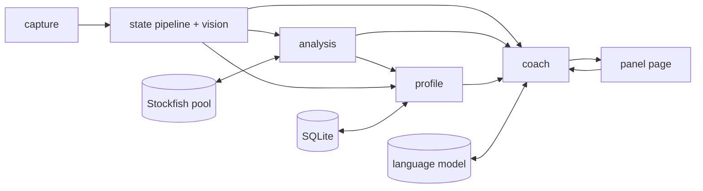

# Sidecoach design

Owner: Tai. Brought up to date with the code on 2026-10-07 (version 0.1.84). This document is
the source of truth for scope and architecture; where it and the code disagree, the code wins
and this file is fixed. Decisions are dated where the date explains why; history lives in git.

The other documents, each the full account of its part:

| Document | What it holds |
|---|---|
| docs/reconciler-model.md | the state reconciler: the stories model, its guarantees, its known limits |
| docs/move-classification.md | how a move gets its label (best ... blunder, great, brilliant, miss, book) |
| docs/coach.md | the coach: the harness the model reads, the hints, the checks |
| docs/game-review.md | Game Review: the library of games, the review screens |
| docs/stats.md | Stats: what a player's reviewed games add up to |
| docs/app.md | the desktop shell, the sidecar, packaging, the phone app |
| docs/testing.md | how to write a test, and the suite's budget |
| docs/eval-results.md | the coach's evaluation: method, numbers, decisions |
| docs/known-issues.md | what is known to be wrong and shipped anyway |

## 1. What it is

Sidecoach watches the screen, finds the chessboard, and coaches the player while they play,
practise or review on any chess site. It is vision-first and platform-agnostic: it reads
pixels, never the site's DOM. It keeps a legal, reconciled game, measures every position with
Stockfish and a motif tagger, and talks to the player through a language model that is handed
the verified facts and the engine's lines and told how much of the answer it may give. After
a game it reviews it; over many games it keeps a profile of the player, recommends puzzles
and shows their stats.

It ships as two apps with one version number: a Windows desktop app (Tauri 2 shell, Svelte 5
page, the Python pipeline as a sidecar) and a native Kotlin Android app that is a 1:1 port of
the pipeline and shows the same Svelte page in a WebView (section 5.8, docs/app.md). The
first site is chess.com, in bot games, puzzles and live games.

## 2. Goals and non-goals

Goals

- Improve the player's chess, measured by per-motif error rates, puzzle accuracy, and eval
  loss at decisive moments. Engagement is not a goal.
- Socratic by default. Before a move the coach hints; it gives the move only when asked
  (section 3).
- Never commit an illegal transition, never tell a wrong side to move, never let the model
  say something false about the board.
- Work on any board theme, piece set and board size, chess.com first, other sites later,
  without per-site integration.

Non-goals

- Playing moves for the user, automating the browser, or reading site internals.
- A cloud service. Everything runs on the user's machine except the language model, which
  is a hosted API by default and can be a local server or none at all (section 5.5).

## 3. Policy

Decided 2026-09-14.

- Sidecoach is a generic tool. Where and how it is used is the user's own responsibility, the
  same as running any engine app beside a game.
- Live engine-informed coaching is always available. There is no gating by opponent type or
  game mode.
- Before a move the coach gives hints. The best move is withheld until the user names it,
  plays it, or asks for it (or asks for a third hint).
- An EULA is the last step before any public release.

Disclosure (Tai, 2026-09-26): the AI coach sees everything -- the engine's lines at every
level, the facts past the current rung -- and the rung is stated in its task. What a reply
gives away of the answer is logged (`Speaker._leaks`, from `disclosure.leak_check`) as a
debugging signal, never a reason to refuse it: an occasional hint that says too much is
minor, a vague coach is not. A false claim about the board still refuses a draft
(`Speaker._problems`). Offline, the templates are built level by level and say only what
their rung allows.

## 4. Architecture

One process per app, a pipeline of stages. The capture loop yields frames; the state
pipeline (`state/pipeline.py`) drives the vision stack on them and the reconciler turns the
readings into game events; every stage after that consumes and emits the pydantic events of
`sidecoach/events.py`, so any stage can be replayed from a recording.



| Stage | Package | In | Out | Responsibility |
|---|---|---|---|---|
| capture | `sidecoach.capture` | timer | frames | One monitor at 10 fps through Windows Graphics Capture, else GDI (`mss`). Grabs that fail are retried. |
| vision | `sidecoach.vision` | frames (called by the pipeline) | cell readings, clock readings, badges | Board detection and tracking, per-square recognition, orientation, coordinate labels, clocks, result badges. |
| state | `sidecoach.state` | frames | `GameStarted`, `MovePlayed`, `PositionChanged`, `Takeback`, `Resync`, `TurnPending`, `GameEnded`, `BoardUnread`, `Unexplained`, `ClockObservation`, `ScreenStateChanged` | The pipeline (bootstrap, cold reads, theme cache, badges, clocks, screen state) and the reconciler (a legal game from the readings). |
| analysis | `sidecoach.analysis` | game events | `Analysis`, `MoveAssessment` | Stockfish on a pool of workers, expected-score loss, labels, decisive moments, threats, traps, motifs, openings, positional ideas. |
| coach | `sidecoach.coach` | game and analysis events, `UserUtterance`, clocks | `CoachMessage`, `ProfileEvidence` | Disclosure ladder, interjection policy, the harness the model reads, draft checks, templates. |
| profile | `sidecoach.profile` | game, analysis and coach events | `GameReview`, `ProfileSnapshot`, `Recommendation`, `PuzzleOutcome` | SQLite record, error taxonomy, reviews, puzzles, the game library, stats. |
| ui | `sidecoach.ui` | all of the above | `UserUtterance`, controls | The FastAPI server behind the Svelte page: panel, puzzle room, review room, settings. |
| voice | `sidecoach.voice` | `CoachMessage`, microphone | speech, `UserUtterance` | Kokoro TTS, Parakeet STT, Silero VAD; optional. |
| replay | `sidecoach.replay` | recordings | frames | Record and replay. |
| llm | `sidecoach.llm` | prompts | completions | One OpenAI-compatible provider, presets per service, an offline provider. |

Every event carries a monotonic timestamp and, where it has one, the frame it derives from,
so latency can be measured end to end.

## 5. Stage designs

### 5.1 Capture

- Backends: Windows Graphics Capture through `windows-capture` (the default where it is
  available: it sees hardware-overlay windows that GDI shows frozen), else `mss` (GDI
  BitBlt); `capture.backend` picks. Neither draws the cursor.
- The whole of one monitor is grabbed every tick, at 10 fps (`capture.fps`); at 5 fps the
  frame interval alone eats the latency target. A frame that shows a move once is followed
  by one early confirming frame (`CONFIRM_INTERVAL_S`, a thirtieth of a second), never a
  higher rate all the time (Tai, 2026-10-02). A change gate skips vision when the board
  region is unchanged.
- A live session must not die with the screen. A grab that fails (a locked session, a
  sleeping monitor, a display change) is retried every half second with the capture
  rebuilt, up to thirty times in a row, before the loop gives up with a clear message; the
  frames are missed and the reconciler catches up. A recorder that fails stops the
  recording and the watching goes on. The default monitor is the primary, which `doctor`
  marks.
- Nothing from the screen is saved by default (Tai, 2026-09-21). Recent frames live in a
  ring in memory and are written only on File > Dump (`data/dumps/<stamp>/`). Recording a
  whole session (`capture.record`) is an opt-in for bug reports.
- Clocks (2026-09-15, Tai): the clocks next to the board are read for the remaining time and
  the time control (`vision/clock.py`: digit templates, no OCR). A failed read is no
  reading, never an error. The clock scales the coach (section 5.5); in the game state it
  does one thing only: a side to move that a resync or a cold start left open is settled by
  the running clock, when one was read in the last three seconds
  (`GamePipeline._turn_from_clock`, `Reconciler.turn_from_clock`). Otherwise whose turn it
  is comes from the board.

### 5.2 Vision

Board detection is classical computer vision (`vision/board_detect.py`). A board is an
axis-aligned square of 8 by 8 equal cells in two colours.

1. Coarse search: for every cell size in a geometric range, every position is scored on how
   well the border-ring means of its 64 cells alternate in a checkerboard, gated on the
   amplitude between the two colours; each scale keeps its local maxima, so an empty board's
   plateau or a window into a larger checkerboard cannot crowd out the game board.
2. Refinement: a comb on the seven boundaries between the cells, fitted on the gradient
   profiles for sub-pixel offset and pitch; of placements a cell apart, the one whose cells
   read most like a board is kept.
3. Validation: the fit score is the fraction of readable cells that match the checker in the
   polarity of the square colours. A candidate whose pattern continues in the ring of cells
   outside it (a whole-cell shift, a window into a larger checkerboard) is rejected, and so
   is a board the frame does not show whole (2026-09-27): its cut cells would reach the
   recogniser squeezed. Among boards of one size a better fit wins, then the more occupied.

Pieces, the cursor, arrows, highlights and labels are local outliers against 64 cells of
evidence. The panel's own board carries a signature no real board has (odd rows three units
bluer, `vision/ownboard.py`), and the tracker never locks onto it. Below 24 px a cell the
detector does not see a board at all.

Tracking (`vision/tracker.py`): while locked, every frame is validated with the cheap checker
fit at the known region, against the colours the lock was taken with, so a dialog over most
of the board cannot rewrite its palette and a board that slid a whole cell fails at once. A
frame that fails validation is re-fitted at once; after a few failures the lock is dropped
and detection runs again, the cheap search near the last cell size first, so a board that
comes back from a cover or a scroll re-locks within a few frames. Sub-cell drift and small
resizes, which validation is blind to for up to a third of a cell, are caught by a periodic
wide re-fit, adopted only when it validates on its own and its comb is clearly stronger. A
re-fit that moves no edge more than two pixels keeps the lock. While part of the board is
covered, cells far from both square colours are left out of the fit, as long as 24 remain.

Square recognition (`vision/pieces.py`, `vision/embedding.py`; Tai's design, 2026-09-19):
nothing is trained. What stands on a square is decided in two parts.

- Whether anything is there, and what sits over it, by geometry, never by colour: the
  silhouette's share of the cell tells an empty square from a mark from a piece; a tint
  (highlight, check, premove, mark, in any hue) shifts the ring and the corners alike and
  leaves the cell readable; a hover outline or a capture ring reads as unknown; a cover (a
  dialog, a toast, a promotion picker, a dialog fading in) is confirmed by its neighbours and
  reads as unknown, never as a hover; a drawing (an arrow) reads as unknown until it is gone.
- Which piece, by a frozen pretrained net: Ultralytics' YOLO26n-cls cut before its ImageNet
  head, exported to ONNX (`tools/classifier/export.py`; AGPL-3.0 weights), embeds each cell
  at 224 px into 1280 numbers. The start position's 64 cells are embedded once; a later cell
  is named by the nearest of them by cosine similarity. Every cell is brought to one
  resolution first (`canonical`), so a board resized after its set was learned reads the
  same. The side of a piece is a vote of three signals, each cast only when sure: the
  embedding's nearest white against nearest black, the fill's brightness, and the fill's
  colour under the kind's exemplar mask. Whether a piece has landed is the phase correlation
  of the cell against that kind's start-position crop on a square of the same colour
  (`_phase_shift`): the sub-pixel shift itself, unmoved by a badge, a glow, a tint or a
  label. A piece dragged or sliding is off its centre, and no move commits on it.

The net runs through onnxruntime on the GPU when there is one, else the CPU, on the changed
cells of a frame in one batch. The rejected alternatives (a CNN trained on synthetic crops,
a fine-tune, landing by shifted exemplars, the silhouette overlap, a cookie-cutter matcher)
are in the git history of those modules. Chess.com's assets are only observed on the user's
own screen; the synthetic renders use open-licensed Lichess sets.

Learned sets (`vision/theme_cache.py`, the pipeline's `_keep_look`). A board-and-piece set is
learned whole, from a start position, and kept on disk under its board colours, several sets
per colours. A set on disk is never replaced (Tai, 2026-10-05: a set learned from chess.com's
small puzzle-page start positions was saved over the one that read his boards, and every
piece after read as in flight); a look no cached set reads as the start is saved beside the
others. A start is learned only once a re-fit puts the lock on the board. A set missing any
of the twelve kinds is never saved. A board read cold tries every set on its colours and
keeps the surest read that is a quiet, complete, legal position.

Orientation: the user's side is the side at the bottom (the reconciler is built with
`user_side=bottom`). It is decided per game from the start position, or for a board read
cold from the coordinate labels (learned per set, `vision/coordinates.py`), or from the
panel's Flip when the labels cannot be read. A board that comes up the other way round is
read again that way.

Result badges (`vision/result_badges.py`, 2026-09-19): chess.com stamps the end of a game on
the kings, a green disc on the winner's, a red one on the loser's, under the game-over dialog.
The reader looks for a disc near the square's top-right corner, of one colour, ringed by
others, not the square's own colour; only win and loss discs are read (the grey draw disc was
never verified), never on a covered cell.

Screen state (`ScreenState`: live game, puzzles, game over, covered, unknown) is derived from
board presence, clocks and covers; there is no classifier.

Known vision limits are in docs/known-issues.md (about 1.2% of the stress sweep's random
games are not followed to the end, mostly dark shaded sets on dark boards and small cells).

### 5.3 State reconciliation

The reconciler (`state/reconcile.py`, `state/stories.py`) turns cell readings into a legal
python-chess game. docs/reconciler-model.md is its full description; in short:

- It relies only on what every site must show: what stands on each square (or unknown),
  whether a piece is settled, the order of frames, the rules, and which side is at the
  bottom. No colour is read, no clock, no text -- with two exceptions below.
- Every way the game may have gone on past the record that fits the frames is kept as a
  story: moves, the user's premove queue as the site draws it, a ply of the move list shown
  (browsing), a piece on its way. Nothing is weighed (Tai, 2026-10-06: no priors): the
  stories kept are those needing the fewest pictures no frame showed, then the fewest events.
- The record takes only what every story agrees on. A move counts once its squares have
  been read settled for `settle_frames` (two) frames. When the stories disagree on the side
  to move, `TurnPending` says so and the coach gives no unasked hint until it is known.
- Recovery by the site's last-move mark (Tai, 2026-10-06): a premoved move and the same move
  played draw alike, so when the frame marks a last move and no fitting story has it, the
  stories are told again with the other side to move (`_marked`); when none has it either,
  the board is read whole and adopted with the side the mark names (`_marked_resync`).
- When no story fits for long enough, the board is read whole and adopted (a position
  resync): held ten frames, or three frames over 0.4 s when twelve or more cells changed.
  Castling rights survive for a king and rook on their home squares.
- Takebacks (one or two plies) and browsing are stories too; a takeback is a different move
  played from the ply shown, which is the only way the two differ on the board.
- Guarantees, asserted by the sweeps on every frame: never a wrong side to move, never an
  illegal game, the position current once premoves resolve, and when lost, a re-read rather
  than a guess.

What the pipeline (`state/pipeline.py`) adds around the reconciler:

- Bootstrap: a start position seen for a few frames begins a game (`GameStarted.kind`
  "game"), learns or finds the set, and decides the orientation. A new start position ends
  the previous game.
- Cold start (2026-09-20): with no game followed and a board locked, the board is read
  through the cached sets every half second and adopted once the same quiet, complete read
  has come three times. Such a game is a *position* (`kind` "position": a puzzle, an
  analysis board, a game joined mid-way). The site's last-move highlight, read here as the
  second exception, says who moved last and opens en passant after a two-square pawn push
  (`last_move_seen`); else the clock, else the first move seen, settles the turn. The
  engine measures the position at once. The profile keeps it as a game only once 16 plies
  are played on it (`PROVISIONAL_PLIES`); a puzzle of the store is scored as a puzzle.
- A board no learned set reads is explained once (`BoardUnread`: no set learned yet, the
  orientation unreadable, or a look changed mid-game that no set reads).
- A piece's kind read wrong on a square read cold is corrected by its first move
  (`_explain_misread`). A cell that keeps disagreeing with every story turns stale after a
  few frames and is ignored, so one unreadable cell cannot stall a game. A cell a confirmed
  cover has just hidden keeps its last stable reading for a while, so a mate found on the
  clean frames settles under the game-over dialog. A frame with fewer than half its cells
  readable is no evidence.
- Game end: mate and stalemate come from the board, repetition and material too. A
  resignation, a timeout or an agreed draw is read from the result badges: two consecutive
  frames of an agreeing pair end the game, a mating story still pending committed first;
  the reason is what the pipeline knows (a mate, the loser's clock at zero, else a
  resignation). The dialog's text is never read. The panel's End game menu remains for a
  site that stamps nothing.

Known limit: a position resync starts the record again. `GameEnded.pgn` holds the moves since
the re-read only, and Game Review of such a game stops where the record does.

### 5.4 Analysis

Stockfish 19 (the universal build, `sf_19`) over UCI through python-chess, as a pool of
single-thread workers (`engine.workers`, three by default) behind `analysis/analyser.py`;
the phone runs the same design. The decisions of the engine audit (2026-10-04/05,
`tools/engine/`):

- Every search is one line to the full depth, 18 (`engine.depth`). Several lines to depth 18
  explode on decided and forcing positions (up to 53 s); one line does not (p50 0.19 s, p99
  1.1 s). One thread a search: more threads widened the search instead of speeding it.
- A position's first answer, for hints, is a six-line search to depth 12 (`EARLY_DEPTH`;
  never over 1.9 s on 8,886 real positions). Its candidates are then each searched as their
  own position, one line to depth 18: the position's lines at full depth are built from
  those children's searches, which are exactly the positions the game goes to next. No
  look-ahead beyond that.
- Then the side searches: the threat (the opponent's best after a null move), traps,
  declined recaptures, what a quiet best move threatens (`threats.aim_lines`).
- Order of work: what the next verdict needs, what the coach asks for, the position the game
  is on, the game's other positions. A search running past a second at a decided score
  lets that depth's score stand in for the verdict. A position with one legal move is never
  searched. A failed search fails alone; a crashed engine is restarted.
- No time cap: a depth asked for is a depth reached (a five-second cap had answered searches
  at depth 11 read as 18). A watchdog ends an engine only when it has been silent and idle
  for 30 s, and makes the search again.
- Game Review searches at one of three strengths (`analysis/game_review.py`): fast (depth
  14, three lines), standard (18, six), deep (22, six).
- Every position is measured once, to the same depth, and cached (`KEEP_NODES`), so the loss
  of a move compares like with like.

Scores are expected score from the mover's view, 0.5 a dead draw, 1.0 a win, never
centipawns. The default curve is Lichess's, fitted to games between people
(`engine.score_model = "human"`): Stockfish's own win-draw-loss says a knight up is won,
which in a club game it is not, and scored the game of 2026-09-14 20:06 as seven blunders and
nothing else. The engine's numbers remain as `score_model = "engine"`. The eval loss of a
move is the best line's expected score minus what the move left; the engine's own first
choice costs nothing by definition.

Move labels follow chess.com's published definitions (support.chess.com article 8572705,
Classification V2; Tai, 2026-10-06: "use their definition"), in expected points lost
(`analysis/score.py`, `label_move`): best is the engine's first choice; excellent under
0.02; good under 0.05; inaccuracy under 0.10; mistake under 0.20; blunder beyond. Brilliant
is the best or nearly best move, a good piece sacrifice (`motifs`: a piece given or left to
be taken), not in a bad position after it, and not completely winning without it. Great is
the best move where every other loses ground, or the punishment of the opponent's blunder,
never an obvious move or in a lost position. Miss is a move that gives ground where a
winning chance was on the board, or lets a forced mate go. Book is the opening tables' move
unless it costs a mistake. The thresholds are settings (`coach.*`). Detail and the reasons:
docs/move-classification.md.

- Accuracy (2026-09-15): per move, Lichess's exponential of the drop in winning chances made
  three times steeper; a side's accuracy is the plain mean. Against chess.com on 144 of
  Tai's game sides it is 5.8 points apart on average, with no lean (2026-09-29).
- Decisive moment: the best line beats the second by 0.10, or an only move (the single legal
  move, or a best move 0.30 ahead).
- Motif tagger (`analysis/motifs.py`): pure functions over (board, move, line) returning
  Lichess puzzle theme names with evidence squares; a material claim must gain something
  once defenders are counted.
- Positional layer (`analysis/positional.py`): the strategic idea behind the best move and
  the position's instructive static features, each computed from the board with its squares.
- Openings: the Lichess chess-openings tables (CC0, `scripts/fetch_openings.py`), indexed by
  position so transpositions resolve; the same index answers book membership. No Polyglot
  book.
- Chess.com's review is a calibration reference, not ground truth (`analysis/chesscom.py`,
  `sidecoach import-reviews`, `sidecoach review --compare`).

### 5.5 Coach

docs/coach.md is the full account. The decisions:

Disclosure ladder (`coach/disclosure.py`): two hints, then the answer (Tai, 2026-09-23).

| Level | The coach may give | Reached by |
|---|---|---|
| 0 silent | nothing | a new position |
| 1 idea | a short lesson on the position: the stakes, the key fact named on the board, the principle, the trap; never the player's move | stuck, or a hint asked |
| 2 focus | the target where it stands, the piece to use, and the question from there to the move | the second hint or stuck; the ceiling unasked |
| 3 move | the move, played out and explained | the third hint, naming it, playing it, or asking |
| 4 line | the whole line | asked, or after the move |

Each level is given once per combination, never lower after higher. With the AI on, the
model reads what the player asks from guidelines and the ladder follows what its reply said
(`disclosure.said_level`; Tai, 2026-10-02); offline, deterministic unlocks drive it.

What the rungs say comes from reading the engine's best line through the player's own moves
(`coach/idea.py`), never from static features that happen to be on the board: the goal (mate,
material won, a pawn queened, an attack on the king, a combination, a draw, conversion into a
won ending, the king's march or a breakthrough in an ending, a threat to meet, or a plan), and
the pattern that delivers it. A tactic counts only when the line cashes it in. The best line
is carried to sixteen plies by searching on from where Stockfish stops. Where the line wins
nothing, the plan is read from the line too (`coach/plans.py`). The first hint is one story of
the best line, the most immediate beat first (`coach/story.py`, `coach/situation.py`; Tai,
2026-09-24: a hint is a precise lesson, never a bare principle); traps come from
`analysis/traps.py`. A lesson after a mistake says what the move allowed, read from the
opponent's side by the same reader.

Interjection policy (`coach/policy.py`), in priority order:

1. Answer the player, always.
2. A lesson after a mistake, blunder or miss.
3. A brief word after every other move of the player's.
4. A hint once the player has been stuck `coach.stuck_seconds` (45 s), then the focus after
   a second stuck spell; the move only when asked.

Nothing else while the player thinks: no question at a decisive moment, in a game or a
puzzle (Tai, 2026-10-01: nothing "until the user is stuck or actively request a hint or after
they have made a move"). A quiet setting silences everything but answers. Clock scaling: the
stuck threshold is the smaller of the setting and 8% of the remaining clock, never under
20 s, and no stuck hint under 30 s left; blitz gets the post-move word only (a mistake too
gets just the word); bullet nothing unasked; untimed games and analysis get everything.

The harness (`coach/conversation.py`, `coach/prompt.py`). Each call is one user message made
of sections: `# Setting` (whom the coach coaches), `# Game so far` (one line per move with
the engine's verdict, and under it what was said after it and any event -- a takeback, a
re-read, a dialog, the end), `# Position now` (the board, the last move, the standing, the
engine's lines in full with line 1 named as the answer, the facts at the rung and those
beyond it set apart, the inventory of the board, the record so far, what was said here),
then the task for this moment, with its reply format. Lines once seen are frozen; late facts
are later notes. The system message has four parts: the persona (one of four,
`coach.persona`), the contract saying how the game reaches the model, the rules, and C, the
lessons distilled from the coach's corrected replies (`coach/context/corrections.md`,
section 8). The player's rating band, when set in the profile settings, goes into the
persona and changes what the templates explain. Asked a question, the model can call the
engine itself (`coach/engine_tools.py`): the position after any moves, its lines, what
attacks a square.

Words without the model. The verdict on a best, excellent or book move is written from the
board (`coach/verdicts.py`, `coach.local_verdicts`; Tai, 2026-09-20), free and immediate; a
good move goes to the model, which names the better one; a great or brilliant move gets the
model with delight. With no model (`llm.provider = "none"`), the templates are the whole
coach and the floor the model must rise above.

Checks. A draft is refused for a false claim about the board (`claims.check_draft`, run
through `Speaker.draft_check`), a verdict or cost against the record, an earlier moment it
invents, or a move it calls illegal that is not; it is regenerated once with the problem
named, then replaced by a template, so the player never sees a false claim and never sees
nothing. Form and leaks are logged, never refused (Tai, 2026-09-26, 2026-09-28). The player's
own reasons are extracted into claims and checked on the board and against the engine
(`claims.py`, direction one). An optional second model reads every candidate against the
facts (`coach.verify`, off by default), and the model can be asked for several phrasings to
sample from (`coach.verbalized_sampling`, off by default). With the voice streaming and no
verifier, the first candidate is spoken sentence by sentence as it is written, each sentence
checked first.

Language model (`sidecoach.llm`): one OpenAI-compatible provider with presets. The default is
`openai` (gpt-5.6-luna over OpenAI's Responses API, the only one on which its reasoning models
take tools with an effort, 2026-09-29), at reasoning effort none (Tai, 2026-10-04: latency
first; the coach was evaluated at medium). `local` is LM Studio at
`http://localhost:1234/v1`, whose Qwen builds ignore every reasoning switch and are silenced
by an empty think-block prefill; `dashscope` and any `custom` endpoint are presets too;
`none` is offline. Every paid call of the evaluation goes through `judge.Ledger`.

### 5.6 Profile

The record (`profile/store.py`, one SQLite file `<data_dir>/profile.sqlite`) is written for
the questions it will be asked: every move carries the phase, the mover's clock, the
material, the expected score after it from the player's side, the tactics on the board
before it and the ones it allowed, and the engine's better move; one key, `move_id`, joins
moves, evidence and dialogue. Tables (`store.py`): games, moves, evidence, dialogue,
sessions, recommendations, puzzle_attempts, settings, library, reviews, stat_games,
stat_moves, twins (a watched game also imported), removed, review_progress. The puzzles
themselves are in `puzzles.sqlite`.

Error taxonomy, two axes: the cause (`profile/causes.py`: time pressure under ten seconds,
an opponent's threat missed, a line miscalculated, a candidate never considered, opening
knowledge, endgame technique, positional misjudgment), correctable by the player; and the
motif, from the tagger. The coach never asks the player what they saw (Tai, 2026-10-02);
their own words within 60 s of a lesson on a mistake are kept beside it as a self-report and
can refine the cause. Each cell is a Beta-distributed rate computed from the record, so one
event never makes a weakness. The insights (`profile/insights.py`) name the area that costs
the player most -- the same rule as Stats' "Work on this" -- and the motif missed most often.

A question about the player over their games is answered by the model writing SQL
(`profile/ask.py`): the schema in words and worked queries in the system message, one
```sql block per round, up to four rounds, then prose; every statement runs read-only under
SQLite's authorizer with a row and time cap, and the queries and rows are kept with the
answer.

After a game the profiler builds the review once the engine has caught up (or after 90 s):
the tally, accuracy, the turning points with the better move and the cause, phases. Game
Review (docs/game-review.md) opens any game from the library -- a PGN, the player's chess.com
games through the public API, their Lichess games -- and reviews it whole: each side's
accuracy and move counts, a game rating estimated from the moves alone
(`profile/performance.py`), phase grades, the key moments, the coach's words on every move.
Stats (docs/stats.md, `profile/stats.py`, `profile/stat_facts.py`) adds the reviewed games
up, beside the same figures for real players of the player's rating.

### 5.7 Recommendations

Puzzles (`profile/puzzles.py`): the Lichess puzzle database (CC0), filtered to 600-2000 into
`data/puzzles.sqlite` (`sidecoach puzzles`), keyed by the solver's position, which is what a
cold read of the screen gives. After a review the profiler recommends three puzzles of the
motif that costs the player most, within 150 of their puzzle level (1100 to begin with, 25 a
step per outcome), none solved in the last fortnight, a failed one back first. A puzzle
opened on Lichess is a position the pipeline joins; the store names it and the player's
moves are checked against the solution (any mate where the line mates). Or it is solved in a
room of its own (`/puzzle/<id>`, `ui/puzzle.py`, `ui/puzzle_room.py`, the page
`desktop/src/routes/puzzle/[id]/+page.svelte`) with its own quiet coach and engine, while the
panel keeps watching the screen. The outcome is recorded once, beside the motif.

A chess.com lesson catalogue was planned and is not started (section 10).

### 5.8 UI and apps

One Svelte 5 page (`desktop/src`, built into `src/sidecoach/ui/web` by `desktop/sync-web.mjs`)
is the interface everywhere: in the desktop app's Tauri window, in a browser through
`sidecoach panel`, and on the phone in a WebView. It talks to its backend over plain HTTP
(`/api/...`): the FastAPI server in `ui/server.py` on the desktop, a loopback server in
Kotlin (`ui/LocalServer.kt`) on the phone. One contract, so every request-shape change is
made on both servers.

The main window: the board and move list, the coach's messages, a composer for questions
(typed or dictated), a status strip, and a debug terminal folded by default; a drawer holds
the rest. Pages of their own: Games (the library), Game Review (`/review/<key>`), Stats,
the puzzle room, settings in plain language, first-run setup, and live captions of the
coach's voice. Keeping the window on top is an opt-in toggle; the disclosure level of a
message shows only in its tooltip. There is no overlay on the game's board.

Desktop (docs/app.md): Tauri 2 shell with a menu bar and a tray, the Python pipeline as a
sidecar on an ephemeral port behind a bearer token; one setup exe, no code signing; the
CUDA pack fetched when an eligible NVIDIA GPU is found. `scripts/release_desktop.py` builds
and installs it.

Phone: a native Kotlin app in `android/`, a 1:1 port of the pipeline, coach,
profile, Game Review, Stats and voice (each Kotlin file says what its Python file says, held
to it by parity tests), capturing through a `mediaProjection` foreground service. Chess.com
live games on Android are FLAG_SECURE and cannot be captured; puzzles and bot games can.

One version for both (`scripts/bump_version.py`), bumped together even when only one
changed; both release scripts refuse a mismatch.

### 5.9 Voice

Optional (`uv sync --group voice` on the desktop; built in on the phone). Kokoro for speech,
Parakeet for recognition with post-correction against the legal moves, Silero VAD; SAN is
spoken as words (`voice/notation.py`). The voice never talks about a position the board has
left. Live captions show what is spoken.

### 5.10 Replay and recording

Every stage is replayable: `sidecoach record` and opt-in session recordings store frames
(FFV1, only the frames that changed, plus keyframes) with an index of every tick, and
`sidecoach replay` feeds them through the pipeline exactly as the live session saw them.
Recordings under `data/` (`gNN-<opponent>-<note>/` with chess.com's `truth.pgn`) are for
replays and the validation scripts; the test suite depends on nothing under `data/`
(2026-09-18): it renders its boards (`tests/synth.py`, real piece sets, a few committed crops
under `tests/fixtures/`), and `tests/test_stress.py` plays seeded random games through the
whole pipeline over every theme, set, size and decoration (docs/testing.md).

## 6. Storage

Under the app's data folder: `profile.sqlite` (section 5.6), `puzzles.sqlite`, the learned
sets (`theme-*.pkl`), the player's own piece sets (`pieces/own/`), dumps written on demand,
and recordings only when opted in. Nothing of a session is written otherwise.

## 7. Latency budget

Latency comes before memory (Tai, 2026-10-02).

| Step | Target |
|---|---|
| Frame to committed move | the frame that shows it plus one confirming frame a thirtieth of a second later |
| Engine, first answer | six lines to depth 12, under 0.3 s at p99 |
| Engine, one line to depth 18 | p50 0.19 s, p99 1.1 s |
| A word on a best/excellent/book move | immediate (written from the board) |
| A model reply | streamed to the voice sentence by sentence, reasoning effort none |

## 8. Evaluation

Pipeline: the stress, geometry, premove and slide sweeps over rendered games, asserting on
every frame (docs/testing.md, docs/reconciler-model.md); the recordings replayed against
chess.com's PGNs; chess.com's own reviews as the reference for labels and accuracy.

The coach (`tools/eval/`, committed; data under `data/eval/`, layout in `data/eval/README.md`;
method, numbers and decisions in docs/eval-results.md): master games from annotated books
played through the real coach move by move, the notes kept as the judge's reference only;
a binary judge at reasoning effort none, every claim decided in code where the record can
decide it; iterative context refinement producing C, now twelve distilled lessons. Held-out
results and the coach benchmark against Lichess puzzles (`tools/puzzles/`) are in
docs/eval-results.md. Paid calls stay at $0 unless Tai names an amount.

Skill metrics, once there are enough games: per-motif error rates over time, puzzle
accuracy, eval loss at decisive moments.

## 9. Stack

| Concern | Choice |
|---|---|
| Language and tooling | Python 3.12, uv, src layout, one package `sidecoach`; Kotlin on the phone |
| Capture | Windows Graphics Capture (`windows-capture`), `mss` as the fallback; `mediaProjection` on the phone |
| Vision | OpenCV, numpy; YOLO26n-cls embeddings in ONNX through onnxruntime (GPU or CPU); no OCR |
| Chess | python-chess, Stockfish 19, the Lichess chess-openings tables |
| LLM | OpenAI-compatible over httpx: OpenAI (Responses API) by default, LM Studio, DashScope, any custom endpoint, or none; keys in the environment |
| Voice | Kokoro, Parakeet, Silero VAD, all on onnxruntime |
| Storage | SQLite, PGN |
| Server and UI | FastAPI; Svelte 5 (SvelteKit, static); Tauri 2 on the desktop, a WebView on the phone |
| CLI | typer, rich: `doctor`, `watch`, `panel`, `record`, `replay`, `review`, `import-reviews`, `puzzles`, `profile`, `cells`, ... |
| Config and events | pydantic, TOML |
| Tests | pytest with xdist on rendered boards; ruff; pyright |

Development machine: RTX 3090 Ti 24 GB, Ryzen 9 9900X, 62 GB RAM; a local model server, when
used, runs on another machine (h200-1). Phone: Pixel 10 Pro XL.

## 10. Roadmap

Built: board detection and tracking on any theme; recognition with no training; the stories
reconciler with premoves, takebacks, browsing and recovery; cold reads of puzzles and games
joined mid-way; result badges; clocks; Stockfish on a worker pool; chess.com's move labels;
the coach with its ladder, policy, harness, checks, templates and offline mode; the profile,
post-game review, Game Review, Stats and puzzle recommendations; voice and captions; the
desktop app and the phone app at parity.

Not built, and not scheduled:

- Reading the move list (it would check the reconciler's ply parity and keep a game whole
  across a re-read). No OCR is in the code.
- A chess.com lesson catalogue mapped to motifs, and lesson recommendations.
- Maia, to predict the move a player of the user's rating would get wrong.
- An overlay on the game's board.
- Linux and macOS desktop builds (the Linux plan is in docs/app.md).
- An EULA, before any public release.

## 11. Open items

- The clock still settles a side to move that a resync or a cold start left open
  (`turn_from_clock`), which docs/reconciler-model.md says the stories replaced; one of the
  two is to be brought in line with the other.
- A position resync restarts the record: the moves before it are not in the game's PGN or
  its review (section 5.3).
- The draft-claims reader (`coach/draft_claims.py`, `Speaker.claim_reader`) is built only by
  tests; the live coach checks drafts with `claims.check_draft` alone.
- `Trigger.DECISIVE_QUESTION` never fires live since 2026-10-01; it is kept so the
  evaluation's recorded requests replay. The `coach.decisive_gap` setting's description
  still says the coach asks the player to slow down.
- The evaluation numbers predate the engine tools (2026-09-28), the Responses API
  (2026-09-29), reasoning effort none by default (2026-10-04) and the rating band in the
  prompt; they have not been measured again.
- Whether Stockfish 19's universal build uses AVX-512 on the Ryzen 9 9900X is unverified.
- Vision and reconciler limits that ship: docs/known-issues.md and the known limits of
  docs/reconciler-model.md.
