<p align="center">
  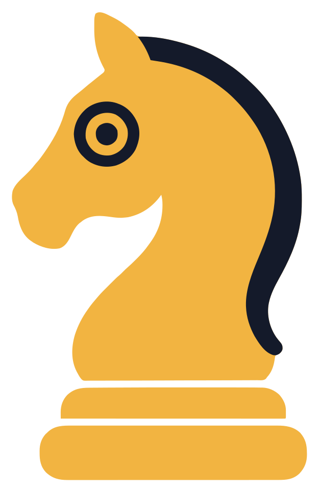
</p>

<h1 align="center">Sidecoach</h1>

<p align="center">
  <b>A chess coach that watches your screen and teaches like a person.</b><br>
  Play on the site you already use. Sidecoach reads the board from the pixels, checks every
  move with Stockfish, and helps the way a good coach does: a hint, a sharper hint, then the
  move and why.
</p>

<p align="center">
  <a href="https://github.com/ductai199x/sidecoach/releases/latest"></a>
  <a href="LICENSE"></a>
  
  
</p>

<p align="center">
  <a href="https://github.com/ductai199x/sidecoach/releases/latest"><b>Download</b></a> ·
  <a href="#a-quick-tour">Tour</a> ·
  <a href="#measured-not-claimed">Measured</a> ·
  <a href="#how-it-works">How it works</a> ·
  <a href="DESIGN.md">Design</a>
</p>

<p align="center">
  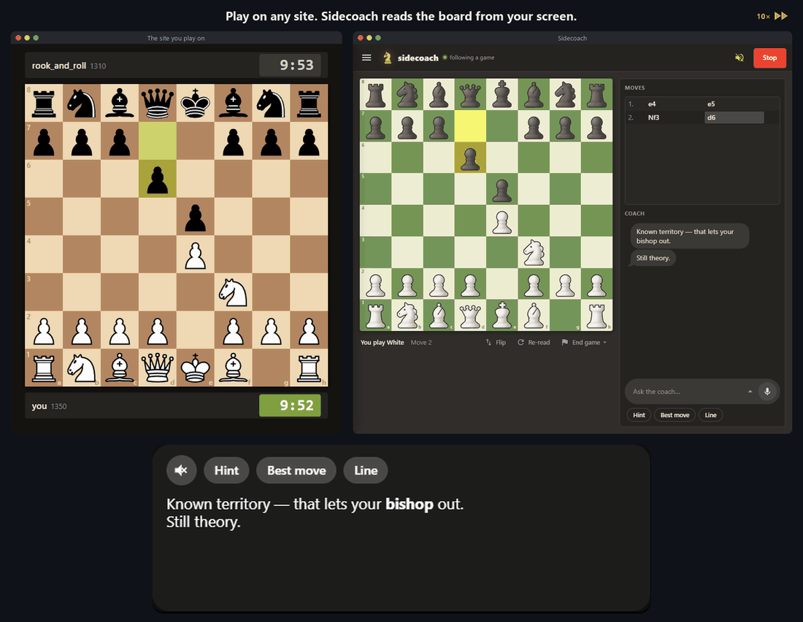
</p>
<p align="center">
  <sub>The real app with the AI coach, its words in the captions box that floats over your
  game. The site is a stand-in page of our own.</sub>
</p>

You play as you always do. Sidecoach sits beside the game, reads the board straight off your
screen and keeps quiet. When you have been stuck for a while, or you ask, it helps in steps:
first the idea, then the piece and the question that leads to the move, and only then the
move. After each of your moves it tells you what it was and what it teaches, and when the game
ends, the whole of it is waiting in Game Review.

<table>
  <tr>
    <td width="50%" valign="top">
      <b>Any site, any board</b><br>
      No extension and no account link: it reads pixels, so it works wherever a chessboard is
      drawn, in any colours and piece set, at any size, as White or as Black.
    </td>
    <td width="50%" valign="top">
      <b>Hints before answers</b><br>
      Silent until you are stuck or ask. Then a hint about the idea, a sharper one, the move,
      and the line if you want it. Each step once, never a lecture.
    </td>
  </tr>
  <tr>
    <td width="50%" valign="top">
      <b>Talk to it</b><br>
      It speaks its words aloud and listens to your questions, both on your own machine. Ask
      "what's their threat?" or "why not Bxf7?" and get an answer about this position.
    </td>
    <td width="50%" valign="top">
      <b>Knows your game</b><br>
      Every game reviewed move by move, your strengths and weak spots across games in Stats,
      and puzzles picked for what you miss, rated exactly the way Lichess rates them.
    </td>
  </tr>
</table>

## A quick tour

<p align="center">
  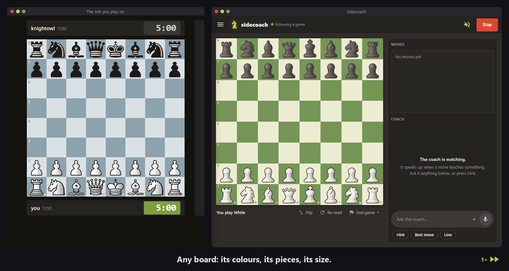
</p>
<p align="center"><b>Any board.</b> New colours and pieces are learned from the first position
of the game; a window resized or moved mid-game is followed; playing Black, the board is read
the right way round.</p>

<p align="center">
  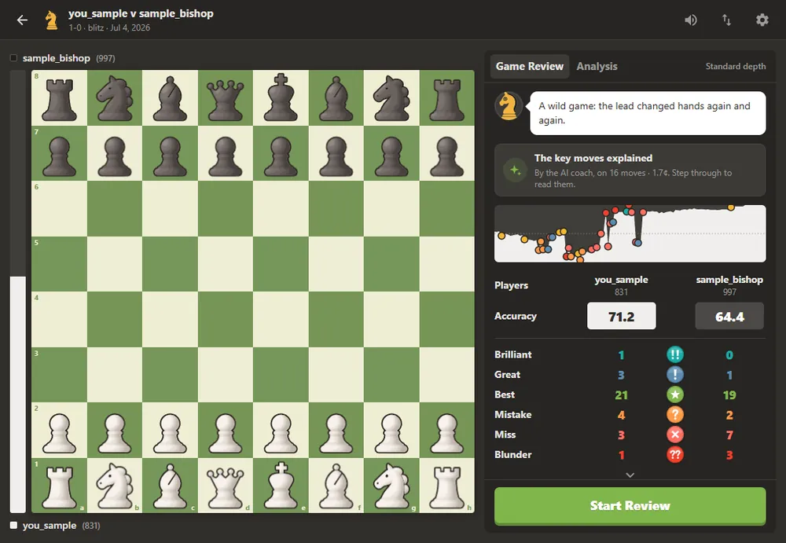
</p>
<p align="center"><b>Game Review.</b> Every key move gets its class and the reason in words:
here a brilliant rook sacrifice, the opponent's blunder, and a missed mate in one. Retry puts
you back in the position to find the move yourself.</p>

<table>
  <tr>
    <td width="50%" valign="top">
      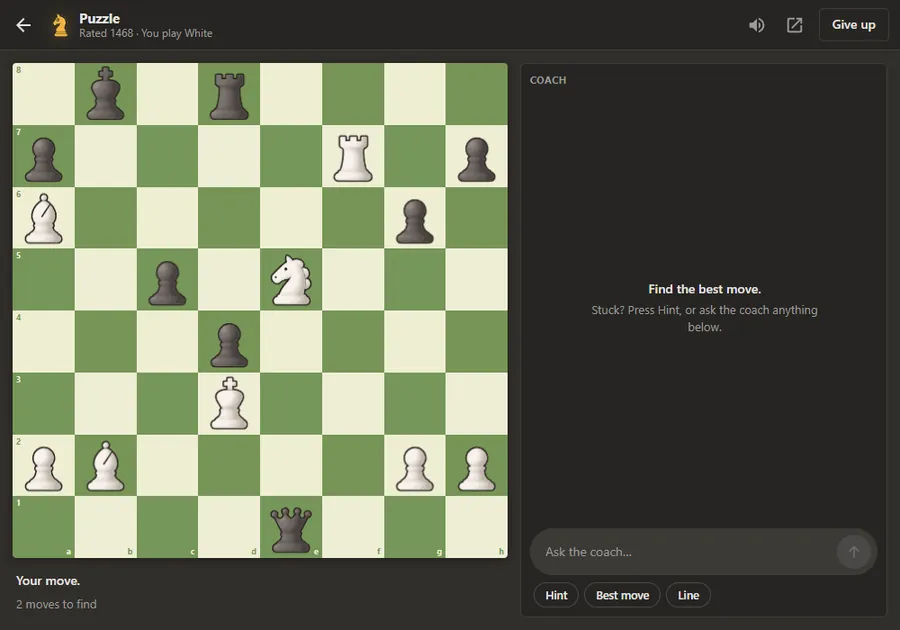
      <p><b>Puzzles for what you miss.</b> Lichess puzzles, picked for your weak spots and
      rated exactly the way Lichess rates them. Stuck? Hint, or ask the coach.</p>
    </td>
    <td width="50%" valign="top">
      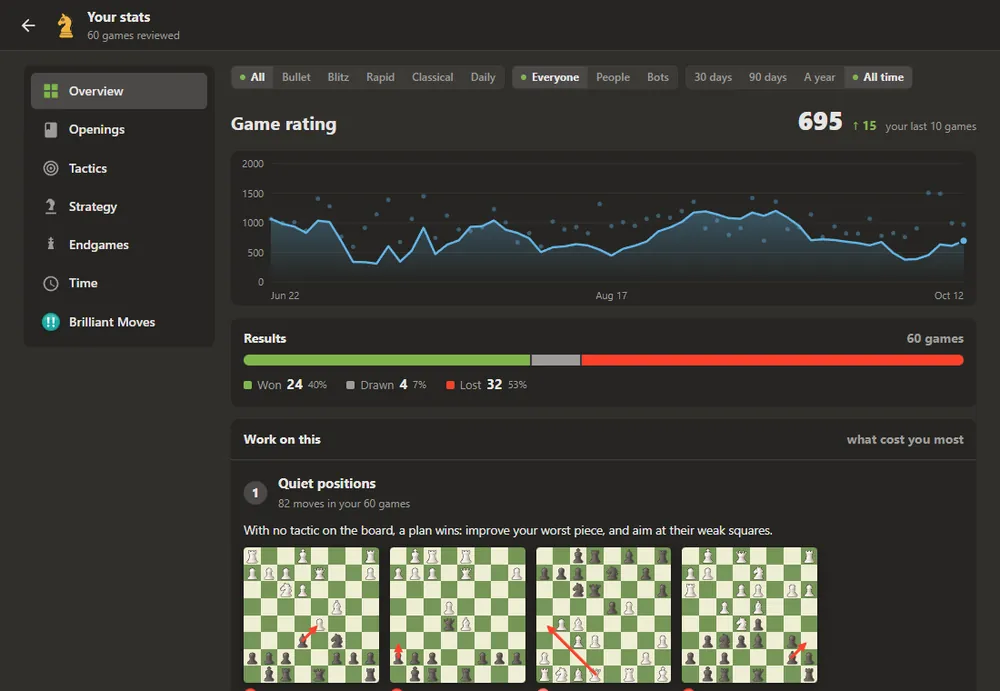
      <p><b>Stats.</b> Your openings, tactics, strategy and endgames across your games, set
      against players of your rating, with what to work on first.</p>
      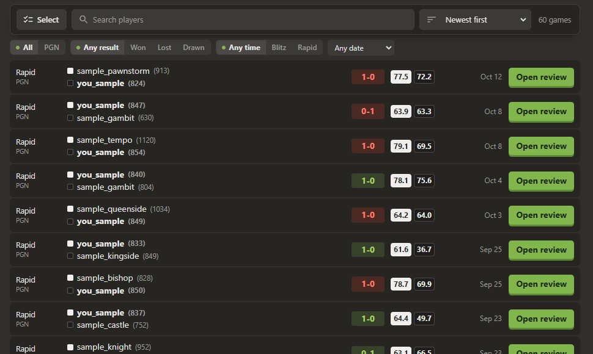
      <p><b>Your games.</b> Every game you play, and the ones you bring in, ready to review;
      on the desktop they are reviewed in the background as they come in.</p>
    </td>
  </tr>
</table>

<sub>The games, ratings and puzzles above are a sample player's, played by bots for these
pictures.</sub>

<table>
  <tr>
    <td width="50%" valign="top">
      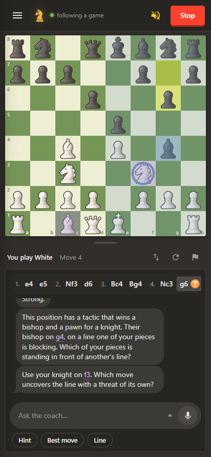
      <p><b>On your phone too.</b> The same coach on Android, over the chess app you play in:
      the board, the hints and the voice, all on the phone.</p>
    </td>
    <td width="50%" valign="top">
      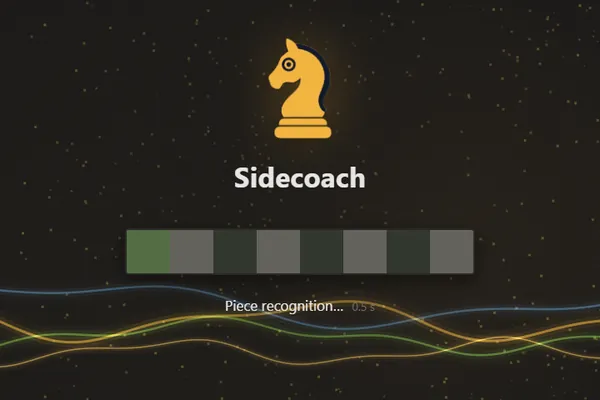
      <p><b>Ready in seconds.</b> Everything warms up at launch, so the first hint comes as
      fast as the hundredth.</p>
      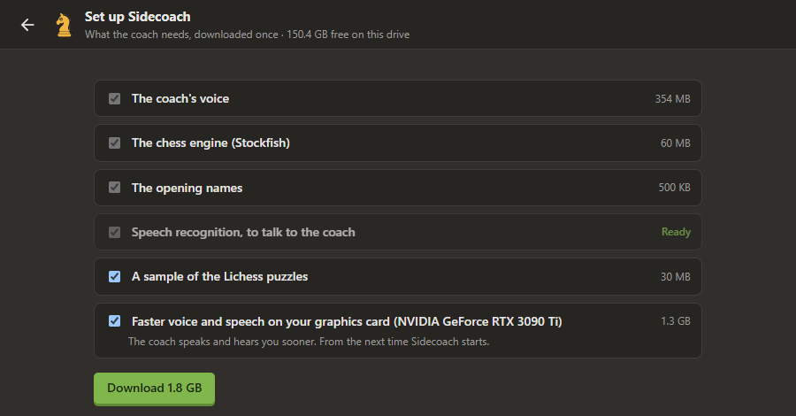
      <p><b>One setup step.</b> The first run downloads what the coach needs in one go, and
      offers the faster voice when your graphics card can run it.</p>
    </td>
  </tr>
</table>

## Measured, not claimed

Every figure below comes from the repository's own measurements, with the method beside it.

| | |
|---|---|
| Random games followed from start to end, over every board, piece set, size and decoration | **995 of 1000** ([sweeps](docs/known-issues.md)) |
| Games with premoves read move for move | **997 of 1000** |
| AI coach replies judged excellent, against the offline coach's | **.99** against .86, 298 replies on held-out games ([eval](docs/eval-results.md)) |
| Questions the AI coach answered | **165 of 166** |
| A first hint that gave away the answer's square | **1 in 15,003**, over 199 master games ([coach](docs/coach.md)) |
| Engine's first answer on a position | **under 1.9 s** on 8,886 real positions, one line to depth 18 in 0.19 s at the median ([design](DESIGN.md)) |
| A Game Review position stepped to | lines in **0.9-1.8 s** ([review](docs/game-review.md)) |

And what is not yet right, in the open: a hand check found a false claim of the model's own in
about 8-12% of AI replies, mostly when it explains a line, and the check on every draft stops
the ones it can name. What still fails to read, and why, is in
[known-issues.md](docs/known-issues.md).

## What it does

- **Reads the board from the screen.** A frozen pretrained network learns the pieces from one
  look at the start position; every later move is read from the pixels, through animations,
  drags, arrows, highlights and premoves. Takebacks are followed, a game joined in the middle,
  a puzzle or an analysis board is read cold, and the clocks are read too.
- **Analyses every move.** Stockfish and a motif tagger find the engine lines and the ideas
  (forks, pins, skewers, discovered attacks, loose pieces, passed pawns, plans), and each move
  gets the class players know from game reviews: brilliant, great, best, excellent, good,
  book, inaccuracy, mistake, miss, blunder ([how each is decided](docs/move-classification.md)).
  What a move costs is measured in expected score, never centipawns.
- **Coaches in steps.** Silent until you have thought for a while (45 seconds by default,
  sooner when your clock is short) or ask. After a mistake it says what the move allowed and
  what was better.
- **An AI coach, or a free offline one.** With a model (OpenAI, DashScope, one on your own
  machine through LM Studio, Ollama or vLLM, or any OpenAI-compatible service) the coach
  answers every question in its own words. It sees the whole analysis, and every draft is
  checked against the board: a false claim it can name is never shown. With no model, the
  coach speaks from the board and its templates, free and offline.
- **Speaks and listens.** A local voice (Kokoro) reads the coach aloud, notation included;
  local speech recognition (Parakeet) takes your questions, push-to-talk from any window or
  hands-free, matched against the legal moves on the board.
- **Game Review, Stats and puzzles.** Every game you play, and games you bring in from the
  sites you play on or as PGN, reviewed move by move with the coach. Stats rates your
  openings, tactics, strategy and endgames across games, and the coach picks Lichess puzzles
  for your weak spots, playable in the app, with a puzzle rating computed exactly as Lichess
  computes it (Glicko-2).
- **Records nothing unless you ask.** A few seconds of frames stay in memory, never on disk.
  API keys go to the operating system's credential store.

## How it works

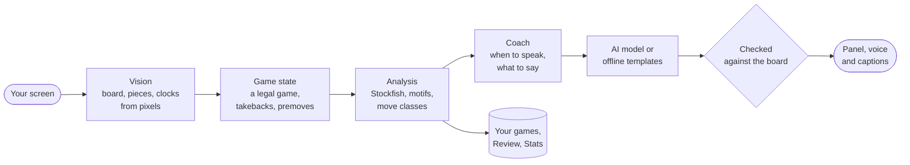

- **Pixels only.** No DOM reading, no browser automation, nothing installed in the site:
  each stage reads the one before through typed events (`src/sidecoach/events.py`).
- **One pipeline, two apps.** The desktop app is a Tauri 2 shell around the Python pipeline,
  which runs beside it behind a local HTTP API; the page is Svelte. The Android app is a
  one-to-one Kotlin port of the same pipeline, held to it by fixtures recorded from the
  Python, serving the same page from the phone.
- **The coach is a policy, then words.** Code decides when to speak and at which step; the
  model or the templates only word it, and the words are checked before anyone hears them.

## How we build it

**Tests prove logic, sweeps prove the eyes.** Every board in the test suite is drawn: real
piece sets, every theme and size, arrows, highlights, drags and dialogs. A seeded sweep plays
a thousand random games through the whole pipeline before each release, and each release is
compared seed by seed with the one before.

**Evals decide, not impressions.** The coach is judged on held-out games by a rubric checked
against human review, paired against the offline coach, with every change and its cost logged
in [docs/eval-results.md](docs/eval-results.md), regressions included.

**Decisions are written down.** [DESIGN.md](DESIGN.md) is the source of truth for scope and
architecture, with each choice and the measurement behind it; [docs/](docs/README.md) has a
document per part.

## Install

Download from the [latest release](https://github.com/ductai199x/sidecoach/releases/latest).

**Windows:** run `Sidecoach_<version>_x64-setup.exe`. It installs for your user and starts. The
installer is not code-signed yet, so Windows shows "Windows protected your PC" the first time:
*More info*, then *Run anyway*. The first run downloads what the coach needs (about 3 GB: the
voice, speech recognition, Stockfish, the opening names and a sample of the Lichess puzzles),
and with a suitable NVIDIA card offers the faster voice as well.

Then, in the app: **Settings → AI Coach** to pick a provider and paste its key, point it at a
model on your own machine, or choose *No model* for the free offline coach. Open the site you
play on, press **Start**, and play.

**Android:** install `Sidecoach_<version>_android.apk` from the same release (allow installs
from your browser or file manager), open it once, grant screen capture, and play in your chess
app. Building it yourself: [android/README.md](android/README.md).

<details>
<summary>Run from source</summary>

Python 3.12 and [uv](https://docs.astral.sh/uv/); an NVIDIA GPU is optional.

```sh
uv sync --all-groups                     # plain `uv sync` installs only the dev group
uv run python scripts/fetch_stockfish.py
uv run python scripts/fetch_openings.py
uv run sidecoach doctor                  # checks Python, vision, Stockfish, capture, voice, GPU
uv run sidecoach panel --monitor 1       # the panel at http://127.0.0.1:8765/
```

Copy `sidecoach.example.toml` to `sidecoach.toml` for the settings; API keys go in `.env` or
the settings page. `uv run sidecoach --help` lists every command (`watch`, `replay`, `review`,
`puzzles`, ...).

</details>

<details>
<summary>Build the desktop app</summary>

Rust (stable, MSVC), Node 24 and uv. One script builds the embedded Python, then the
installer:

```sh
uv run --no-sync python scripts/release_desktop.py             # sidecar + installer
uv run --no-sync python scripts/release_desktop.py --install   # and install it
uv run --no-sync python scripts/bump_version.py <version>      # one version, every platform
```

More in [desktop/README.md](desktop/README.md).

</details>

<details>
<summary>Development</summary>

```sh
uv run pytest tests/test_<what you changed>.py   # the files that import what you changed
uv run pytest tests/test_stress.py --seeds 1000 -n 8   # the vision sweep
uv run ruff check . && uv run ruff format .
uv run pyright
```

How to write a test, and the suite's budget: [docs/testing.md](docs/testing.md). Every
document, with when to read it: [docs/README.md](docs/README.md). The README's pictures are
made by `tools/media/` from the real app on a sample player's games.

</details>

## License

Copyright (C) 2026 Tai Duc Nguyen.

Sidecoach's code is licensed under the [GNU Affero General Public License v3.0](LICENSE): you
may use, study, change and share it, and if you distribute a modified version or run it as a
service, you must publish its source under the same license.

What it bundles keeps its own license: Stockfish (GPL-3.0), the piece-naming network
(Ultralytics YOLO26n-cls, AGPL-3.0), the voice (Kokoro, Apache-2.0), speech recognition
(Parakeet, CC-BY-4.0), espeak-ng on the phone (GPL-3.0), the Lichess puzzles and opening names
(CC0), and the Lichess piece sets, each under the license its author gave it
([desktop/static/pieces/LICENSE.txt](desktop/static/pieces/LICENSE.txt)).
