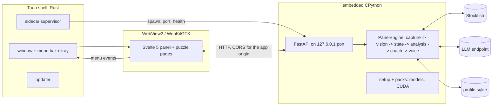

# Sidecoach as an application: the desktop shell, Linux, Android

Status: draft v0.1, 2026-09-21. Owner: Tai. This document plans the move from `sidecoach
panel` in a browser to installed applications: Windows first, Linux second, Android last.
DESIGN.md stays the source of truth for the pipeline; this file governs the shells, the
packaging and the order of work. Decisions are dated; change them by editing this file.
The evaluation behind the choices is summarised in Appendix A.

## 1. What is being decided, and what is not

Decided (2026-09-21), pending the spike in section 5:

- Desktop shell: **Tauri 2** (Rust, thin) hosting a **Svelte 5** frontend, with the existing
  Python pipeline running as a **sidecar** behind the HTTP API it already exposes
  (`sidecoach/ui/server.py`). Electron is the documented exit, reachable by swapping the
  shell only: nothing app-specific may live in the shell.
- The Python ships as an **embedded interpreter** (python-build-standalone plus a real
  `site-packages` installed by `uv`), not as a frozen PyInstaller binary.
- **CPU by default, CUDA as a pack** that the app fetches on its own when it finds an
  eligible NVIDIA GPU (section 7). The user never chooses a runtime; they see one download.
- Android is **a native Kotlin app around a `mediaProjection` foreground service**, written
  last, tested on the Pixel 10 Pro XL (Android 17). It shares no code with the desktop
  pipeline; it may reuse the Svelte puzzle page in a WebView (section 10).

Not decided, and settled by the spike: whether Tauri 2 on Windows meets the performance and
stability bar in section 4. If it does not, the same measurements are taken on an Electron
scaffold before choosing.

Why these, in one paragraph each:

- *Tauri over Electron.* On Windows both render with Chromium (WebView2 is preinstalled on
  Windows 11), so the panel renders as it did in Chrome either way; Tauri's shell is ~10 MB
  and idles at tens of MB, Electron's is ~150 MB and idles above 100 MB. The reasons teams
  went back to Electron in 2025-26 were bundling a Node daemon, Linux WebKitGTK rendering,
  and notification callbacks (Appendix A). Our daemon is Python either way, so Electron's
  bundled Node buys nothing here; the Linux risk is real and has three exits (Tauri 3's CEF
  runtime, Electron, or accepting WebKitGTK); notifications we do not use.
- *Embedded interpreter over PyInstaller.* onnxruntime's `preload_dlls()`, onnx-asr's
  Hugging Face cache and kokoro-onnx's file paths all assume a normal `site-packages`.
  A frozen bundle fights each; an embedded interpreter changes nothing about how the code
  runs, and `uv` stays the one tool.
- *CPU default.* The square classifier already runs on the CPU by design, Parakeet was
  chosen because it does ~100 ms on the CPU, Kokoro ran on the CPU before the CUDA recipe.
  The 1.3 GB of CUDA wheels are a latency improvement for the voice, not a requirement.
- *Native Android.* The Android app is mostly a background service (capture, vision,
  engine, voice) while the chess app is in front. A WebView does not run JavaScript in the
  background (Capacitor's own issues confirm listeners never fire once the app is swiped
  away), so the pipeline would be Kotlin in any shell; the native building blocks
  (onnxruntime-android, sherpa-onnx with Kokoro and Parakeet, official Stockfish Android
  builds, MediaProjection) are first-party or officially maintained, so nothing pushes
  towards a JS runtime in between. React Native's Headless JS is the one JS stack that
  fits the service model; it is the alternative if the port is to be TypeScript.

## 2. Architecture



Roles:

- **Shell** (Rust, target: under 300 lines). Owns the window, the native menu bar, the tray,
  always-on-top, window state, the updater, and the sidecar's life: spawn, read the port,
  wait for `/api/health`, load the UI, kill on exit. It knows nothing about chess.
- **Frontend** (Svelte 5 + Vite, TypeScript). One codebase, two hosts: bundled into the
  shell (`frontendDist`), and built into `src/sidecoach/ui/web/` so `sidecoach panel` in a
  browser and the server tests keep working. The menu bar is built from the frontend with
  Tauri's JS menu API (`Menu`, `Submenu`, `CheckMenuItem`, `PredefinedMenuItem`); in the
  browser host the same items render as an in-page menu.
- **Sidecar** (the package as it is, plus a setup module). Started with `--port 0`, prints
  one JSON line `{"port": N}` on stdout, serves the API and the static pages, exits when
  its parent dies. Owns every download (models, packs), the data directory, the settings
  file, and the GPU decision.

Process rules, decided:

- **Nothing of a session reaches the disk** (Tai, 2026-09-21, "very important"): the shell
  always launches the sidecar with `--no-persist --no-record`. No session folder, no
  `debug.jsonl`, no recording; the recent frames live in memory (`PanelEngine.frames`, a
  ring of JPEGs at half scale, under 40 MB) and are written only by File > Dump, on the
  user's own action. Recording stays a development tool of the CLI.

- **Everything loads when the app opens; Start and Stop only start and stop reading the
  screen** (Tai, 2026-09-21). The sidecar warms itself as soon as it serves: the piece
  net, the voice and speech recognition (loaded and primed with one inference each, so the first real
  one is 20 ms, not 750), Stockfish and the coach's second engine (one search of the start
  position each), the coach and its model (a server on this machine gets one short request,
  which is where LM Studio loads the model; a paid provider is never called), the
  session's modules and the vision's first pass. Measured 2026-09-21 on the 3090 Ti: 8.4 s
  from launch to everything primed, in the background, the window usable throughout. A
  Start that comes sooner waits for it. Stop keeps Stockfish and the coach for the next
  Start; only exit closes them, and the shell's hard kill leaves nothing behind (Stockfish
  exits on its closed stdin). The microphone test in the settings therefore needs no
  loading, and neither does the first move of a game. A splash screen covers it: the
  shell opens a frameless card (`splash` window, the `/splash` route) before the sidecar
  is spawned and keeps the main window hidden until the card says `splash_done`; the card
  polls `sidecar_status` for the port, then `/api/health`, whose `warm` field lists the
  eight stages (piece recognition, voice, speech recognition, microphone, board reading, Stockfish,
  coach, ready) -- drawn as White's first rank: each stage that finishes puts its piece on its
  square, rook on a1 to rook on h1, a failed stage's piece greyed. Behind it, the pieces
  of light (Tai's brief, 2026-09-21: pleasing, cool, and chess): two thousand points on a
  lathe profile form a king, turn slowly, blow apart hard, each point on its own path, and
  gather slowly as the next piece -- queen, rook, bishop, pawn -- about five seconds a
  piece, two per warm-up; low ribbons of light drift beneath them. Esc opens the window
  without waiting (unadvertised); a sidecar that fails shows why, with "Open anyway".
  Reopening from the tray shows no splash; `SIDECOACH_NO_SPLASH` skips it (the smoke
  test); `/splash?demo` in a browser fakes the stages for looking at the design. The
  window is exactly the card, undecorated, rounded and shadowed by Windows (a transparent
  webview showed its own dark backdrop, so no transparency).

- **The logo** (Tai, 2026-09-21): a knight in profile, amber (#F2B441) with a navy
  (#141A2A) mane stroke, whose eye is a camera lens -- it watches. Explored with
  gpt-image-2.5 (`tools/brand/logo_ideas.py`: 8 concepts x 2 at medium, then the pick four
  ways at high, $0.86 in all, every call on the usage ledger), the chosen render cleaned
  to two flat colours and traced (`tools/brand/vectorise.py`, vtracer spline mode, 7 paths)
  into `desktop/brand/logo.svg`; the icon set comes from `desktop/brand/icon-source.png`
  (the mark on a rounded tile a step lighter than the navy, so the mane shows) through
  `npm run tauri icon`. The renders themselves stay under `data/brand/`, uncommitted.

- The frontend is served from the shell's own origin (`http://tauri.localhost` on Windows,
  `tauri://localhost` on Linux) and calls the sidecar cross-origin; FastAPI allows exactly
  those origins. The webview is never pointed at the sidecar's URL in the product, because
  Tauri's JS APIs are only injected into the app's origin. (The spike does point at the
  sidecar's URL, with a `remote` capability, to measure the existing pages unchanged.)
- The sidecar is spawned with `CREATE_NO_WINDOW` on Windows, stdout piped, stderr to a log
  file under the data directory. It takes `--parent-pid` and exits within 5 s of the parent
  vanishing (psutil is already a panel dependency), so a crashed or killed shell never
  leaves an orphan; the shell also kills it on exit. One instance per data directory,
  guarded by a lock file with the port inside, so a second launch focuses the first.
- Ports are ephemeral. The browser flow keeps `--port 8765` as its default; the app never
  uses a fixed port.
- **Closing the window** (Tai, 2026-09-21) is a setting with two values: *quit* (the
  default: the window's close ends everything) and *keep running in the tray* (opted
  into: the close request hides the window, the sidecar keeps watching and the coach
  keeps talking, the tray icon by the clock brings the window back, the tray's Quit ends
  everything). The shell owns this; the sidecar
  never learns the window went away. The setting lives in the shell's own small config
  (`shell.json` in the app config dir) so the shell can honour it before the sidecar is up.
- **Delivery** (Tai, 2026-09-21) is one `Sidecoach-setup.exe`: Tauri's NSIS bundle, per
  user, no administrator prompt, launched when the install ends; its pre-install hook
  finds the same version already installed and launches that instead of installing
  again, so the same file serves as "install, or just run". A single-file portable that
  unpacks 250 MB of Python on every start is not worth its convenience; the installer is
  the portable thing.
- The API gets a per-launch bearer token, passed to the frontend by the shell, checked by
  FastAPI on every `/api` route; `--token ""` (the browser flow's default) turns it off.
  Cheap, and closes the "any local page can drive my coach" hole.

Repository layout:

```
desktop/
  ui/                 # Svelte 5 app: panel, puzzle page, settings, setup wizard
  src-tauri/          # the shell: Cargo project, tauri.conf.json, capabilities, icons
  resources/          # build output only (gitignored): python/, packs/
  package.json
scripts/build_sidecar.py   # python-build-standalone + uv pip install -> desktop/resources/python
scripts/build_pack.py      # the CUDA pack zip for a platform, with its manifest and hashes
src/sidecoach/ui/web/      # the frontend's build output for the browser host (committed)
src/sidecoach/setup/       # downloads, packs, GPU detection, first-run state (new)
```

Per-user paths (decided): data under `%LOCALAPPDATA%\Sidecoach\data` (Windows),
`$XDG_DATA_HOME/sidecoach` (Linux); the settings file beside it; the LLM key in the OS
credential store through `keyring`, with `.env` still honoured for development. The CLI
grows `--data-dir` and the environment variable `SIDECOACH_DATA_DIR`; `load_settings`
already honours `SIDECOACH_CONFIG`.

### 2.1 Where everything lives (audited 2026-09-21 on both platforms)

| What | Windows | Linux | Written by | Removed by |
|---|---|---|---|---|
| The app: `sidecoach(.exe)`, the embedded interpreter, the uninstaller | `%LOCALAPPDATA%\Sidecoach\` | `/usr/bin/sidecoach`, `/usr/lib/Sidecoach/python/`, the `.desktop` entry and icons under `/usr/share/` (the AppImage: nothing installed) | the installer / dpkg | the uninstaller / `apt remove`; nothing else is ever written there (the bytecode cache goes to the data folder, `-Xpycache_prefix`) |
| Data: the models (`models/hf`, `models/kokoro`), Stockfish (`tools/`), the openings, the CUDA pack (`packs/cuda/<n>`), the profile and puzzle databases, the theme cache, `pycache/`, `sidecar.log`, `panel.lock`, `dumps/` (File > Dump only) | `%LOCALAPPDATA%\dev.sidecoach.desktop\data\` | `~/.local/share/dev.sidecoach.desktop/data/` | the sidecar (first-run setup, sessions) | the person, by deleting the folder: the uninstaller keeps it on purpose (4.9 GB of downloads and the player's profile) |
| The webview's own storage and cache | `…\dev.sidecoach.desktop\EBWebView\` (WebView2) | `~/.local/share/dev.sidecoach.desktop/` beside `data/` (WebKitGTK: `WebKitCache`, `localstorage`, `storage`, …) | the webview | with the folder above |
| Settings: `sidecoach.toml` (the sidecar's), `shell.json` (closing, start with the system) | `%APPDATA%\dev.sidecoach.desktop\` | `~/.config/dev.sidecoach.desktop/` | the settings window | with the folder |
| API keys | the Windows Credential Manager | the Secret Service (a keyring daemon) | the settings window | the settings window ("clear") |
| Registry / desktop integration | the Uninstall key, the Start-menu and desktop shortcuts | the `.desktop` entry, the hicolor icons | the installer | the uninstaller (verified: gone after `/S`) |
| Development only, never by the app | `%TEMP%` scratch of the scripts, `~\sidecoach-packs` (the pack to publish), `~\sidecoach-recordings` | `~/sidecoach` (the clone), `~/packs`, `~/.cache/tauri` (the packer) | the scripts, me | me |

Nothing is written outside these places; the audit found two stale temp files and the pack
script's empty staging folder, all removed, and the script fixed.

## 3. The menu bar and the settings

Menus (decided; every item also reachable in the browser host):

| Menu | Items |
|---|---|
| File | Start / Stop watching; Open recording…; Replay at 1x / 3x / as fast as it goes; Quit |
| Game | Resigned; Won; Draw; Forget this game; Re-read the screen; Flip |
| View | check items: Board, Move list, Coach, Profile card, Practice card, Status strip, Terminal; Always on top; Reset layout |
| Voice | Mute; Listen: off / push-to-talk / voice activity; the voice picker |
| Data | Clear caches; Reset profile… (confirmed) |
| Debug | Terminal: verbose; Vision preview (the board as the pipeline sees it, with cells); Fact bundle (the last bundle the coach saw); Timing (the tick log, stalls); Dump the last frames; Open data folder; Open log |
| Help | Run doctor; Check for updates; About |

Settings: a second window (`/settings`) generated from the pydantic schema, plus the
shell's own two: what closing the window does (tray or quit), and start with Windows. `config.py`'s
field comments move into `Field(description=...)` so the form, the CLI help and the docs
share one source. `GET /api/settings` returns the settings and the schema; `PUT
/api/settings` validates, writes the TOML, applies what can be applied live, and returns
the fields that need a restart. Live: everything under `coach`, `llm` (the provider is
rebuilt at the next call), `voice.voice`, `voice.speed`, `voice.output_device`,
`voice.listen`, `capture.fps`. Restart: `voice.tts_device`, `voice.stt_device`,
`voice.stt_provider`, `capture.backend`, `data_dir`. A restart prompt appears only when no
game is in progress.

## 4. The bar the shell must clear

The spike (section 5) measures the existing panel and puzzle pages, unchanged, in the Tauri
window on Windows 11, and in Chrome `--app=` as the baseline the UI was built against.
Numbers are recorded in section 5.8 of this file, with the date and the build.

| Criterion | Target | How measured |
|---|---|---|
| Window visible after launch | ≤ 1.0 s (sidecar already warm) | stopwatch on a screen recording, 5 runs |
| Panel interactive, cold | ≤ 5 s from click to board on screen, sidecar start included | same |
| Frame rate under load | 60 fps sustained; long frames (> 50 ms) under 1% over 10 min | in-page `requestAnimationFrame` meter (`?perf=1`) during `panel --replay --speed 3` with the terminal open and verbose |
| Poll round trip | p95 ≤ 20 ms for `/api/poll` | the same meter, `performance.now()` around the fetch |
| Input latency | click to visible change ≤ 50 ms (menu open, chip press, board flip) | screen recording at 120 fps, 10 clicks |
| Idle resources, UI only | shell + webview processes no heavier than Chrome `--app=` on the same page (the 150 MB first written here was wrong: WebView2's browser, renderer, GPU and utility processes alone are ~400 MB for this page, as Chrome's are); CPU ≤ 5% of one core at p50 | `scripts/perf_sample.py`: psutil over the shell's process tree (WebView2's processes are its children; a sidecar the shell spawned is counted apart), 1 Hz, 10 min |
| Loaded resources, UI only | RSS no heavier than Chrome on the same replay; CPU p50 ≤ 10% of one core | same, during the replay at 3x |
| Leak | RSS growth under 20% over a 4 h looped replay | same |
| Lifecycle | 20 launch/quit cycles: no orphan `python.exe`, no port left bound; sleep/resume; DPI 100/125/150%; a second monitor; window state restored | scripted where possible, checklist otherwise |
| Rendering parity | the panel, the puzzle page, the arrows, the promotion picker, the menus look and behave as in Chrome | side-by-side, the puzzle page's manual checklist from 2026-09-20 |
| Native features | menu bar with working check items; tray; always on top; updater dry run against a local `latest.json` | done or not |

Reference points from the field (Appendix A): a Tauri overlay app measured 14 MB RSS on
Windows 11 for the shell process; single-window apps idle around 42 MB for Tauri against
168 MB for Electron 43. WebView2 adds its own processes to both numbers; the table above
counts them.

Go: every row met, or missed by a margin the frontend port will clearly close (a slow
DOM update in `app.js` is not a shell fault). No-go: a miss in frame rate, input latency,
leak or lifecycle that survives a day of investigation. On no-go, the Electron scaffold is
measured the same way before deciding; the sidecar and the frontend carry over unchanged.

## 5. Phase 0: the Windows spike

Goal: a Tauri window running the existing pages against the existing sidecar, measured
against section 4, with the menu bar and the sidecar lifecycle proven. No frontend port,
no packaging. Toolchain on this machine already meets the prerequisites (Rust 1.97.1
stable-msvc, VS Build Tools 2026, Windows SDK 10.0.26100, Node 24); `rustup update` first.

Steps, in order; each ends in a commit.

1. **Scaffold.** `npm create tauri-app@latest desktop -- --template svelte-ts`; Vite,
   Svelte 5, TypeScript. Confirm `tauri dev` opens a window. Add `desktop/` to the ruff
   and pyright excludes.
2. **Point at the panel.** `uv run --no-sync sidecoach panel --port 8799 --replay <rec>
   --speed 3` in one terminal; the window's URL set to `http://127.0.0.1:8799/` with a
   `remote` capability for that origin. The unchanged panel renders in WebView2. Note every
   visual difference from Chrome.
3. **Instrument.** In `app.js`, behind `?perf=1`: a `requestAnimationFrame` meter (fps,
   frames over 50 ms, poll round-trip p50/p95) shown in the status strip and exposed on
   `window.__perf` for scripts. `scripts/perf_sample.py`: sample RSS and CPU of a PID's
   process tree at 1 Hz to CSV, print p50/p95/max and the growth over the run. Same two
   tools serve Chrome `--app=` and, if needed, Electron.
4. **Measure.** The table in section 4, Tauri and Chrome side by side: idle 10 min, loaded
   10 min (replay at 3x, verbose terminal), the puzzle page with arrows and the promotion
   picker. Record in section 5.8.
5. **Menu bar.** Built from JS with `@tauri-apps/api/menu`: the View check items toggle
   the existing panes (`hidden` on the DOM nodes), Data calls the existing endpoints, Game
   the outcomes, Voice the mute. Tray icon with Show / Quit. Always on top.
6. **Sidecar lifecycle.** The shell spawns `uv run --no-sync sidecoach panel --port 0
   --parent-pid <pid>` (the embedded interpreter comes in Phase 1), parses the port line,
   waits for `/api/health`, navigates. New in Python: `--port 0` and the port line,
   `--parent-pid` with the watchdog, the lock file. Kill on quit. Twenty launch/quit
   cycles with `Get-Process python` between them.
7. **Soak.** The 4 h looped replay; sleep/resume; DPI change; unplug the second monitor;
   the machine's own game in a browser beside the window (the panel's self-exclusion rect
   must still keep vision off the panel's board).
8. **Decision.** Fill the table, write the go/no-go here with the date. On go, Phase 1.
   On no-go, a one-day Electron scaffold measured with the same tools, then the decision.

### 5.8 Measurements

2026-09-21, this machine (Ryzen 9 9900X, RTX 3090 Ti, 144 Hz 2560x1440 monitor, Windows 11
26200), Tauri 2.11 debug build of the shell, WebView2 on Chromium 153, Chrome 153 `--app=`
as the baseline, the unchanged panel on both, the sidecar fed `g04-antonio-takebacks` at
3x with the local LLM and no voice models. UI figures are the shell and its webview
processes only. Raw runs under `data/perf/`.

| | Tauri, idle | Chrome, idle | Tauri, loaded | Chrome, loaded |
|---|---|---|---|---|
| RSS p50 / p95 / max (MB) | 474 / 475 / 476 | 578 / 628 / 796 | 487 / 492 / 493 | 548 / 659 / 723 |
| RSS growth over the run | +1.4% (10 min) | -11% | +2.9% (5 min) | +12% |
| CPU p50 / p95 / max (% of a core) | 3.0 / 9.2 / 15 | 3.0 / 9.2 / 43 | 6.1 / 34 / 49 | 4.6 / 32 / 60 |
| page fps mean / min | not measured | not measured | 144 / 144 | 142 / 4.5 |
| long frames (> 50 ms) | | | 0 of 58,930 | 1 of 41,293 |
| poll round trip p50 / p95 | | | 3 / 7 ms | 3 / 6 ms |

The periodic CPU bursts (every ~35 s, 25-50% for a few seconds) appear identically in
Chrome, so they belong to the page under polling (Chromium's memory reducer), not to the
shell; the Svelte port re-measures them. Per process at idle: WebView2 browser 134 MB,
renderer 121 MB, GPU 86 MB, two utilities 63 MB, crashpad 14 MB, the debug shell 58 MB.

Lifecycle (`scripts/shell_cycles.ps1`, 20 cycles alternating a window close and a forced
kill of the shell): 20/20 healthy, the sidecar answering `/api/health` 1.6 s after launch
at the median (`uv run` included), 20/20 clean, nothing left within 3.2 s of the quit
either way (the close through the shell's exit path, the kill through the sidecar's
parent watchdog). Launching a second shell against a running sidecar attaches through
the lock file (seen once by accident when `tauri dev` rebuilt itself mid-run).

Rendering parity: the panel, its overlay, the move list, the coach messages, the status
strip and the terminal render as in Chrome (screenshots compared); the menu bar (File,
Game, View, Voice, Data, Debug, Help) is native, its check items toggle the panes and
survive a reload, the tray icon appears. Not yet exercised: sleep/resume, a DPI change,
a monitor unplugged, the puzzle page's promotion picker in the shell.

The installed app (the NSIS build, per user, 2026-09-21): the sidecar answers 3.6 s after
launch from the embedded interpreter; closing the window hides it to the tray and a second
launch (the shortcut, or the setup file run again) shows it; close set to quit stops
everything in 0.8 s; a killed shell takes the sidecar with it in 1.3 s; no lock file left
on any path; the uninstaller keeps the data directory. Three things only the installed
build showed, each fixed in 62d3e4e: a window built from a synchronous Tauri command comes
up white on Windows (the webview's creation completes through the main thread's message
loop, which the command holds) -- `open_window` is async; the NSIS hooks file is included
before the template's defines, so its install-or-run check reads the versions from the
files at run time and runs at MUI's GUI init; and a second launch made a second shell over
the same sidecar -- the single-instance plugin.

Soak (the shell.js page, before the port): a looped replay at 3x, stopped at 1 h 42 min.
The page held 144 fps throughout; the UI's RSS grew 43%, all of it the terminal's DOM,
which had no cap. The Svelte terminal keeps at most 4000 rows.

Soak of the Svelte page (2026-09-21, the release exe with the embedded interpreter, the
bundled page with its meter on, g04 looped at 3x with Stockfish and the offline coach, two
hours, `data/perf/svelte-soak.*`): fps mean 139.8, min 118.7, 289 long frames of 1.05 M
(0.03%); poll p50 5 ms, p95 17 ms; the sidecar flat at 2.13 GB (p50; Stockfish and the
embedding net on CUDA included) at 480% of a core; the UI tree 519 MB once loaded, 766 MB
in the last minute (+48%), 781 MB at most -- the WebView2 renderer, 121 MB at the spike's
idle, at 326 MB after 76 minutes, the other processes unchanged. The page's own lists were
not all bounded (the coach pane and the conversation tab rendered every item since
launch); both are capped now (200 items, 400 turns) and the meter reports the JS heap,
the DOM's size and the lists, so the next soak says whether the growth is the page's or
Chromium's own.

That soak (40 minutes, same setup, `data/perf/svelte-soak2.*`): the renderer's memory
tracks the DOM, and the DOM tracks the terminal's rows -- 4000 rows are 25.8 k nodes; the
RSS climbs with them (522 MB at 5 min, 646 at 25) and levels once the cap is reached at
23 minutes (624, 644, 656 MB over the last fifteen), the JS heap between 40 and 60 MB the
whole way, fps mean 142.1, min 127.3, 6 long frames of 349 k, poll p50 4 ms. So the
two-hour climb was the two unbounded lists and the 4000-row terminal, not a leak. The
terminal now keeps 1500 rows (about 10 k nodes; the sidecar's ring and a dump keep the
3,000), for a steady state near 550 MB with everything drawn.

**Decision (2026-09-21, Tai): go.** Tauri renders the page as Chrome does, lighter and
flatter in memory, with the sidecar lifecycle proven. Phase 1 proceeds.

## 6. Phase 1: the Windows prototype

Goal: an installer a second Windows machine can run: download, first run, watch a game,
update. Steps in order; each is a commit and, where it touches Python, tests.

Status (2026-09-21, commits f4b2009, 3a6d422, b4db009): steps 1 to 8 and 10 are built;
1 to 6 verified end to end on this machine (a clean data dir, the setup downloading
4 GB in about a minute, the pack activated: the embedding net, Kokoro and Parakeet on
CUDA from the CPU-only interpreter). Step 7's installer is built (87 MB) and being
install-tested; step 8's updater is wired and unexercised until a release exists; step 9
is dropped (below); step 10's workflow runs on the next push. Three decisions taken
along the way:

- **No model is a supported mode.** `llm.provider = "none"` gives an offline provider;
  the coach speaks from the board and its templates (verdicts, the mistake lesson, the
  decisive question, the stuck hints, the review), with claims and the verifier off. The
  app is free and offline when the player wants that. The templates were read through
  eight play-throughs (real games and masters', both colours) and fixed where they read
  wrong; the coach also falls back to this mode when the configured provider cannot be
  reached.
- **No Authenticode signing.** Tai has no Azure account and does not intend to get one
  (2026-09-21); no other signing service is on the table either. The installer ships
  unsigned: a downloaded setup shows SmartScreen's "Windows protected your PC -- More
  info -- Run anyway" on first run, and that is documented in the README. The updater's
  own signature (minisign, `~/.tauri/sidecoach.key`) is what verifies an update, and that
  stays. Revisit only if distribution widens beyond people who know the project.
- **The app records nothing.** The shell always passes `--no-persist --no-record`; the
  only frames kept are the in-memory ring (`FrameRing`, 150 half-scale JPEGs) that
  `File > Dump` writes on request. Recording stays a CLI affair for development.

1. **Frontend port.** `desktop/ui` in Svelte 5: the panel (Board with the overlay,
   Moves, Coach with the pinned message and hover marks, ProfileCard, PracticeCard,
   StatusStrip, Terminal with its filters, the header as menus), the puzzle page (the
   board manners of 2026-09-20 kept exactly, or chessground if it matches them), the
   settings window, the setup wizard. State: one `$state` store fed by `/api/poll` at
   250 ms, unchanged contract. Build output copied to `src/sidecoach/ui/web/`; the server
   tests and the Chrome checklist pass on the built output. The old `app.js` and
   `puzzle.js` are deleted in the same commit that makes the tests pass on the new build.
2. **Settings.** `Field(description=...)` throughout `config.py`; `GET/PUT /api/settings`
   with the live/restart map of section 3; the settings window; the menu bar complete.
3. **Paths.** `--data-dir` / `SIDECOACH_DATA_DIR`; the per-user defaults; `keyring` for
   the LLM key with `.env` still honoured; `doctor` reports both; the recordings, sessions,
   themes, puzzles and profile all under the data directory (they already are, relative
   to `data_dir`).
4. **First-run setup.** `sidecoach/setup/`: a manifest of what the app needs (Kokoro,
   Parakeet at the shipped precision, Silero, Stockfish, the openings tables, the puzzle
   sample) with URLs, sizes and SHA-256; resumable downloads with progress over
   `/api/setup/status`; the wizard page shows one list, one progress bar, the GPU line of
   section 7, and finishes with `doctor`'s checks. Re-runnable from Help.
5. **Embedded interpreter.** `scripts/build_sidecar.py`: fetch python-build-standalone
   3.12 (`install_only_stripped`, `x86_64-pc-windows-msvc`), `uv pip install` the package
   with the `panel` and `voice` groups but the CPU `onnxruntime` in place of
   `onnxruntime-gpu` and without the nvidia wheels, prune `__pycache__`, tests and docs,
   report the size (target under 250 MB). Tauri `bundle.resources` carries it; the shell
   spawns `resources/python/python.exe -m sidecoach ...`. The pyproject's
   `override-dependencies` trick is reproduced by the script's explicit wheel list.
6. **CUDA pack.** `scripts/build_pack.py` and the runtime loader of section 7. Verified on
   this machine (pack present, CUDA used, the voice's device shown in the strip) and on
   a machine without NVIDIA (no prompt, CPU, nothing downloaded).
7. **Installer.** NSIS, per-user, the WebView2 bootstrapper with the offline installer as
   the fallback (one Windows 10 report of the bootstrapper failing, Appendix A); icons;
   `tauri build`. Installed and run on a clean Windows account and, if available, a VM.
8. **Updater.** `tauri-plugin-updater` against a `latest.json` on the GitHub release,
   signed with the updater key; the Python resource rides along in the full installer.
   Check for updates in Help and once a day.
9. **Signing.** Dropped: no signing account (see the decision above). The setup file is
   unsigned; the README says what SmartScreen shows.
10. **CI.** GitHub Actions on `windows-latest`: `uv run pytest`, `pyright`, `ruff`, the
    Svelte build, `build_sidecar.py`, `tauri build`, the WebDriver smoke test
    (`tauri-driver`: launch, replay, a board appears, quit, no orphan), the installer as
    an artifact on every tag.

## 7. The CUDA pack: automatic and unobtrusive

The rule: the user sees one download at first run and never a runtime choice. Decided
2026-09-21.

Detection (sidecar, at every start, under 100 ms): an NVIDIA GPU through `nvidia-ml-py`
(already in the environment) or `nvidia-smi`, the driver version, the VRAM. Eligible means
a driver at or above the CUDA 13 minimum (the R580 branch; the exact number goes in the
manifest with the pack) and at least 4 GB of VRAM.

States, `gpu.mode` in settings: `auto` (default), `cpu`, `cuda`.

- `auto`, eligible, pack absent, first run: the setup wizard's list has one more line,
  "GPU acceleration for the voice (1.3 GB), NVIDIA RTX 3090 Ti found", ticked. One
  progress bar for everything.
- `auto`, eligible, pack absent, later (a new GPU, or "Not now" at first run): the app runs
  on the CPU immediately; one toast in the panel, "NVIDIA GPU found: download GPU
  acceleration (1.3 GB)? Download / Not now / Never". The download runs in the sidecar
  with progress in the status strip; on completion, "GPU acceleration ready; used from the
  next start" with a Restart button when no game is in progress (the voice models are
  loaded once per session, per `VoiceSettings`). "Never" sets `gpu.mode = cpu`.
- `auto`, pack present: CUDA is tried for the models whose device is `cuda`; if the
  provider fails to initialise (driver too old, a DLL mismatch), the model falls back to
  the CPU, one warning line goes to the terminal, the strip's device shows `cpu (cuda
  failed: …)`, and nothing blocks. Three failures in a row disable the pack until the
  next update of it.
- `cpu`: nothing is detected, nothing is downloaded, nothing is prompted.
- `cuda`: as `auto` but a failure is an error line rather than a silent fallback.

The pack itself: a zip per platform built by `scripts/build_pack.py` (onnxruntime-gpu and
the nvidia wheels at the pins of `pyproject.toml`, installed into a scratch environment,
zipped), published as a release asset with its manifest (versions, size, SHA-256, minimum
driver). At runtime the sidecar unzips it to `<data>/packs/cuda/<version>/` and, when
enabled, adds that directory with `site.addsitedir` ahead of the base `site-packages`
before importing onnxruntime, and calls `onnxruntime.preload_dlls(directory=…)` pointed at
it. The base environment is never modified: removing the pack is deleting a folder;
upgrading is fetching the next one. Settings > Performance shows the pack's state and a
Remove button; the strip keeps showing the device per model as it does today.

Linux: the same, with the linux wheels, and the driver check through the same tools.

## 8. Phase 2: Linux, through WSL first

What WSL2 with WSLg can prove: the shell builds and runs on WebKitGTK, the sidecar runs on
Linux, the replay-fed pipeline, audio out (WSLg's PulseAudio), CUDA on Linux (the driver
passes through; `onnxruntime-gpu`'s linux wheels), the AppImage and the .deb install and
start. What it cannot: capturing the Windows desktop (WSLg's compositor sees only Linux
windows), a global hotkey, and anything about a real distribution's WebKitGTK version. The
capture backend and the final rendering verdict need a real Linux desktop: a spare
machine, or a VM with a browser inside running chess.com.

1. **Environment.** WSL2 Ubuntu 24.04 with WSLg; `libwebkit2gtk-4.1-dev` and the rest of
   Tauri's Linux prerequisites; Rust; `uv sync`; the CUDA driver passthrough checked by
   `doctor`. Build the shell in WSL.
2. **Rendering.** The section 4 table again on WebKitGTK, replay-fed, with the frontend
   port from Phase 1. Known risks from the field: 40 fps reports, CSS differences, WASM
   instability. Record the numbers here.
3. **Decision on the Linux webview.** WebKitGTK meets the bar: ship on it. It does not:
   spike Tauri 3's CEF runtime (alpha since 2026-09-13; Readest ships its Linux build on
   it; ~170 MB more) on the same branch, or the Electron shell. The frontend and the
   sidecar are unchanged in every case.
4. **Interpreter and packs for Linux.** `build_sidecar.py` for `x86_64-unknown-linux-gnu`;
   the CUDA pack for Linux; AppImage and .deb through `tauri build`; the updater on Linux.
5. **Capture on a real desktop.** `capture.backend = portal`: the xdg-desktop-portal
   ScreenCast path over PipeWire (`pipewire-capture` on PyPI is a starting point: MIT,
   alpha, window picker, BGRA numpy frames), monitor capture where the portal offers it,
   `mss` kept for X11. The portal asks the user once per session which window or screen;
   the app remembers nothing it is not allowed to.
6. **Push-to-talk on Linux.** X11: pynput as today. Wayland: no global key; the panel's
   own button and the voice-activity mode carry it. `doctor` says which.
7. **Test matrix.** Ubuntu 24.04 (GNOME, Wayland) and one KDE Plasma image in a VM; the
   WebDriver smoke test on Linux in CI (`ubuntu-latest` has WebKitGTK).

Log, 2026-09-21 (step 1, WSL2 Ubuntu 24.04 with WSLg, the 3090 Ti passed through):

- The sidecar runs on Linux as it stands: `uv sync` (clang for `evdev`, pynput's Linux
  dependency, since the managed CPython carries a clang flag gcc rejects), the doctor,
  and the whole suite -- 1006 passed, 4 skipped, 106 s on the CPU. CUDA through
  `onnxruntime-gpu` 1.30 (the nvidia wheels): the piece net, Kokoro (1.3 s) and Parakeet
  (1.2 s; the test clip in 82 then 21 ms) on the GPU; the microphone through WSLg's
  audio. The panel replay-fed follows a recorded game with everything warm.
- Found and fixed: the Stockfish fetch script took the Windows zip on any platform, the
  finder saw only `stockfish*.exe`, and Stockfish 19 had renamed its Linux assets
  (`stockfish-linux-x86-64-universal.tar.gz`), so the app's first-run download would
  have failed on Linux; one chooser serves the setup and the script (48e0415).
  `build_sidecar.py` knew only Windows' layout; it now makes `bin/python3` +
  `lib/python3.12/`, with `opencv-python-headless` (the Linux opencv wheel bundles Qt
  and GTK, 116 MB) and libpython stripped (207 MB of debug info to 37): 474 MB.
- Capture under WSLg fails as expected (the X root refuses `GetImage`); waits for a real
  desktop. Bundle targets: AppImage first (Tai), the .deb alongside.
- The AppImage (254 MB) builds and runs under WSLg: the splash renders on WebKitGTK (the
  pieces of light, the rank filling), every warm-up stage completes on the CPU (Parakeet's
  CPU load is the slow one, 48 s), the main window comes up with GTK's menu bar and the
  panel as on Windows. Two things stood in the way. (1) Tauri fetches the `continuous`
  build of `linuxdeploy-plugin-appimage`, whose 2026-09 AppImage runtime cannot start on
  WSL2's 5.15 kernel ("execv error"), and linuxdeploy probes every `linuxdeploy-plugin-*`
  file beside itself, so that one crash killed the packer with "subprocess failed (exit
  code 127)"; the 1-alpha-20230713-1 release in `~/.cache/tauri/` in its place works
  (and nothing else may sit in that directory under a plugin-like name). AppImageLauncher,
  if installed, intercepts the packer too: `APPIMAGELAUNCHER_DISABLE=1`. (2) The
  AppImage's launcher exports PYTHONHOME and PYTHONPATH for any Python inside; the
  embedded interpreter died before its first import until the shell ran it isolated
  (`python -I`, the two variables scrubbed) -- the right thing on every platform
  (0993be5). WSLg's compositor frames the undecorated splash window; a desktop with
  decoration support will not.
- Step 2, rendering on WebKitGTK (the AppImage under WSLg, replay-fed at 1x, the page's
  own meter, 3 min after the warm-up): 62 fps median (WSLg's compositor is vsync-capped
  at 60; WebView2 ran uncapped at 140), one 5 s window at 43; long frames 0.32 % (bar:
  under 1 %); poll p50 4 ms; poll p95 54 ms median, 101 max -- over the bar's 20 ms, but
  the sidecar was CPU-bound (Stockfish, the vision and the coach on the CPU, no CUDA pack
  yet), so that is the server's stall, not the page's; to re-measure with the GPU pack
  and at 3x with the terminal open, as the bar says. The DOM stayed bounded (1,944 nodes,
  219 rows). Menus native GTK, the panel as on Windows.
- Step 4, the CUDA pack for Linux (2026-09-21 evening): `build_pack.py` on the Linux box
  makes `cuda-linux-x86_64-v1.zip` (1.69 GB, 537 files) and its manifest; served from a
  folder (`SIDECOACH_PACK_URL=file://...`), the AppImage's setup detects the 3090 Ti
  (driver 616.56, eligible), fetches and installs the pack, and after a restart every
  model reports `cuda` -- net 1.5 s, Kokoro 3.3, Parakeet 9.4, all eight stages by 11.4 s,
  the same shape as Windows. The poll p95 did not move with the GPU (53 ms); polled from
  outside the webview the sidecar answers at p50 2 / p95 4 / max 18 ms, so the stall is
  WebKitGTK's under WSLg, which paints in software here (`/dev/dri/renderD128` is
  root:render and the user is in neither group). To re-measure with the groups set, and
  on a real desktop.
- Step 3, the decision: WebKitGTK meets the bar on what it controls; ship on it. No CEF
  spike. Open on a real desktop: the tray registered twice on D-Bus (a warning), WebKitGTK
  wants a GStreamer `appsink` (media in the page, which we have none of), the frameless
  splash under a compositor with decoration support.

## 9. Phase 3: Android, on the Pixel 10 Pro XL

The product on the phone: open the app once, grant screen capture, switch to the chess
app and play; the coach speaks. The app's own screens (puzzles, notes, reviews, settings)
are opened occasionally, on Android 17 through the system's bubble for any app (the June
2026 Pixel Drop), elsewhere through the app's own bubble from the Bubbles API.

Platform rules the design obeys (2026): a `mediaProjection` foreground service with a
notification; consent before every session (a fresh capture intent, one virtual display
per projection), the status-bar chip, auto-stop on lock; no start from `BOOT_COMPLETED`;
no 6-hour cap for this type; battery optimisation off for the app, by the user; native
libraries 16 KB-page-aligned and read-only when loaded (Android 17); developer verification
for installs (the free 20-device account for our own phones until a verified account
exists).

1. **Repository.** `sidecoach-android`: Kotlin, Compose, Gradle; `minSdk` 33, target the
   current API; modules `service`, `vision`, `chess`, `analysis`, `coach`, `profile`,
   `ui`. The Python package's test fixtures (sprite sheets, the committed crops) are
   copied in for instrumented tests.
2. **Spike A, capture.** The foreground service with MediaProjection into an
   `ImageReader` at a quarter of the screen's size, 2 fps; thirty minutes with chess.com in
   front; log the frame interval, the service's CPU, the battery drain and the thermal
   state. The bubble on Android 17; the Bubbles-API fallback.
3. **Spike B, the building blocks.** onnxruntime-android with the 6 MB embedder (time for
   64 crops; NNAPI vs XNNPACK); sherpa-onnx's Kokoro (time to first audio for a
   two-sentence line) and Parakeet (a 3 s utterance); Stockfish's official Android build
   under the NDK at two and four threads, movetime 300 ms; all four at once for thirty
   minutes, with the thermal state logged.
4. **Port, in pipeline order,** each module with parity tests against the Python
   package's fixtures: chess (a Kotlin chess library for the rules; the reconciler's own
   logic ported), vision (board detection, the theme cache, the embedder matcher, the clock
   and badge readers), state (`reconcile`, `pipeline`), analysis (the engine wrapper,
   expected score, motifs, positional ideas, openings), coach (facts, disclosure, claims,
   the conversation, verdicts, the prompt; the LLM over OkHttp with the same usage ledger),
   profile (Room over the same schema). Recordings of the phone's own screen, made by the
   service, become the phone corpus; the desktop recordings do not transfer (the app draws
   its board differently), the synthetic renderer does.
5. **UI.** Compose: Home (start, stop, status, the last words), Settings, Reviews, Notes;
   Puzzles as the Svelte puzzle page in a WebView served from assets, or a Compose board
   if the WebView's touch behaviour disappoints.
6. **Distribution.** The limited-distribution account for the Pixel; a verified account
   before anyone else installs.

React Native with Headless JS remains the alternative if the port is to be TypeScript
rather than Kotlin; the native modules (MediaProjection, onnxruntime-react-native,
react-native-sherpa-onnx, a Stockfish module) are needed just the same.

### 6.1 Development hooks

Environment variables the shell reads, none of them for the product: `SIDECOACH_PYTHON`
(an interpreter to run instead of the bundled one; with it the data dir is the per-user
one), `SIDECOACH_DATA_DIR` and `SIDECOACH_CONFIG` (the sidecar's, passed through),
`SIDECOACH_SIDECAR_ARGS` (extra arguments: a replay, a config), `SIDECOACH_PAGE_PERF=<label>`
(the bundled page with its meter on, samples to `<data>/perf/<label>.jsonl`),
`SIDECOACH_PAGE_QUERY` (the main window pointed at the sidecar-served page instead),
`SIDECOACH_OPEN_WINDOW=<route>` (a second window at start: `settings`, `setup`,
`puzzle/<id>`), `SIDECOACH_PAGE_TRACE` (every asset a secondary window asks for, and the
resolver's answer, in `<data>/shell-trace.log`), `SIDECOACH_PACK_URL` (the CUDA pack's
manifest, `file://` for a local build). A page's own uncaught errors reach the panel's
terminal (`sys`) through `POST /api/client_log`, always.

## 10. Risks and exits

| Risk | Signal | Exit |
|---|---|---|
| Tauri misses the bar on Windows | section 4 table | Electron shell, same frontend, same sidecar |
| WebKitGTK misrenders or stutters on Linux | Phase 2 step 2 | Tauri 3 CEF runtime, or Electron |
| Sidecar orphaned, port clash, console flash | Phase 0 step 6 | parent watchdog, lock file, `CREATE_NO_WINDOW`; all three are in the plan |
| `preload_dlls` does not see the pack directory | Phase 1 step 6 | `preload_dlls(directory=)`; the pack's own loader as the last resort |
| WebView2 bootstrap fails on an old Windows 10 | Phase 1 step 7 | offline installer embedded |
| Tauri 3 lands mid-way | release notes | the shell is small; migrate when 3.0 is stable |
| A window that works under `tauri dev` and not installed | only the installed build shows it (the dev server served `/settings`; the bundle's asset protocol and a sync command did not) | every window route opened from the installed build before a release, `SIDECOACH_OPEN_WINDOW` and `SIDECOACH_PAGE_TRACE` |
| Wayland: no capture, no hotkey, no click-through overlay | Phase 2 | portal capture; in-app PTT; the overlay milestone (M8) stays Windows-first |
| Phone thermal load with everything on | Phase 3 spike B | lower fps, smaller Parakeet, Android's TTS as the fallback voice |
| Verification and Play policy | 2027 global | verified account; the consent flow documented in the listing |

## 11. Open questions

- Polling or server-sent events for the frontend: polling stays for the port; SSE is a
  later change if the 250 ms poll shows in the profile.
- Which Parakeet precision ships in the manifest (int8 at ~600 MB or fp32 at 2.4 GB), decided
  by a WER check on the chess-correction set.
- Whether the puzzle page moves to chessground now (the library lichess's mobile UI uses,
  with touch handled) or after the port, once its manners are matched against the
  2026-09-20 checklist.
- The overlay (M8) as a second, click-through Tauri window on Windows: after Phase 1.

## Appendix A: the evidence, in brief (read 2026-09-21)

- Field reports that moved from Tauri to Electron, and why: Paseo (May 2026; a Node
  daemon as a sidecar, WebKitGTK layout differences, notification clicks;
  https://paseo.sh/blog/i-was-wrong-about-electron); yojo (HN, May 2025; rendering
  differences, cryptic errors migrating to 2.0; https://news.ycombinator.com/item?id=44118251);
  Caido as quoted on HN ("webviews on OS are garbage 25-35% of the time";
  https://news.ycombinator.com/item?id=43652476); DoltHub stayed on Electron for want of
  .appx, macOS signing and a Node sidecar, while finding webview incompatibilities
  "exceedingly rare" (https://www.dolthub.com/blog/2025-11-13-electron-vs-tauri/).
- Shipped on Tauri: Readest, whose Linux build moved to Tauri's CEF runtime on 2026-09-06
  (https://github.com/flathub/com.bilingify.readest/pull/33); Manasight, a game overlay,
  14 MB RSS on Windows 11 (https://blog.manasight.gg/why-i-chose-tauri-v2-for-a-desktop-overlay/).
- WebKitGTK's record and the CEF runtime: https://github.com/orgs/tauri-apps/discussions/8524;
  Tauri 3.0.0-alpha.0 (2026-09-13) selects Wry or CEF at build time
  (https://github.com/tauri-apps/tauri/releases/tag/tauri-v3.0.0-alpha.0); CEF adds ~170 MB
  (https://getatrium.dev/blog/embedding-real-browser-tauri).
- Numbers: Electron 43 (2026-07-02, Chromium 150; https://www.electronjs.org/blog/electron-43-0);
  idle 42 MB vs 168 MB single-window (https://www.pkgpulse.com/blog/best-desktop-app-frameworks-2026);
  decision rules (https://www.pkgpulse.com/guides/electron-vs-tauri-2026).
- Tauri docs used: menus from JS (https://v2.tauri.app/learn/window-menu/), sidecars and
  resources (https://v2.tauri.app/develop/sidecar/), webviews per platform
  (https://v2.tauri.app/reference/webview-versions/), bundle targets (nsis, msi, deb, rpm,
  appimage; https://v2.tauri.app/reference/config/), SvelteKit/Svelte setup
  (https://v2.tauri.app/start/frontend/sveltekit/).
- Python packaging: pytauri's embedded-interpreter recipe
  (https://pytauri.github.io/pytauri/latest/usage/tutorial/build-standalone/);
  python-build-standalone (https://gregoryszorc.com/docs/python-build-standalone/main/running.html);
  onnxruntime `preload_dlls` and its 2026 path issue
  (https://github.com/microsoft/onnxruntime/issues/29198); DirectML in sustained
  engineering (https://onnxruntime.ai/docs/get-started/with-windows.html).
- Frontend: State of JS 2025, Svelte 86% satisfaction (https://2025.stateofjs.com/en-US/libraries/front-end-frameworks/);
  Svelte 5.57 / SvelteKit 2.61 current, no Svelte 6 (https://svelte.dev/blog/whats-new-in-svelte-june-2026).
- Signing: Azure Artifact Signing would be $9.99/month for individuals in the US and Canada
  (https://learn.microsoft.com/en-us/windows/apps/package-and-deploy/code-signing-options);
  not taken up.
- Linux capture: pipewire-capture 0.3.0 (https://pypi.org/project/pipewire-capture/0.3.0/);
  click-through broken on Wayland in both shells (https://github.com/electron/electron/issues/53794,
  https://github.com/tauri-apps/tauri/issues/3117).
- Android: media projection rules (https://developer.android.com/media/grow/media-projection);
  foreground service timeouts (https://developer.android.com/develop/background-work/services/fgs/timeout);
  Capacitor listeners not called in the background (https://github.com/ionic-team/capacitor/issues/6234);
  Headless JS (https://reactnative.dev/docs/headless-js-android); onnxruntime-react-native 1.24.3
  (https://www.npmjs.com/package/onnxruntime-react-native); sherpa-onnx with Kokoro on Android
  (https://github.com/k2-fsa/sherpa-onnx); WebView has no SharedArrayBuffer
  (https://issues.chromium.org/issues/40914606); bubbles for every app in the June 2026 Pixel
  Drop (https://9to5google.com/2026/06/16/june-2026-pixel-feature-drop/); developer verification
  (https://android-developers.googleblog.com/2026/03/android-developer-verification-rolling-out-to-all-developers.html);
  Android 17's read-only rule for loaded native files
  (https://android-developers.googleblog.com/2026/03/the-third-beta-of-android-17.html).
